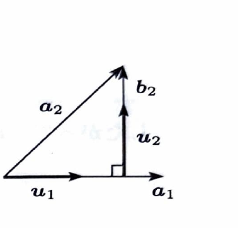

例題 59

次に示す $\mathbb{R}^3$ の基底を、グラム・シュミットの正規直交化法を用いて正規直交化せよ。

$$
\boldsymbol{a}_1=
\begin{pmatrix}
1\\
1\\
0
\end{pmatrix},
\qquad
\boldsymbol{a}_2=
\begin{pmatrix}
1\\
1\\
-1
\end{pmatrix},
\qquad
\boldsymbol{a}_3=
\begin{pmatrix}
0\\
-1\\
2
\end{pmatrix}
$$

> グラム・シュミットの正規直交化法では、まず
>
> $$
> \boldsymbol{u}_1=
> \frac{\boldsymbol{a}_1}{|\boldsymbol{a}_1|}
> $$
>
> とする。次に、
>
> $$
> \boldsymbol{b}_2
> =
> \boldsymbol{a}_2
> -
> (\boldsymbol{a}_2\cdot\boldsymbol{u}_1)\boldsymbol{u}_1
> $$
>
> $$
> \boldsymbol{u}_2
> =
> \frac{\boldsymbol{b}_2}{|\boldsymbol{b}_2|}
> $$
>
> とする。最後に、
>
> $$
> \boldsymbol{b}_3
> =
> \boldsymbol{a}_3
> -
> (\boldsymbol{a}_3\cdot\boldsymbol{u}_1)\boldsymbol{u}_1
> -
> (\boldsymbol{a}_3\cdot\boldsymbol{u}_2)\boldsymbol{u}_2
> $$
>
> $$
> \boldsymbol{u}_3
> =
> \frac{\boldsymbol{b}_3}{|\boldsymbol{b}_3|}
> $$
>
> とする。

---

## 解答

> 求める順序が指定されているため、$\boldsymbol{a}_1$、$\boldsymbol{a}_2$、$\boldsymbol{a}_3$ の順にグラム・シュミット法を適用する。各段階で、先に得られた単位ベクトル方向の成分を差し引く。

まず、$\boldsymbol{a}_1$ の大きさを求める。

$$
|\boldsymbol{a}_1|
=
\sqrt{1^2+1^2+0^2}
=
\sqrt2
$$

したがって、

$$
\boldsymbol{u}_1
=
\frac{\boldsymbol{a}_1}{|\boldsymbol{a}_1|}
$$

に代入すると、

$$
\boldsymbol{u}_1
=
\frac1{\sqrt2}
\begin{pmatrix}
1\\
1\\
0
\end{pmatrix}
$$

である。

次に、$\boldsymbol{a}_2$ から $\boldsymbol{u}_1$ 方向の成分を除く。

まず、内積を求める。

$$
\boldsymbol{a}_2\cdot\boldsymbol{u}_1
=
\begin{pmatrix}
1\\
1\\
-1
\end{pmatrix}
\cdot
\frac1{\sqrt2}
\begin{pmatrix}
1\\
1\\
0
\end{pmatrix}
$$

$$
\boldsymbol{a}_2\cdot\boldsymbol{u}_1
=
\frac{1+1+0}{\sqrt2}
=
\sqrt2
$$

である。

したがって、

$$
\boldsymbol{b}_2
=
\boldsymbol{a}_2
-
(\boldsymbol{a}_2\cdot\boldsymbol{u}_1)\boldsymbol{u}_1
$$

に代入すると、

$$
\boldsymbol{b}_2
=
\begin{pmatrix}
1\\
1\\
-1
\end{pmatrix}
-
\sqrt2\cdot
\frac1{\sqrt2}
\begin{pmatrix}
1\\
1\\
0
\end{pmatrix}
$$

$$
\boldsymbol{b}_2
=
\begin{pmatrix}
1\\
1\\
-1
\end{pmatrix}
-
\begin{pmatrix}
1\\
1\\
0
\end{pmatrix}
=
\begin{pmatrix}
0\\
0\\
-1
\end{pmatrix}
$$

である。

その大きさは、

$$
|\boldsymbol{b}_2|
=
\sqrt{0^2+0^2+(-1)^2}
=
1
$$

である。したがって、

$$
\boldsymbol{u}_2
=
\frac{\boldsymbol{b}_2}{|\boldsymbol{b}_2|}
=
\begin{pmatrix}
0\\
0\\
-1
\end{pmatrix}
$$

である。

次に、$\boldsymbol{a}_3$ から $\boldsymbol{u}_1$ 方向と $\boldsymbol{u}_2$ 方向の成分を除く。

まず、

$$
\boldsymbol{a}_3\cdot\boldsymbol{u}_1
=
\begin{pmatrix}
0\\
-1\\
2
\end{pmatrix}
\cdot
\frac1{\sqrt2}
\begin{pmatrix}
1\\
1\\
0
\end{pmatrix}
$$

$$
\boldsymbol{a}_3\cdot\boldsymbol{u}_1
=
\frac{0-1+0}{\sqrt2}
=
-\frac1{\sqrt2}
$$

である。

また、

$$
\boldsymbol{a}_3\cdot\boldsymbol{u}_2
=
\begin{pmatrix}
0\\
-1\\
2
\end{pmatrix}
\cdot
\begin{pmatrix}
0\\
0\\
-1
\end{pmatrix}
=
-2
$$

である。

したがって、

$$
\boldsymbol{b}_3
=
\boldsymbol{a}_3
-
(\boldsymbol{a}_3\cdot\boldsymbol{u}_1)\boldsymbol{u}_1
-
(\boldsymbol{a}_3\cdot\boldsymbol{u}_2)\boldsymbol{u}_2
$$

に代入すると、

$$
\boldsymbol{b}_3
=
\begin{pmatrix}
0\\
-1\\
2
\end{pmatrix}
-
\left(-\frac1{\sqrt2}\right)
\frac1{\sqrt2}
\begin{pmatrix}
1\\
1\\
0
\end{pmatrix}
-
(-2)
\begin{pmatrix}
0\\
0\\
-1
\end{pmatrix}
$$

$$
\boldsymbol{b}_3
=
\begin{pmatrix}
0\\
-1\\
2
\end{pmatrix}
+
\frac12
\begin{pmatrix}
1\\
1\\
0
\end{pmatrix}
+
2
\begin{pmatrix}
0\\
0\\
-1
\end{pmatrix}
$$

$$
\boldsymbol{b}_3
=
\begin{pmatrix}
\frac12\\
-\frac12\\
0
\end{pmatrix}
=
\frac12
\begin{pmatrix}
1\\
-1\\
0
\end{pmatrix}
$$

である。

その大きさは、

$$
|\boldsymbol{b}_3|
=
\frac12\sqrt{1^2+(-1)^2+0^2}
=
\frac{\sqrt2}{2}
$$

である。

したがって、

$$
\boldsymbol{u}_3
=
\frac{\boldsymbol{b}_3}{|\boldsymbol{b}_3|}
$$

に代入すると、

$$
\boldsymbol{u}_3
=
\frac{\frac12}{\frac{\sqrt2}{2}}
\begin{pmatrix}
1\\
-1\\
0
\end{pmatrix}
=
\frac1{\sqrt2}
\begin{pmatrix}
1\\
-1\\
0
\end{pmatrix}
$$

である。

以上より、求める正規直交基底は、

$$
\boxed{
\boldsymbol{u}_1=
\frac1{\sqrt2}
\begin{pmatrix}
1\\
1\\
0
\end{pmatrix},
\quad
\boldsymbol{u}_2=
\begin{pmatrix}
0\\
0\\
-1
\end{pmatrix},
\quad
\boldsymbol{u}_3=
\frac1{\sqrt2}
\begin{pmatrix}
1\\
-1\\
0
\end{pmatrix}
}
$$
