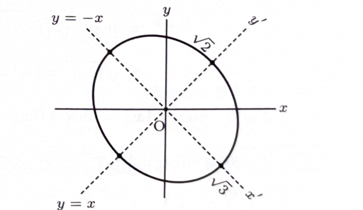

問題 208

2次曲線

$$
5x^2+2xy+5y^2+c=0
\tag{a}
$$

について、次の問いに答えよ。

> 実対称行列で表される2次形式は、直交行列によって対角化できる。座標変換を直交変換に選ぶと、ベクトルの長さを保ったまま $xy$ の交差項を消せる。

---

## (1)

$\boldsymbol{x}=(x,y)^T$ として、式 (a) を

$$
\boldsymbol{x}^TA\boldsymbol{x}+c=0
$$

の形で表すときの対称行列 $A$ を示せ。ただし、$T$ は転置を表す。

---

## (1) 解答

> 対称行列の非対角成分は、2次形式を展開すると2倍されて交差項の係数になる。したがって、$2xy$ の係数2の半分である1を非対角成分に置く。

一般に、

$$
\begin{pmatrix}x&y\end{pmatrix}
\begin{pmatrix}
a&b\\
b&d
\end{pmatrix}
\begin{pmatrix}
x\\y
\end{pmatrix}
=
ax^2+2bxy+dy^2
$$

である。係数比較すると、

$$
a=5,\qquad 2b=2,\qquad d=5
$$

なので、

$$
b=1
$$

である。よって、

$$
\boxed{
A=
\begin{pmatrix}
5&1\\
1&5
\end{pmatrix}
}
$$

となる。

---

## (2)

行列 $A$ の固有値を求めよ。

---

## (2) 解答

> $2\times2$ 行列なので固有方程式を直接展開する。

固有方程式は

$$
|A-\lambda E|=0
$$

である。

$$
|A-\lambda E|
=
\begin{vmatrix}
5-\lambda&1\\
1&5-\lambda
\end{vmatrix}
$$

$$
=(5-\lambda)^2-1
$$

平方差の公式を用いると、

$$
(5-\lambda)^2-1^2
=
(5-\lambda-1)(5-\lambda+1)
$$

$$
=(4-\lambda)(6-\lambda)
$$

したがって、

$$
(4-\lambda)(6-\lambda)=0
$$

より、

$$
\boxed{\lambda=4,\ 6}
$$

である。

---

## (3)

$P^{-1}AP$ を対角行列にする正則行列 $P$ と、そのときの対角行列

$$
B=P^{-1}AP
$$

を求めよ。ただし、正則行列の列ベクトルの大きさは1とする。

---

## (3) 解答

> $A$ は実対称行列なので、互いに直交する単位固有ベクトルを列に並べれば直交行列 $P$ が得られる。列の大きさを1にするという条件にちょうど合う。

$\lambda=4$ のとき、

$$
A-4E
=
\begin{pmatrix}
1&1\\
1&1
\end{pmatrix}
$$

である。方程式

$$
x+y=0
$$

より、

$$
y=-x
$$

である。方向ベクトルとして

$$
\begin{pmatrix}
1\\-1
\end{pmatrix}
$$

を選べる。大きさは

$$
\sqrt{1^2+(-1)^2}=\sqrt2
$$

なので、単位固有ベクトルは

$$
\boldsymbol{v}_1
=
\frac1{\sqrt2}
\begin{pmatrix}
1\\-1
\end{pmatrix}
$$

である。

$\lambda=6$ のとき、

$$
A-6E
=
\begin{pmatrix}
-1&1\\
1&-1
\end{pmatrix}
$$

である。方程式

$$
-x+y=0
$$

より、

$$
y=x
$$

である。方向ベクトル

$$
\begin{pmatrix}
1\\1
\end{pmatrix}
$$

を正規化すると、

$$
\boldsymbol{v}_2
=
\frac1{\sqrt2}
\begin{pmatrix}
1\\1
\end{pmatrix}
$$

となる。

これらを列に並べて、

$$
P=
\frac1{\sqrt2}
\begin{pmatrix}
1&1\\
-1&1
\end{pmatrix}
$$

とする。列は正規直交しているので、

$$
P^{-1}=P^T
=
\frac1{\sqrt2}
\begin{pmatrix}
1&-1\\
1&1
\end{pmatrix}
$$

である。各列の固有値は順に $4,6$ だから、

$$
\boxed{
B=P^{-1}AP
=
\begin{pmatrix}
4&0\\
0&6
\end{pmatrix}
}
$$

となる。

よって、

$$
\boxed{
P=
\frac1{\sqrt2}
\begin{pmatrix}
1&1\\
-1&1
\end{pmatrix},
\qquad
P^{-1}
=
\frac1{\sqrt2}
\begin{pmatrix}
1&-1\\
1&1
\end{pmatrix}
}
$$

である。

> $P$ は回転角 $-45^\circ$ の回転行列
>
> $$
> \begin{pmatrix}
> \cos(-45^\circ)&-\sin(-45^\circ)\\
> \sin(-45^\circ)&\cos(-45^\circ)
> \end{pmatrix}
> $$
>
> に等しい。

---

## (4)

$\boldsymbol{x}'=(x',y')^T$ として、設問 (3) の正則行列 $P$ を用いて

$$
\boldsymbol{x}=P\boldsymbol{x}'
$$

で式 (a) を座標変換して得られる

$$
(\boldsymbol{x}')^TB\boldsymbol{x}'+c=0
$$

の概形を $x'$ 軸、$y'$ 軸と共に描け。ただし、$c=-12$ とする。

---

## (4) 解答

> 直交対角化によって交差項を消し、標準形を求める。標準形から半軸の長さを読み取り、最後に新座標軸が元の $xy$ 平面でどの直線になるかを求める。

$c=-12$ を式 (a) に代入すると、

$$
5x^2+2xy+5y^2-12=0
$$

すなわち、

$$
5x^2+2xy+5y^2=12
$$

である。

行列表示では、

$$
\boldsymbol{x}^TA\boldsymbol{x}=12
$$

である。座標変換の文字の式

$$
\boldsymbol{x}=P\boldsymbol{x}'
$$

を代入する。

$$
(P\boldsymbol{x}')^TA(P\boldsymbol{x}')=12
$$

$$
(\boldsymbol{x}')^TP^TAP\boldsymbol{x}'=12
$$

(3) より、

$$
P^TAP=B=
\begin{pmatrix}
4&0\\
0&6
\end{pmatrix}
$$

なので、

$$
4(x')^2+6(y')^2=12
$$

となる。両辺を $12$ で割ると、

$$
\boxed{
\frac{(x')^2}{3}+\frac{(y')^2}{2}=1
}
$$

である。したがって、$x'$ 軸方向の半径は $\sqrt3$、$y'$ 軸方向の半径は $\sqrt2$ である。

次に、新座標軸を元の座標で表す。座標変換は

$$
\begin{pmatrix}
x\\y
\end{pmatrix}
=
\frac1{\sqrt2}
\begin{pmatrix}
1&1\\
-1&1
\end{pmatrix}
\begin{pmatrix}
x'\\y'
\end{pmatrix}
$$

である。

$x'$ 軸では $y'=0$ なので、

$$
\begin{pmatrix}
x\\y
\end{pmatrix}
=
\frac{x'}{\sqrt2}
\begin{pmatrix}
1\\-1
\end{pmatrix}
$$

より、

$$
\boxed{x'\text{ 軸}:\ y=-x}
$$

である。

$y'$ 軸では $x'=0$ なので、

$$
\begin{pmatrix}
x\\y
\end{pmatrix}
=
\frac{y'}{\sqrt2}
\begin{pmatrix}
1\\1
\end{pmatrix}
$$

より、

$$
\boxed{y'\text{ 軸}:\ y=x}
$$

である。

したがって、概形は原点を中心とし、$y=-x$ の方向に半径 $\sqrt3$、$y=x$ の方向に半径 $\sqrt2$ をもつ楕円である。

> 太い実線が楕円、実線が元の $x,y$ 軸、点線が新しい $x',y'$ 軸を表す。
