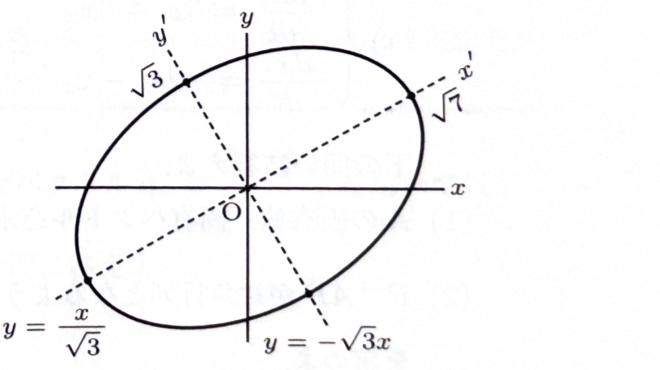

$xy$ 平面上の2次曲線 $C$

$$
4x^2-2\sqrt3xy+6y^2=21
$$

について考える。次の問いに答えよ。

> 2次形式
>
> $$
> ax^2+2bxy+cy^2
> $$
>
> は対称行列を用いて
>
> $$
> \begin{pmatrix}x&y\end{pmatrix}
> \begin{pmatrix}
> a&b\\
> b&c
> \end{pmatrix}
> \begin{pmatrix}
> x\\y
> \end{pmatrix}
> $$
>
> と表せる。実対称行列を直交対角化すると、回転によって交差項 $xy$ を消し、2次曲線を標準形へ変形できる。

---

## (1)

$$
4x^2-2\sqrt3xy+6y^2
=
\begin{pmatrix}x&y\end{pmatrix}
A
\begin{pmatrix}x\\y\end{pmatrix}
$$

を満たす対称行列 $A$ を求めよ。

---

## (1) 解答

> 対称行列の非対角成分は、展開すると2倍されて $xy$ の係数になる。そのため、$xy$ の係数 $-2\sqrt3$ の半分を非対角成分に置く。

一般に、

$$
\begin{pmatrix}x&y\end{pmatrix}
\begin{pmatrix}
a&b\\
b&c
\end{pmatrix}
\begin{pmatrix}
x\\y
\end{pmatrix}
=
ax^2+2bxy+cy^2
$$

である。係数比較すると、

$$
a=4,\qquad 2b=-2\sqrt3,\qquad c=6
$$

である。したがって、

$$
b=-\sqrt3
$$

となる。よって、

$$
\boxed{
A=
\begin{pmatrix}
4&-\sqrt3\\
-\sqrt3&6
\end{pmatrix}
}
$$

である。

---

## (2)

$A$ の固有値 $\lambda_1,\lambda_2$ を求めよ。ただし、$\lambda_1\le\lambda_2$ とする。

---

## (2) 解答

> 固有方程式を直接解く。$A$ は実対称行列なので、固有値は実数になる。

固有方程式は

$$
|A-\lambda E|=0
$$

である。

$$
|A-\lambda E|
=
\begin{vmatrix}
4-\lambda&-\sqrt3\\
-\sqrt3&6-\lambda
\end{vmatrix}
$$

$$
=(4-\lambda)(6-\lambda)-3
$$

$$
=24-10\lambda+\lambda^2-3
$$

$$
=\lambda^2-10\lambda+21
$$

因数分解すると、

$$
\lambda^2-10\lambda+21
=
(\lambda-3)(\lambda-7)
$$

したがって、

$$
\boxed{\lambda_1=3,\qquad \lambda_2=7}
$$

である。

---

## (3)

(2) で求めた各固有値について、正規化された固有ベクトルを求めよ。

---

## (3) 解答

> 各固有値について $(A-\lambda E)\boldsymbol{x}=\boldsymbol{0}$ を解き、最後にベクトルの大きさで割って正規化する。符号を反転したベクトルも同じく正規化固有ベクトルである。

$\lambda_1=3$ のとき、

$$
A-3E
=
\begin{pmatrix}
1&-\sqrt3\\
-\sqrt3&3
\end{pmatrix}
$$

である。方程式

$$
x-\sqrt3y=0
$$

より、

$$
x=\sqrt3y
$$

となる。$y=1$ とすれば、

$$
\boldsymbol{x}_1=
\begin{pmatrix}
\sqrt3\\1
\end{pmatrix}
$$

である。その大きさは

$$
\|\boldsymbol{x}_1\|
=
\sqrt{(\sqrt3)^2+1^2}
=
\sqrt4
=
2
$$

なので、正規化すると、

$$
\boldsymbol{v}_1
=
\pm\frac12
\begin{pmatrix}
\sqrt3\\1
\end{pmatrix}
$$

となる。

$\lambda_2=7$ のとき、

$$
A-7E
=
\begin{pmatrix}
-3&-\sqrt3\\
-\sqrt3&-1
\end{pmatrix}
$$

である。第2行から、

$$
-\sqrt3x-y=0
$$

すなわち、

$$
y=-\sqrt3x
$$

となる。$x=-1$ とすれば、

$$
\boldsymbol{x}_2=
\begin{pmatrix}
-1\\\sqrt3
\end{pmatrix}
$$

である。その大きさは

$$
\|\boldsymbol{x}_2\|
=
\sqrt{(-1)^2+(\sqrt3)^2}
=
2
$$

なので、正規化すると、

$$
\boldsymbol{v}_2
=
\pm\frac12
\begin{pmatrix}
-1\\\sqrt3
\end{pmatrix}
$$

となる。

よって、

$$
\boxed{
\boldsymbol{v}_1
=
\pm\frac12
\begin{pmatrix}
\sqrt3\\1
\end{pmatrix},
\qquad
\boldsymbol{v}_2
=
\pm\frac12
\begin{pmatrix}
-1\\\sqrt3
\end{pmatrix}
}
$$

である。

---

## (4)

$A$ を

$$
P^{-1}AP=
\begin{pmatrix}
\lambda_1&0\\
0&\lambda_2
\end{pmatrix}
$$

の形に対角化する直交行列 $P$、およびその逆行列 $P^{-1}$ を求めよ。

---

## (4) 解答

> 正規化した固有ベクトルを列に並べる。列の向きを選ぶとき、行列式を正の数、ここでは $1$ にすると回転行列になる。

(3) の正規化固有ベクトルから、

$$
P=
\frac12
\begin{pmatrix}
\sqrt3&-1\\
1&\sqrt3
\end{pmatrix}
$$

とする。列ベクトルは互いに直交し、大きさ1なので、

$$
P^TP=E
$$

である。したがって、

$$
P^{-1}=P^T
=
\frac12
\begin{pmatrix}
\sqrt3&1\\
-1&\sqrt3
\end{pmatrix}
$$

となる。

各列の固有値は順に $3,7$ なので、

$$
\boxed{
P^{-1}AP
=
\begin{pmatrix}
3&0\\
0&7
\end{pmatrix}
}
$$

である。

よって、

$$
\boxed{
P=
\frac12
\begin{pmatrix}
\sqrt3&-1\\
1&\sqrt3
\end{pmatrix},
\qquad
P^{-1}
=
\frac12
\begin{pmatrix}
\sqrt3&1\\
-1&\sqrt3
\end{pmatrix}
}
$$

となる。

> $P$ は
>
> $$
> \begin{pmatrix}
> \cos30^\circ&-\sin30^\circ\\
> \sin30^\circ&\cos30^\circ
> \end{pmatrix}
> $$
>
> に等しく、原点のまわりの回転を表す。

---

## (5)

座標変換

$$
\begin{pmatrix}
x\\y
\end{pmatrix}
=
P
\begin{pmatrix}
x'\\y'
\end{pmatrix}
$$

を行うとき、2次曲線 $C$ を $x',y'$ を用いて表せ。

---

## (5) 解答

> 行列表示へ座標変換を代入し、$P^TAP$ が対角行列であることを使う。これにより交差項が消える。

ベクトルを

$$
\boldsymbol{x}
=
\begin{pmatrix}
x\\y
\end{pmatrix},
\qquad
\boldsymbol{x}'
=
\begin{pmatrix}
x'\\y'
\end{pmatrix}
$$

とおく。座標変換は

$$
\boldsymbol{x}=P\boldsymbol{x}'
$$

である。元の2次形式は

$$
\boldsymbol{x}^TA\boldsymbol{x}=21
$$

なので、文字の式に $\boldsymbol{x}=P\boldsymbol{x}'$ を代入する。

$$
(P\boldsymbol{x}')^TA(P\boldsymbol{x}')=21
$$

転置の公式 $(P\boldsymbol{x}')^T=(\boldsymbol{x}')^TP^T$ より、

$$
(\boldsymbol{x}')^TP^TAP\boldsymbol{x}'=21
$$

(4) の

$$
P^TAP=
\begin{pmatrix}
3&0\\
0&7
\end{pmatrix}
$$

を代入すると、

$$
\begin{pmatrix}x'&y'\end{pmatrix}
\begin{pmatrix}
3&0\\
0&7
\end{pmatrix}
\begin{pmatrix}
x'\\y'
\end{pmatrix}
=21
$$

したがって、

$$
3(x')^2+7(y')^2=21
$$

である。両辺を $21$ で割ると、

$$
\boxed{
\frac{(x')^2}{7}+\frac{(y')^2}{3}=1
}
$$

となる。

---

## (6)

$x'$ 軸および $y'$ 軸を、それぞれ $x,y$ を用いた直線の式で表せ。

---

## (6) 解答

> 新座標軸上の点を座標変換へ代入する。$x'$ 軸では $y'=0$、$y'$ 軸では $x'=0$ とする。

座標変換は

$$
\begin{pmatrix}
x\\y
\end{pmatrix}
=
\frac12
\begin{pmatrix}
\sqrt3&-1\\
1&\sqrt3
\end{pmatrix}
\begin{pmatrix}
x'\\y'
\end{pmatrix}
$$

である。

$x'$ 軸上では

$$
y'=0
$$

であるから、

$$
\begin{pmatrix}
x\\y
\end{pmatrix}
=
\frac12
\begin{pmatrix}
\sqrt3&-1\\
1&\sqrt3
\end{pmatrix}
\begin{pmatrix}
x'\\0
\end{pmatrix}
=
\frac{x'}2
\begin{pmatrix}
\sqrt3\\1
\end{pmatrix}
$$

となる。したがって、

$$
\frac{y}{x}=\frac1{\sqrt3}
$$

より、

$$
\boxed{x'\text{ 軸}:\quad y=\frac{x}{\sqrt3}}
$$

である。

$y'$ 軸上では

$$
x'=0
$$

であるから、

$$
\begin{pmatrix}
x\\y
\end{pmatrix}
=
\frac12
\begin{pmatrix}
\sqrt3&-1\\
1&\sqrt3
\end{pmatrix}
\begin{pmatrix}
0\\y'
\end{pmatrix}
=
\frac{y'}2
\begin{pmatrix}
-1\\\sqrt3
\end{pmatrix}
$$

となる。したがって、

$$
\frac{y}{x}=-\sqrt3
$$

より、

$$
\boxed{y'\text{ 軸}:\quad y=-\sqrt3x}
$$

である。

---

## (7)

2次曲線 $C$ の概形を $xy$ 平面上に描け。ただし、図中には $x'$ 軸と $y'$ 軸を明記すること。

---

## (7) 解答

> (5) の標準形から、$C$ は $x'$ 方向の半径が $\sqrt7$、$y'$ 方向の半径が $\sqrt3$ の楕円である。$x'$ 軸と $y'$ 軸はそれぞれ (6) の直線である。

標準形は

$$
\frac{(x')^2}{(\sqrt7)^2}
+
\frac{(y')^2}{(\sqrt3)^2}
=1
$$

である。したがって、中心は原点、長半軸は $x'$ 軸方向で長さ $\sqrt7$、短半軸は $y'$ 軸方向で長さ $\sqrt3$ である。

$$
\boxed{
\begin{aligned}
x'\text{ 軸}&:\ y=\frac{x}{\sqrt3},\\
y'\text{ 軸}&:\ y=-\sqrt3x
\end{aligned}
}
$$

> 太い実線が楕円 $C$、実線が元の $x,y$ 軸、点線が新しい $x',y'$ 軸を表す。
