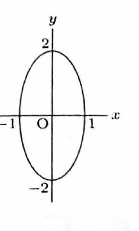

> 正則な線形変換による曲線の像は、逆行列を用いて元の座標を像の座標で表し、元の方程式へ代入して求められる。
>
> 二次形式を行列で表して合同変換する方法もある。この方法は計算を体系化できるが、ここではまず座標代入を用い、最後に別解の要点も示す。

---

問題 217

$2$ 次の正方行列

$$
A=
\begin{pmatrix}
1&1\\
1&2
\end{pmatrix}
$$

に対し、次の問いに答えよ。

---

## (1)

$A$ の逆行列 $A^{-1}$ を求めよ。

---

## (1) 解答

> $2\times2$ 行列の逆行列の公式を用いる。行基本変形で求める方法もある。

一般に、

$$
\begin{pmatrix}
a&b\\
c&d
\end{pmatrix}^{-1}
=
\frac{1}{ad-bc}
\begin{pmatrix}
d&-b\\
-c&a
\end{pmatrix}
$$

である。ただし、 $ad-bc\ne0$ とする。

ここで、

$$
a=1,\quad b=1,\quad c=1,\quad d=2
$$

である。

まず、代入前の行列式の式は、

$$
\det A=ad-bc
$$

である。値を代入すると、

$$
\det A=1\cdot2-1\cdot1=1
$$

となる。

したがって、

$$
A^{-1}
=
\frac{1}{1}
\begin{pmatrix}
2&-1\\
-1&1
\end{pmatrix}
$$

である。

よって、

$$
\boxed{
A^{-1}=
\begin{pmatrix}
2&-1\\
-1&1
\end{pmatrix}
}
$$

---

## (2)

曲線

$$
C:5x^2+12xy+8y^2-4=0
$$

の $A$ による像 $C'$ の方程式を求め、 $C'$ の概形を図示せよ。

---

## (2) 解答

> $A$ は正則であるため、像の点 $(x',y')$ から元の点 $(x,y)$ を逆行列で表し、元の方程式へ代入する方法を選ぶ。

曲線 $C$ 上の点を

$$
\begin{pmatrix}
x\\
y
\end{pmatrix}
$$

とし、その像を

$$
\begin{pmatrix}
x'\\
y'
\end{pmatrix}
$$

とする。

変換の式は、

$$
\begin{pmatrix}
x'\\
y'
\end{pmatrix}
=
A
\begin{pmatrix}
x\\
y
\end{pmatrix}
$$

である。

逆変換は、

$$
\begin{pmatrix}
x\\
y
\end{pmatrix}
=
A^{-1}
\begin{pmatrix}
x'\\
y'
\end{pmatrix}
$$

である。(1) の結果を代入すると、

$$
\begin{pmatrix}
x\\
y
\end{pmatrix}
=
\begin{pmatrix}
2&-1\\
-1&1
\end{pmatrix}
\begin{pmatrix}
x'\\
y'
\end{pmatrix}
=
\begin{pmatrix}
2x'-y'\\
-x'+y'
\end{pmatrix}
$$

となる。

したがって、

$$
x=2x'-y',
\qquad
y=-x'+y'
$$

である。

元の曲線の式

$$
5x^2+12xy+8y^2-4=0
$$

へ代入する。

$$
5(2x'-y')^2
+
12(2x'-y')(-x'+y')
+
8(-x'+y')^2
-4=0
$$

それぞれを展開する。

$$
5(2x'-y')^2
=
5\left(4(x')^2-4x'y'+(y')^2\right)
=
20(x')^2-20x'y'+5(y')^2
$$

$$
12(2x'-y')(-x'+y')
=
12\left(-2(x')^2+3x'y'-(y')^2\right)
=
-24(x')^2+36x'y'-12(y')^2
$$

$$
8(-x'+y')^2
=
8\left((x')^2-2x'y'+(y')^2\right)
=
8(x')^2-16x'y'+8(y')^2
$$

これらを加えると、

$$
\left(20-24+8\right)(x')^2
+
\left(-20+36-16\right)x'y'
+
\left(5-12+8\right)(y')^2
-4=0
$$

したがって、

$$
4(x')^2+(y')^2-4=0
$$

である。

両辺を $4$ で割ると、

$$
(x')^2+\frac{(y')^2}{4}=1
$$

となる。

通常の座標記号へ戻すと、

$$
\boxed{x^2+\frac{y^2}{4}=1}
$$

である。

これは中心が原点、 $x$ 軸方向の半径が $1$ 、 $y$ 軸方向の半径が $2$ の楕円である。

> 二次形式を用いる別解では、
>
> $$
> 5x^2+12xy+8y^2
> =
> \begin{pmatrix}x&y\end{pmatrix}
> \begin{pmatrix}5&6\\6&8\end{pmatrix}
> \begin{pmatrix}x\\y\end{pmatrix}
> $$
>
> と書き、 $x=A^{-1}x'$ を代入する。係数行列は
>
> $$
> (A^{-1})^T
> \begin{pmatrix}5&6\\6&8\end{pmatrix}
> A^{-1}
> =
> \begin{pmatrix}4&0\\0&1\end{pmatrix}
> $$
>
> となるので、同じ方程式を得る。
