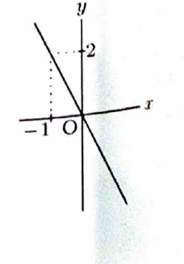

> 行列
>
> $$
> A=
> \begin{pmatrix}
> 2&-1\\
> -4&2
> \end{pmatrix}
> $$
>
> は正則ではない。そのため、逆行列による方法は使えず、直線を媒介変数表示して各点の像を求める。
>
> また、
>
> $$
> A
> \begin{pmatrix}x\\y\end{pmatrix}
> =
> (2x-y)
> \begin{pmatrix}1\\-2\end{pmatrix}
> $$
>
> であるため、平面全体の像は高々直線になる。

---

問題 218

行列

$$
\begin{pmatrix}
2&-1\\
-4&2
\end{pmatrix}
$$

で定義される $xy$ 平面の $1$ 次変換について、以下の問いに答えよ。

---

## (1)

直線 $y=3x$ の像を求めよ。

---

## (1) 解答

> 直線を媒介変数表示して変換し、媒介変数を消去する。

直線 $y=3x$ 上の点を、

$$
x=t,\qquad y=3t
$$

と表す。

すなわち、

$$
\begin{pmatrix}
x\\
y
\end{pmatrix}
=
\begin{pmatrix}
t\\
3t
\end{pmatrix}
$$

である。

像を

$$
\begin{pmatrix}
x'\\
y'
\end{pmatrix}
$$

とすると、代入前の式は、

$$
\begin{pmatrix}
x'\\
y'
\end{pmatrix}
=
A
\begin{pmatrix}
x\\
y
\end{pmatrix}
$$

である。媒介変数表示を代入すると、

$$
\begin{pmatrix}
x'\\
y'
\end{pmatrix}
=
\begin{pmatrix}
2&-1\\
-4&2
\end{pmatrix}
\begin{pmatrix}
t\\
3t
\end{pmatrix}
$$

となる。

計算すると、

$$
\begin{pmatrix}
x'\\
y'
\end{pmatrix}
=
\begin{pmatrix}
2t-3t\\
-4t+6t
\end{pmatrix}
=
\begin{pmatrix}
-t\\
2t
\end{pmatrix}
$$

である。

したがって、

$$
x'=-t,
\qquad
y'=2t
$$

である。 $t=-x'$ を $y'=2t$ に代入すると、

$$
y'=-2x'
$$

を得る。

よって、像は

$$
\boxed{y=-2x}
$$

である。

---

## (2)

原点を通る直線のうち、その像が原点だけになるものを求めよ。

---

## (2) 解答

> 直線全体が原点へ写るためには、その方向ベクトルが核に属する必要がある。一般の原点を通る直線を媒介変数表示して求める。

原点を通る一般の直線を、

$$
x=at,\qquad y=bt
$$

とする。ただし、 $(a,b)\ne(0,0)$ とする。

像は、

$$
\begin{pmatrix}
x'\\
y'
\end{pmatrix}
=
\begin{pmatrix}
2&-1\\
-4&2
\end{pmatrix}
\begin{pmatrix}
at\\
bt
\end{pmatrix}
$$

である。

計算すると、

$$
\begin{pmatrix}
x'\\
y'
\end{pmatrix}
=
\begin{pmatrix}
(2a-b)t\\
(-4a+2b)t
\end{pmatrix}
=
(2a-b)t
\begin{pmatrix}
1\\
-2
\end{pmatrix}
$$

となる。

すべての $t$ に対して像が原点になるためには、

$$
2a-b=0
$$

が必要十分である。

したがって、

$$
b=2a
$$

であるから、求める直線は、

$$
\boxed{y=2x}
$$

である。

---

## (3)

原点を通る直線のうち、その像がその直線自身になるものを求めよ。

---

## (3) 解答

> 像は常に方向ベクトル $(1,-2)^T$ をもつ直線上にある。そのため、像が元の直線自身になるには、元の直線も同じ方向をもつ必要がある。

(2) の計算から、一般の点の像は、

$$
\begin{pmatrix}
x'\\
y'
\end{pmatrix}
=
(2a-b)t
\begin{pmatrix}
1\\
-2
\end{pmatrix}
$$

である。

像が原点だけではなく、元の直線自身となるには、元の方向ベクトル

$$
\begin{pmatrix}
a\\
b
\end{pmatrix}
$$

が、

$$
\begin{pmatrix}
1\\
-2
\end{pmatrix}
$$

と平行でなければならない。

したがって、

$$
b=-2a
$$

であり、求める直線は、

$$
\boxed{y=-2x}
$$

である。

---

## (4)

この $1$ 次変換による $xy$ 平面の像を図示せよ。

---

## (4) 解答

> 行列の列ベクトルが互いに比例しているため、像空間は $1$ 次元である。任意の点の像を因数分解して像全体を特定する。

任意の点に対し、

$$
\begin{pmatrix}
x'\\
y'
\end{pmatrix}
=
\begin{pmatrix}
2&-1\\
-4&2
\end{pmatrix}
\begin{pmatrix}
x\\
y
\end{pmatrix}
$$

である。

成分を計算すると、

$$
\begin{pmatrix}
x'\\
y'
\end{pmatrix}
=
\begin{pmatrix}
2x-y\\
-4x+2y
\end{pmatrix}
$$

となる。

第 $2$ 成分は、

$$
-4x+2y=-2(2x-y)
$$

だから、

$$
\begin{pmatrix}
x'\\
y'
\end{pmatrix}
=
(2x-y)
\begin{pmatrix}
1\\
-2
\end{pmatrix}
$$

である。

$2x-y$ は任意の実数値を取れるため、像全体は、

$$
\left\{
s
\begin{pmatrix}
1\\
-2
\end{pmatrix}
\ \middle|\
s\in\mathbb{R}
\right\}
$$

である。

したがって、

$$
\boxed{\operatorname{Im}A=\{(x,y)\in\mathbb{R}^2\mid y=-2x\}}
$$

である。

