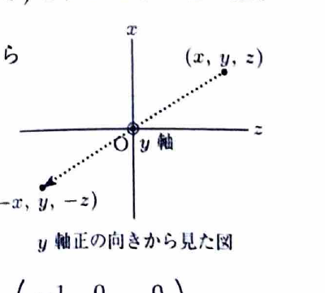

> 空間の対称移動や回転は、各座標がどのように変化するかを調べて行列にする。
>
> ある軸に関する対称移動では、その軸方向の成分は保存され、軸に垂直な成分は符号が反転する。 $z$ 軸まわりの回転では $z$ 座標は不変で、 $xy$ 平面内の成分だけが通常の $2$ 次元回転を受ける。

---

問題 220

$xyz$ 空間のベクトル

$$
\boldsymbol{A}=
\begin{pmatrix}
x\\
y\\
z
\end{pmatrix}
$$

に対する線形変換について、以下の問いに答えよ。

---

## (1)

$\boldsymbol{A}$ を $y$ 軸に対して対称移動させるような $3\times3$ 行列を導出せよ。

---

## (1) 解答

> $y$ 軸上の成分は変化せず、 $y$ 軸に垂直な $x$ 成分と $z$ 成分の向きが反転することを用いる。線分の中点を使う幾何的導出も可能である。

点 $(x,y,z)$ を $y$ 軸に関して対称移動した点を $(x',y',z')$ とする。

$y$ 座標は軸方向の成分なので変化せず、

$$
y'=y
$$

である。

一方、 $x$ 座標と $z$ 座標は $y$ 軸に垂直な平面内の成分であり、対称移動で符号が反転する。

$$
x'=-x,
\qquad
z'=-z
$$

したがって、

$$
\begin{pmatrix}
x'\\
y'\\
z'
\end{pmatrix}
=
\begin{pmatrix}
-x\\
y\\
-z
\end{pmatrix}
$$

である。

これを行列で表すと、

$$
\begin{pmatrix}
x'\\
y'\\
z'
\end{pmatrix}
=
\begin{pmatrix}
-1&0&0\\
0&1&0\\
0&0&-1
\end{pmatrix}
\begin{pmatrix}
x\\
y\\
z
\end{pmatrix}
$$

となる。

したがって、求める行列は、

$$
\boxed{
\begin{pmatrix}
-1&0&0\\
0&1&0\\
0&0&-1
\end{pmatrix}
}
$$

である。

---

## (2)

$\boldsymbol{A}$ を $z$ 軸のまわりに角 $\theta$ だけ回転させるような $3\times3$ 行列を導出せよ。

---

## (2) 解答

> $z$ 軸に垂直な $xy$ 平面で通常の $2$ 次元回転を行い、 $z$ 座標を保存する。

$xy$ 平面内の回転の一般式は、

$$
\begin{pmatrix}
x'\\
y'
\end{pmatrix}
=
\begin{pmatrix}
\cos\theta&-\sin\theta\\
\sin\theta&\cos\theta
\end{pmatrix}
\begin{pmatrix}
x\\
y
\end{pmatrix}
$$

である。

したがって、

$$
x'=x\cos\theta-y\sin\theta
$$

$$
y'=x\sin\theta+y\cos\theta
$$

である。

$z$ 軸まわりの回転では $z$ 座標は変化しないため、

$$
z'=z
$$

である。

以上をまとめると、

$$
\begin{pmatrix}
x'\\
y'\\
z'
\end{pmatrix}
=
\begin{pmatrix}
\cos\theta&-\sin\theta&0\\
\sin\theta&\cos\theta&0\\
0&0&1
\end{pmatrix}
\begin{pmatrix}
x\\
y\\
z
\end{pmatrix}
$$

となる。

したがって、求める行列は、

$$
\boxed{
\begin{pmatrix}
\cos\theta&-\sin\theta&0\\
\sin\theta&\cos\theta&0\\
0&0&1
\end{pmatrix}
}
$$
