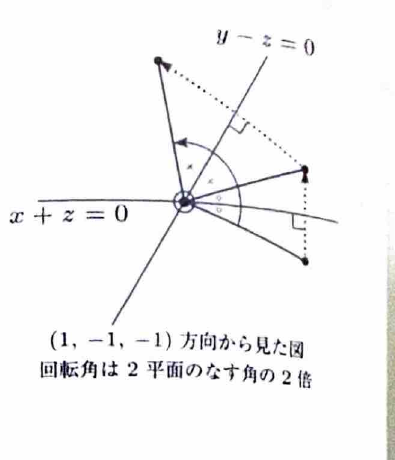

> 平面
>
> $$
> ax+by+cz=0
> $$
>
> の法線ベクトルには $(a,b,c)^T$ を取れる。点から平面への垂線の足は、法線方向の直線と平面の交点として求められる。
>
> 平面に関する対称移動では、平面への垂線の足が元の点と像の中点になる。
>
> 二つの原点を通る平面に関する鏡映の合成は、それらの交線を軸とする回転になる。回転角は二平面のなす角の $2$ 倍である。

---

問題 222

$f:\mathbb{R}^3\to\mathbb{R}^3$ を平面

$$
x+z=0
$$

に関する対称移動とし、 $g:\mathbb{R}^3\to\mathbb{R}^3$ を平面

$$
y-z=0
$$

に関する対称移動とする。以下の問いに答えよ。

---

## (1)

平面 $x+z=0$ の原点を通る法線に点 $(x,y,z)$ から下ろした垂線の足を $P$ とするとき、点 $P$ の座標を求めよ。

---

## (1) 解答

> 平面の法線ベクトルを求め、その法線上の点を媒介変数で表す。点 $Q=(x,y,z)$ から法線へ下ろした垂線の足を $P$ とすると、ベクトル $\overrightarrow{QP}$ は法線ベクトルと直交する。この直交条件から媒介変数を決定する。
>
> 正射影の公式を用いる方法もあるが、ここでは「垂線の足では直交する」という幾何的な意味が分かりやすい方法を用いる。

平面

$$
x+z=0
$$

の法線ベクトルの一つは、

$$
n=
\begin{pmatrix}
1\\
0\\
1
\end{pmatrix}
$$

である。

原点を通り、方向ベクトルが $n$ である法線上の点 $P$ は、

$$
P=tn
$$

と表せる。 $n$ の成分を代入すると、

$$
P=
t
\begin{pmatrix}
1\\
0\\
1
\end{pmatrix}
=
\begin{pmatrix}
t\\
0\\
t
\end{pmatrix}
$$

である。

元の点を

$$
Q=
\begin{pmatrix}
x\\
y\\
z
\end{pmatrix}
$$

とする。

$P$ は $Q$ から法線へ下ろした垂線の足であるから、ベクトル $\overrightarrow{QP}$ は法線の方向ベクトル $n$ と直交する。したがって、

$$
\overrightarrow{QP}\cdot n=0
$$

である。

まず、文字だけの式で、

$$
\overrightarrow{QP}=P-Q
$$

と表せる。 $P$ と $Q$ を代入すると、

$$
\overrightarrow{QP}
=
\begin{pmatrix}
t\\
0\\
t
\end{pmatrix}
-
\begin{pmatrix}
x\\
y\\
z
\end{pmatrix}
=
\begin{pmatrix}
t-x\\
-y\\
t-z
\end{pmatrix}
$$

である。

したがって、直交条件は、

$$
\begin{pmatrix}
t-x\\
-y\\
t-z
\end{pmatrix}
\cdot
\begin{pmatrix}
1\\
0\\
1
\end{pmatrix}
=0
$$

となる。

内積を計算すると、

$$
(t-x)\cdot1+(-y)\cdot0+(t-z)\cdot1=0
$$

であるから、

$$
2t-x-z=0
$$

である。

これを $t$ について解くと、

$$
2t=x+z
$$

$$
t=\frac{x+z}{2}
$$

となる。

この値を

$$
P=
\begin{pmatrix}
t\\
0\\
t
\end{pmatrix}
$$

に代入すると、

$$
P=
\begin{pmatrix}
\dfrac{x+z}{2}\\
0\\
\dfrac{x+z}{2}
\end{pmatrix}
$$

である。

したがって、

$$
\boxed{
P=
\left(
\frac{x+z}{2},
0,
\frac{x+z}{2}
\right)
}
$$

---

## (2)

$$
\boldsymbol{x}=
\begin{pmatrix}
x\\
y\\
z
\end{pmatrix}
\in\mathbb{R}^3
$$

に対し、 $f(\boldsymbol{x})=A\boldsymbol{x}$ となる $3$ 次正方行列 $A$ を求めよ。

---

## (2) 解答

> 平面に関する対称移動では、平面に平行な成分はそのまま残り、法線方向の成分だけが符号反転する。この性質から得られる鏡映の公式
>
> $$
> f(q)=q-2(q\cdot\hat n)\hat n
> $$
>
> を用いる。ここで $\hat n$ は平面の単位法線ベクトルである。
>
> 連立方程式を用いて像の座標を直接求める方法もあるが、上の公式を用いると計算の意味が明確で、行列も直ちに読み取れる。

平面

$$
x+z=0
$$

の法線ベクトルとして、

$$
n=
\begin{pmatrix}
1\\
0\\
1
\end{pmatrix}
$$

を取る。

まず、法線ベクトルの大きさを求める。ベクトルの大きさの公式は、

$$
|n|=\sqrt{n_1^2+n_2^2+n_3^2}
$$

である。

成分を代入すると、

$$
|n|
=
\sqrt{1^2+0^2+1^2}
=
\sqrt2
$$

である。

したがって、単位法線ベクトルは、

$$
\hat n=\frac{n}{|n|}
$$

により求められる。 $n$ と $|n|$ を代入すると、

$$
\hat n
=
\frac{1}{\sqrt2}
\begin{pmatrix}
1\\
0\\
1
\end{pmatrix}
$$

である。

ここで、

$$
q=
\begin{pmatrix}
x\\
y\\
z
\end{pmatrix}
$$

とする。

平面に関する鏡映の公式は、

$$
f(q)=q-2(q\cdot\hat n)\hat n
$$

である。

まず、内積 $q\cdot\hat n$ を計算する。

$$
q\cdot\hat n
=
\begin{pmatrix}
x\\
y\\
z
\end{pmatrix}
\cdot
\frac{1}{\sqrt2}
\begin{pmatrix}
1\\
0\\
1
\end{pmatrix}
$$

$$
=
\frac{1}{\sqrt2}
(x\cdot1+y\cdot0+z\cdot1)
=
\frac{x+z}{\sqrt2}
$$

である。

次に、文字だけの鏡映の公式

$$
f(q)=q-2(q\cdot\hat n)\hat n
$$

へ、求めた $q\cdot\hat n$ と $\hat n$ を代入する。

$$
f(q)
=
\begin{pmatrix}
x\\
y\\
z
\end{pmatrix}
-
2\cdot
\frac{x+z}{\sqrt2}
\cdot
\frac{1}{\sqrt2}
\begin{pmatrix}
1\\
0\\
1
\end{pmatrix}
$$

ここで、

$$
2\cdot\frac{1}{\sqrt2}\cdot\frac{1}{\sqrt2}
=
2\cdot\frac12
=
1
$$

であるから、

$$
f(q)
=
\begin{pmatrix}
x\\
y\\
z
\end{pmatrix}
-
(x+z)
\begin{pmatrix}
1\\
0\\
1
\end{pmatrix}
$$

となる。

成分ごとに計算すると、

$$
f(q)
=
\begin{pmatrix}
x-(x+z)\\
y-0\\
z-(x+z)
\end{pmatrix}
=
\begin{pmatrix}
-z\\
y\\
-x
\end{pmatrix}
$$

である。

これを行列の積で表すと、

$$
\begin{pmatrix}
-z\\
y\\
-x
\end{pmatrix}
=
\begin{pmatrix}
0&0&-1\\
0&1&0\\
-1&0&0
\end{pmatrix}
\begin{pmatrix}
x\\
y\\
z
\end{pmatrix}
$$

である。

したがって、

$$
\boxed{
A=
\begin{pmatrix}
0&0&-1\\
0&1&0\\
-1&0&0
\end{pmatrix}
}
$$

---

## (3)

連立 $1$ 次方程式

$$
\begin{cases}
x+z=0\\
y-z=0
\end{cases}
$$

を解け。

---

## (3) 解答

> 二平面の交線を求める問題である。一つの変数を自由変数として表す。

第 $1$ 式

$$
x+z=0
$$

から、

$$
x=-z
$$

である。

第 $2$ 式

$$
y-z=0
$$

から、

$$
y=z
$$

である。

$z=t$ とおくと、

$$
x=-t,
\qquad
y=t,
\qquad
z=t
$$

である。

したがって、解は、

$$
\boxed{
(x,y,z)=(-t,t,t)
\qquad(t\in\mathbb{R})
}
$$

である。

---

## (4)

平面 $x+z=0$ と平面 $y-z=0$ のなす角 $\theta$ を求めよ。ただし、

$$
0\le\theta\le\frac{\pi}{2}
$$

とする。

---

## (4) 解答

> 平面のなす鋭角は、法線ベクトルのなす角 $\alpha$ に対して $\theta=\min(\alpha,\pi-\alpha)$ で求める。

各平面の法線ベクトルを、

$$
n_1=
\begin{pmatrix}
1\\
0\\
1
\end{pmatrix},
\qquad
n_2=
\begin{pmatrix}
0\\
1\\
-1
\end{pmatrix}
$$

とする。

法線ベクトルのなす角を $\alpha$ とすると、

$$
\cos\alpha
=
\frac{n_1\cdot n_2}{|n_1||n_2|}
$$

である。

内積は、

$$
n_1\cdot n_2
=
1\cdot0+0\cdot1+1\cdot(-1)
=-1
$$

である。

大きさは、

$$
|n_1|=\sqrt{1^2+0^2+1^2}=\sqrt2
$$

$$
|n_2|=\sqrt{0^2+1^2+(-1)^2}=\sqrt2
$$

である。

したがって、

$$
\cos\alpha
=
\frac{-1}{\sqrt2\sqrt2}
=
-\frac12
$$

である。

よって、

$$
\alpha=\frac{2\pi}{3}
$$

である。

平面のなす角は鋭角側なので、

$$
\theta=\pi-\alpha
$$

である。値を代入すると、

$$
\theta
=
\pi-\frac{2\pi}{3}
=
\frac{\pi}{3}
$$

となる。

したがって、

$$
\boxed{\theta=\frac{\pi}{3}}
$$

---

## (5)

$g\circ f:\mathbb{R}^3\to\mathbb{R}^3$ は原点を通る直線を軸とする回転移動となる。軸となる直線の方向ベクトルと回転する角度を答えよ。

---

## (5) 解答

> 二つの鏡映の合成であるため回転になる。資料では幾何的に二平面のなす角の $2$ 倍を求めている。ここでは合成行列を求め、固有値 $1$ の固有ベクトルから軸を、行列のトレースから角度を求める。これにより向きも検証できる。

まず、 $g$ は平面

$$
y-z=0
$$

に関する対称移動である。この平面に関する鏠映では、

$$
(x,y,z)\mapsto(x,z,y)
$$

となる。

したがって、 $g$ の行列は、

$$
B=
\begin{pmatrix}
1&0&0\\
0&0&1\\
0&1&0
\end{pmatrix}
$$

である。

合成変換 $g\circ f$ の行列は、

$$
R=BA
$$

である。

(2) の行列 $A$ を代入すると、

$$
R=
\begin{pmatrix}
1&0&0\\
0&0&1\\
0&1&0
\end{pmatrix}
\begin{pmatrix}
0&0&-1\\
0&1&0\\
-1&0&0
\end{pmatrix}
$$

である。

行列積を計算すると、

$$
R=
\begin{pmatrix}
0&0&-1\\
-1&0&0\\
0&1&0
\end{pmatrix}
$$

となる。

すなわち、

$$
(x,y,z)\mapsto(-z,-x,y)
$$

である。

回転軸上のベクトル $n$ は変化しないため、

$$
Rn=n
$$

を満たす。すなわち、

$$
(R-E)n=0
$$

を解く。

$$
R-E=
\begin{pmatrix}
-1&0&-1\\
-1&-1&0\\
0&1&-1
\end{pmatrix}
$$

である。

$n=(a,b,c)^T$ とすると、

$$
-a-c=0
$$

$$
-a-b=0
$$

$$
b-c=0
$$

である。

第 $1$ 式から、

$$
c=-a
$$

第 $2$ 式から、

$$
b=-a
$$

である。第 $3$ 式も満たされる。

したがって、回転軸の方向ベクトルには、

$$
\boxed{
n=
\begin{pmatrix}
1\\
-1\\
-1
\end{pmatrix}
}
$$

を取れる。

次に、 $3$ 次元の回転行列では、

$$
\operatorname{tr}R=1+2\cos\beta
$$

が成り立つ。ここで $\beta$ は回転角である。

今回、

$$
\operatorname{tr}R=0+0+0=0
$$

だから、

$$
0=1+2\cos\beta
$$

である。

したがって、

$$
\cos\beta=-\frac12
$$

となる。 $0\le\beta\le\pi$ とすると、

$$
\beta=\frac{2\pi}{3}
$$

である。

向きを確認するため、軸に垂直なベクトルを

$$
p=
\begin{pmatrix}
1\\
1\\
0
\end{pmatrix}
$$

と取る。実際、

$$
p\cdot n=1-1+0=0
$$

である。

その像は、

$$
Rp=
\begin{pmatrix}
0\\
-1\\
1
\end{pmatrix}
$$

である。

外積を計算すると、

$$
p\times Rp
=
\begin{pmatrix}
1\\
-1\\
-1
\end{pmatrix}
=n
$$

となる。したがって、 $n$ の向きを軸の正方向とすると、右ねじの向きに $\dfrac{2\pi}{3}$ 回転する。

よって、

$$
\boxed{
\text{回転軸の方向ベクトル }
\begin{pmatrix}
1\\
-1\\
-1
\end{pmatrix},
\qquad
\text{回転角 }\frac{2\pi}{3}
}
$$

である。

