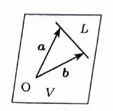

> 部分集合 $L$ を含む最小の部分ベクトル空間は、 $L$ に含まれるベクトル全体が生成する空間である。
>
> アフィン直線が原点を通らない場合、その直線自体は部分空間ではない。直線上の位置ベクトルと方向ベクトルを生成元に加える必要がある。
>
> 部分空間 $V$ の直交補空間は、
>
> $$
> V^\perp=\{x\in\mathbb{R}^3\mid x\cdot v=0\text{ for all }v\in V\}
> $$
>
> である。

---

問題 231

$\mathbb{R}^3$ の部分集合 $L$ を、

$$
L=
\left\{
(x,y,z)\in\mathbb{R}^3
\ \middle|\
\frac{x-1}{2}
=
\frac{y-2}{3}
=
\frac{z-3}{4}
\right\}
$$

とおく。

---

## (1)

$L$ を含む最小の $\mathbb{R}^3$ の部分ベクトル空間 $V$ の基底と次元を求めよ。

---

## (1) 解答

> 直線上の二点の位置ベクトルを取り、それらが生成する空間を考える。直線上の一点と方向ベクトルを用いても同じ空間を得る。

共通の値を $t$ とおくと、

$$
\frac{x-1}{2}
=
\frac{y-2}{3}
=
\frac{z-3}{4}
=t
$$

である。

したがって、

$$
x=1+2t,
\qquad
y=2+3t,
\qquad
z=3+4t
$$

である。

$t=0$ の点は、

$$
(1,2,3)
$$

である。

$t=1$ の点は、

$$
(3,5,7)
$$

である。

これらの位置ベクトルを、

$$
a=
\begin{pmatrix}
1\\
2\\
3
\end{pmatrix},
\qquad
b=
\begin{pmatrix}
3\\
5\\
7
\end{pmatrix}
$$

とする。

$V$ は $L$ を含む部分ベクトル空間なので、直線上の点の位置ベクトル $a,b$ を含まなければならない。したがって、 $V$ は少なくとも、

$$
\operatorname{span}\{a,b\}
$$

を含む。

一方、直線の任意の点の位置ベクトルは、

$$
\begin{pmatrix}
1+2t\\
2+3t\\
3+4t
\end{pmatrix}
$$

である。

$b-a$ を計算すると、

$$
b-a
=
\begin{pmatrix}
2\\
3\\
4
\end{pmatrix}
$$

である。

したがって、直線上の任意の位置ベクトルは、

$$
a+t(b-a)
$$

と表される。

これを $a,b$ の線形結合に直すと、

$$
a+t(b-a)
=
(1-t)a+tb
$$

である。

したがって、 $L$ のすべての位置ベクトルは $\operatorname{span}\{a,b\}$ に含まれる。

よって、求める最小の部分空間は、

$$
V=\operatorname{span}\{a,b\}
$$

である。

$a,b$ は定数倍ではないため線形独立である。

したがって、

$$
\boxed{
\left\{
\begin{pmatrix}
1\\
2\\
3
\end{pmatrix},
\begin{pmatrix}
3\\
5\\
7
\end{pmatrix}
\right\}
\text{ は }V\text{ の基底}
}
$$

であり、

$$
\boxed{\dim V=2}
$$

である。

---

## (2)

$V$ の直交補空間を求めよ。

---

## (2) 解答

> $V$ の基底 $a,b$ の両方に直交するベクトルを求める。連立方程式を解く方法のほか、外積 $a\times b$ を使う方法もある。

$$
x=
\begin{pmatrix}
x\\
y\\
z
\end{pmatrix}
\in V^\perp
$$

とする。

$x$ は $V$ のすべてのベクトルに直交する。基底 $a,b$ に直交すれば十分なので、

$$
x\cdot a=0
$$

および、

$$
x\cdot b=0
$$

を満たす。

代入すると、

$$
x+2y+3z=0
$$

$$
3x+5y+7z=0
$$

である。

第 $1$ 式を $3$ 倍すると、

$$
3x+6y+9z=0
$$

である。

ここから第 $2$ 式を引くと、

$$
y+2z=0
$$

だから、

$$
y=-2z
$$

である。

これを代入前の第 $1$ 式

$$
x+2y+3z=0
$$

へ代入すると、

$$
x+2(-2z)+3z=0
$$

すなわち、

$$
x-z=0
$$

だから、

$$
x=z
$$

である。

$z=c$ とおくと、

$$
\begin{pmatrix}
x\\
y\\
z
\end{pmatrix}
=
c
\begin{pmatrix}
1\\
-2\\
1
\end{pmatrix}
$$

となる。

したがって、

$$
\boxed{
V^\perp
=
\left\{
c
\begin{pmatrix}
1\\
-2\\
1
\end{pmatrix}
\ \middle|\
c\in\mathbb{R}
\right\}
}
$$

である。

基底と次元は、

$$
\boxed{
\left\{
\begin{pmatrix}
1\\
-2\\
1
\end{pmatrix}
\right\}
\text{ は }V^\perp\text{ の基底},
\qquad
\dim V^\perp=1
}
$$

である。

> 外積を使うと、
>
> $$
> a\times b
> =
> \begin{pmatrix}
> -1\\
> 2\\
> -1
> \end{pmatrix}
> $$
>
> であり、その符号を反転すると同じ方向ベクトル $(1,-2,1)^T$ が得られる。
