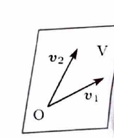

> $\mathbb{R}^3$ の部分集合 $V$ が部分空間であることを示すには、任意の $u,v\in V$ と任意の実数 $c$ に対し、
>
> $$
> u+v\in V,\qquad cu\in V
> $$
>
> を示せばよい。
>
> ただし、方程式から全要素をいくつかの固定ベクトルの線形結合として表せる場合は、生成される集合であることから部分空間性を同時に示せる。基底には、生成性に加えて線形独立性が必要である。

---

例題 71

$$
V=
\left\{
\begin{pmatrix}
x\\
y\\
z
\end{pmatrix}
\in\mathbb{R}^3
\ \middle|\
3x+4y-z=0
\right\}
$$

が $\mathbb{R}^3$ の部分空間であることを示し、その基底を $1$ 組求めよ。

---

## 解答

> 方程式を $z$ について解くと、任意の要素を $2$ 本の固定ベクトルの線形結合にできる。この方法なら、部分空間であることと基底候補の抽出を同時に行える。定義に沿って加法・実数倍への閉性を別々に確認する方法もある。

条件

$$
3x+4y-z=0
$$

を $z$ について解くと、

$$
z=3x+4y
$$

である。

したがって、任意の $v\in V$ は

$$
v=
\begin{pmatrix}
x\\
y\\
z
\end{pmatrix}
=
\begin{pmatrix}
x\\
y\\
3x+4y
\end{pmatrix}
$$

と表される。

$x$ と $y$ を係数として分けると、

$$
v
=
x
\begin{pmatrix}
1\\
0\\
3
\end{pmatrix}
+
y
\begin{pmatrix}
0\\
1\\
4
\end{pmatrix}
$$

である。

ここで、

$$
v_1=
\begin{pmatrix}
1\\
0\\
3
\end{pmatrix},
\qquad
v_2=
\begin{pmatrix}
0\\
1\\
4
\end{pmatrix}
$$

とおくと、

$$
V=\{xv_1+yv_2\mid x,y\in\mathbb{R}\}
$$

である。

> 固定ベクトルの全線形結合の集合は、和と実数倍について閉じている。実際、
>
> $$
> (a_1v_1+a_2v_2)+(b_1v_1+b_2v_2)
> =(a_1+b_1)v_1+(a_2+b_2)v_2
> $$
>
> および
>
> $$
> c(a_1v_1+a_2v_2)=(ca_1)v_1+(ca_2)v_2
> $$
>
> である。

したがって、 $V$ は $\mathbb{R}^3$ の部分空間である。

次に、線形独立性を調べる。係数 $c_1,c_2$ に対して、

$$
c_1v_1+c_2v_2=
\begin{pmatrix}
0\\
0\\
0
\end{pmatrix}
$$

とする。

成分で書くと、

$$
\begin{pmatrix}
c_1\\
c_2\\
3c_1+4c_2
\end{pmatrix}
=
\begin{pmatrix}
0\\
0\\
0
\end{pmatrix}
$$

である。第 $1$ 成分と第 $2$ 成分から、

$$
c_1=0,\qquad c_2=0
$$

を得る。よって、 $v_1,v_2$ は線形独立である。

以上より、

$$
\boxed{
\left\{
\begin{pmatrix}
1\\
0\\
3
\end{pmatrix},
\begin{pmatrix}
0\\
1\\
4
\end{pmatrix}
\right\}
}
$$

は $V$ の基底であり、

$$
\boxed{\dim V=2}
$$

である。

> 基底の取り方は一通りではない。例えば $x=-\frac43y+\frac13z$ として別の自由変数を選ぶと、
>
> $$
> \left\{
> \begin{pmatrix}-4\\3\\0\end{pmatrix},
> \begin{pmatrix}1\\0\\3\end{pmatrix}
> \right\}
> $$
>
> も基底になる。
