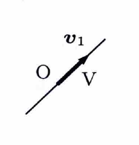

> 原点を通る直線は、零でない方向ベクトル $v$ の実数倍全体
>
> $$
> V=\{tv\mid t\in\mathbb{R}\}
> $$
>
> と表される。零でない $1$ 本のベクトルは線形独立なので、その方向ベクトルが基底となり、次元は $1$ である。

---

例題 72

$$
V=
\left\{
\begin{pmatrix}
x\\
y\\
z
\end{pmatrix}
\in\mathbb{R}^3
\ \middle|\
\frac{x}{2}=\frac{y}{-1}=\frac{z}{3}
\right\}
$$

の基底と次元を求めよ。

---

## 解答

> 対称形の直線の式では、共通の値を媒介変数と置くのが最も自然である。連立方程式に直して解くこともできるが、同じ結果をより長い計算で得ることになる。

共通の値を $t$ とおく。

$$
\frac{x}{2}=\frac{y}{-1}=\frac{z}{3}=t
$$

すると、

$$
x=2t,\qquad y=-t,\qquad z=3t
$$

である。

したがって、

$$
\begin{pmatrix}
x\\
y\\
z
\end{pmatrix}
=
t
\begin{pmatrix}
2\\
-1\\
3
\end{pmatrix}
$$

となる。

ここで、

$$
v_1=
\begin{pmatrix}
2\\
-1\\
3
\end{pmatrix}
$$

とおく。 $v_1\ne0$ であるから、 $v_1$ は単独で線形独立である。また、 $V$ の任意の要素は $tv_1$ と表されるので、 $v_1$ は $V$ を生成する。

したがって、

$$
\boxed{
\left\{
\begin{pmatrix}
2\\
-1\\
3
\end{pmatrix}
\right\}
\text{ は }V\text{ の基底}
}
$$

であり、

$$
\boxed{\dim V=1}
$$

である。

