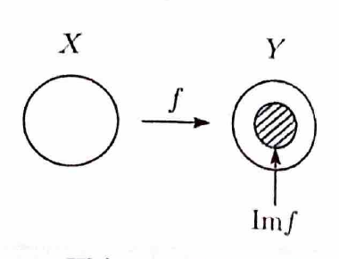

> 写像 $f:X\to Y$ の像は
>
> $$
> \operatorname{Im}f=\{f(x)\in Y\mid x\in X\}
> $$
>
> である。
>
> $\operatorname{Im}f=Y$ なら全射である。異なる入力が必ず異なる出力に移るとき単射であり、全射かつ単射なら全単射である。

---

例題 74

次の関数の $\operatorname{Im}f$ を求めよ。また、全射および単射について調べよ。

---

## (1)

$$
f:\mathbb{R}\to\mathbb{R},
\qquad
x\mapsto y=x^2
$$

---

## (1) 解答

> 二次関数の値域を調べる。全射は終域 $\mathbb{R}$ の全要素が値として現れるか、単射は同じ値を取る異なる入力があるかで判定する。

任意の実数 $x$ に対し、

$$
x^2\ge0
$$

である。また、任意の $y\ge0$ に対して、

$$
x=\sqrt{y}
$$

を取れば、

$$
f(x)=x^2=y
$$

となる。

したがって、

$$
\boxed{\operatorname{Im}f=\{y\in\mathbb{R}\mid y\ge0\}}
$$

である。

終域は $\mathbb{R}$ であるが、負の実数は像に含まれないので、

$$
\boxed{f\text{ は全射ではない}}
$$

である。

また、

$$
x_1=-1,\qquad x_2=1
$$

とすると、

$$
x_1\ne x_2
$$

であるにもかかわらず、

$$
f(x_1)=(-1)^2=1,\qquad f(x_2)=1^2=1
$$

である。よって、

$$
\boxed{f\text{ は単射ではない}}
$$

である。

---

## (2)

$$
f:\mathbb{R}\to\mathbb{R},
\qquad
x\mapsto y=2x
$$

---

## (2) 解答

> 一次関数 $y=2x$ は逆に $x=y/2$ と解けるため、任意の出力に対応する入力がただ一つ存在する。この事実から全射と単射を同時に示せる。

任意の $y\in\mathbb{R}$ に対し、

$$
x=\frac{y}{2}
$$

とおくと、

$$
f(x)=2\cdot\frac{y}{2}=y
$$

となる。したがって、

$$
\boxed{\operatorname{Im}f=\mathbb{R}}
$$

であり、 $f$ は全射である。

次に、 $f(x_1)=f(x_2)$ と仮定する。

$$
2x_1=2x_2
$$

両辺を $2$ で割ると、

$$
x_1=x_2
$$

である。したがって、

$$
\boxed{f\text{ は単射である}}
$$

である。

以上より、

$$
\boxed{f\text{ は全単射である}}
$$
