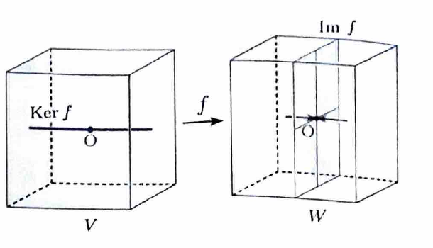

> 線形写像 $f:V\to W$ の像と核は
>
> $$
> \operatorname{Im}f=\{f(x)\mid x\in V\},
> \qquad
> \operatorname{Ker}f=\{x\in V\mid f(x)=0\}
> $$
>
> で定義される。
>
> 部分集合 $U$ が部分空間であることは、任意の $u_1,u_2\in U$ と任意の実数 $a$ に対し、 $u_1+u_2\in U$ と $au_1\in U$ を示せばよい。

---

例題 76

線形写像 $f:V\to W$ について、次を示せ。

---

## (1)

$\operatorname{Im}f$ は $W$ の部分空間である。

---

## (1) 解答

> 部分空間の判定条件に従い、像の任意の $2$ 元の和と、像の任意の元の実数倍が再び像に入ることを示す。零ベクトルを含むことも、 $f(0)=0$ から自動的に従う。

$y_1,y_2\in\operatorname{Im}f$ とする。

像の定義より、ある $u_1,u_2\in V$ が存在して、

$$
f(u_1)=y_1,
\qquad
f(u_2)=y_2
$$

となる。

$f$ は線形写像なので、

$$
f(u_1+u_2)=f(u_1)+f(u_2)
$$

である。右辺へ $f(u_1)=y_1$ 、 $f(u_2)=y_2$ を代入すると、

$$
f(u_1+u_2)=y_1+y_2
$$

となる。

$u_1+u_2\in V$ であるから、 $f(u_1+u_2)$ は像に含まれる。したがって、

$$
y_1+y_2\in\operatorname{Im}f
$$

である。

次に、任意の $a\in\mathbb{R}$ を取る。線形性より、

$$
f(au_1)=af(u_1)
$$

である。 $f(u_1)=y_1$ を代入すると、

$$
f(au_1)=ay_1
$$

となる。

$au_1\in V$ であるから、

$$
ay_1\in\operatorname{Im}f
$$

である。

以上より、 $\operatorname{Im}f$ は和と実数倍について閉じているので、

$$
\boxed{\operatorname{Im}f\text{ は }W\text{ の部分空間である}}
$$

---

## (2)

$\operatorname{Ker}f$ は $V$ の部分空間である。

---

## (2) 解答

> 核の元は $f$ によって零ベクトルへ移る元である。二つの核の元の和と、核の元の実数倍も線形性によって零ベクトルへ移ることを示す。

$x_1,x_2\in\operatorname{Ker}f$ とする。

核の定義より、

$$
f(x_1)=0,
\qquad
f(x_2)=0
$$

である。

$f$ の線形性から、

$$
f(x_1+x_2)=f(x_1)+f(x_2)
$$

である。右辺へ上の値を代入すると、

$$
f(x_1+x_2)=0+0=0
$$

となる。

したがって、

$$
x_1+x_2\in\operatorname{Ker}f
$$

である。

次に、任意の $a\in\mathbb{R}$ を取る。線形性より、

$$
f(ax_1)=af(x_1)
$$

である。 $f(x_1)=0$ を代入すると、

$$
f(ax_1)=a0=0
$$

となる。

したがって、

$$
ax_1\in\operatorname{Ker}f
$$

である。

以上より、

$$
\boxed{\operatorname{Ker}f\text{ は }V\text{ の部分空間である}}
$$

> 線形写像には次元定理
>
> $$
> \dim\operatorname{Ker}f+\dim\operatorname{Im}f=\dim V
> $$
>
> が成り立つ。
