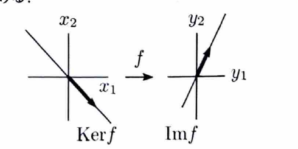

> 線形写像 $f:\mathbb{R}^n\to\mathbb{R}^m$ が行列 $A$ で表されるとき、
>
> $$
> \operatorname{Im}f
> $$
>
> は $A$ の列ベクトルで生成される空間であり、
>
> $$
> \operatorname{Ker}f
> $$
>
> は連立方程式 $Ax=0$ の解空間である。
>
> 像の次元は行列の階数に等しく、
>
> $$
> \dim\operatorname{Im}f=\operatorname{rank}A
> $$
>
> である。

---

例題 77

次の線形写像 $f$ について、 $\operatorname{Im}f$ および $\operatorname{Ker}f$ の基底と次元を求めよ。

---

## (1)

$$
f:\mathbb{R}^2\to\mathbb{R}^2,
\qquad
f\left(
\begin{pmatrix}
x_1\\
x_2
\end{pmatrix}
\right)
=
\begin{pmatrix}
x_1+2x_2\\
2x_1-x_2
\end{pmatrix}
$$

---

## (1) 解答

> 像は行列の列ベクトルから求め、核は同次連立方程式を解いて求める。行列式が $0$ でないことから、像が $\mathbb{R}^2$ 全体で核が零空間であることも一度に分かる。

写像を列ベクトルで分解すると、

$$
f\left(
\begin{pmatrix}
x_1\\
x_2
\end{pmatrix}
\right)
=
x_1
\begin{pmatrix}
1\\
2
\end{pmatrix}
+
x_2
\begin{pmatrix}
2\\
-1
\end{pmatrix}
$$

である。

$$
v_1=
\begin{pmatrix}
1\\
2
\end{pmatrix},
\qquad
v_2=
\begin{pmatrix}
2\\
-1
\end{pmatrix}
$$

とおく。

この $2$ 本の線形独立性を調べるため、行列式を計算する。

$$
\det
\begin{pmatrix}
1&2\\
2&-1
\end{pmatrix}
=
1\cdot(-1)-2\cdot2
=-5
$$

したがって、

$$
-5\ne0
$$

より、 $v_1,v_2$ は線形独立である。また、像の任意の元は $x_1v_1+x_2v_2$ と表される。

よって、

$$
\boxed{
\left\{
\begin{pmatrix}
1\\
2
\end{pmatrix},
\begin{pmatrix}
2\\
-1
\end{pmatrix}
\right\}
\text{ は }\operatorname{Im}f\text{ の基底}
}
$$

であり、

$$
\boxed{\dim\operatorname{Im}f=2}
$$

である。

次に核を求める。核の条件は、

$$
f\left(
\begin{pmatrix}
x_1\\
x_2
\end{pmatrix}
\right)
=
\begin{pmatrix}
0\\
0
\end{pmatrix}
$$

である。したがって、

$$
\begin{cases}
x_1+2x_2=0\\
2x_1-x_2=0
\end{cases}
$$

を解く。

第 $1$ 式から、

$$
x_1=-2x_2
$$

である。これを代入前の第 $2$ 式

$$
2x_1-x_2=0
$$

へ代入すると、

$$
2(-2x_2)-x_2=0
$$

すなわち、

$$
-5x_2=0
$$

だから、

$$
x_2=0
$$

である。したがって、

$$
x_1=0
$$

である。

よって、

$$
\operatorname{Ker}f=\{0\}
$$

であり、

$$
\boxed{\operatorname{Ker}f\text{ の基底は空集合},\qquad
\dim\operatorname{Ker}f=0}
$$

である。

---

## (2)

$$
f:\mathbb{R}^2\to\mathbb{R}^2,
\qquad
f\left(
\begin{pmatrix}
x_1\\
x_2
\end{pmatrix}
\right)
=
\begin{pmatrix}
x_1+x_2\\
2x_1+2x_2
\end{pmatrix}
$$

---

## (2) 解答

> 二つの出力成分が同じ一次式 $x_1+x_2$ の倍になっているため、像は $1$ 次元である。核は $x_1+x_2=0$ の解空間として求める。

出力を因数分解すると、

$$
f\left(
\begin{pmatrix}
x_1\\
x_2
\end{pmatrix}
\right)
=
(x_1+x_2)
\begin{pmatrix}
1\\
2
\end{pmatrix}
$$

である。

したがって、像の任意の元は

$$
c
\begin{pmatrix}
1\\
2
\end{pmatrix}
\qquad
(c\in\mathbb{R})
$$

と表される。

よって、

$$
\boxed{
\left\{
\begin{pmatrix}
1\\
2
\end{pmatrix}
\right\}
\text{ は }\operatorname{Im}f\text{ の基底}
}
$$

であり、

$$
\boxed{\dim\operatorname{Im}f=1}
$$

である。

核の条件は、

$$
\begin{pmatrix}
x_1+x_2\\
2x_1+2x_2
\end{pmatrix}
=
\begin{pmatrix}
0\\
0
\end{pmatrix}
$$

である。二つの方程式は同値であり、

$$
x_1+x_2=0
$$

を得る。

$x_1$ を自由変数 $c$ とおくと、

$$
x_1=c,
\qquad
x_2=-c
$$

である。したがって、

$$
\begin{pmatrix}
x_1\\
x_2
\end{pmatrix}
=
c
\begin{pmatrix}
1\\
-1
\end{pmatrix}
$$

となる。

よって、

$$
\boxed{
\left\{
\begin{pmatrix}
1\\
-1
\end{pmatrix}
\right\}
\text{ は }\operatorname{Ker}f\text{ の基底}
}
$$

であり、

$$
\boxed{\dim\operatorname{Ker}f=1}
$$

である。

> 次元定理を確認すると、
>
> $$
> \dim\operatorname{Ker}f+\dim\operatorname{Im}f=1+1=2=\dim\mathbb{R}^2
> $$
>
> となる。
