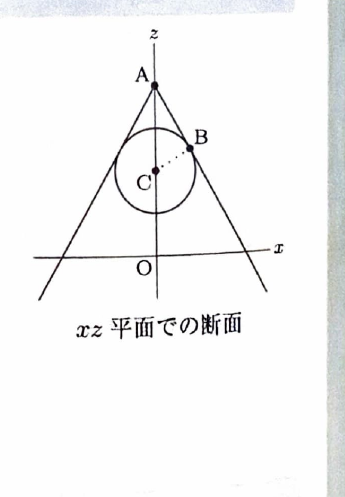

> **事前知識：回転面・円錐面・ガウスの発散定理**
>
> 直線をある軸のまわりに回転すると円錐面が得られる。軸を含む平面で切った断面では、円錐面は2本の直線として見える。
>
> 球面と円錐面が接する点では、球の中心から接点へ向かう半径は円錐面の母線に垂直である。したがって、軸を含む断面図では直角三角形を利用できる。
>
> また、閉曲面 $S$ が領域 $V$ を囲み、$\boldsymbol{n}$ が外向き単位法線ベクトルであるとき、ガウスの発散定理
>
> $$
> \int_S\boldsymbol{F}\cdot\boldsymbol{n}\,dS
> =
> \int_V\nabla\cdot\boldsymbol{F}\,dV
> $$
>
> が成り立つ。
>
> 円柱座標
>
> $$
> x=r\cos\theta,\qquad
> y=r\sin\theta,\qquad
> z=z
> $$
>
> では、体積要素は
>
> $$
> dV=r\,dz\,dr\,d\theta
> $$
>
> である。

---

問題 242

> 難度区分：B／出典：東北大学

点 $O(0,0,0)$ を原点とする $xyz$ 空間において、中心を点

$$
C(0,0,1)
$$

、半径を

$$
\frac12
$$

とする球面 $S_1$ がある。

点

$$
A(0,0,2)
$$

を通る直線を $z$ 軸まわりに回転して得られる円錐面 $S_2$ が、球面 $S_1$ に接している。ただし、

$$
z\le2
$$

とする。

---

## (1)

円錐面 $S_2$ と球面 $S_1$ の接点の一つを $B$ とするとき、

$$
\cos\angle CAB
$$

を求めよ。

---

## (1) 解答

> 円錐面と球面は $z$ 軸に関して回転対称なので、$z$ 軸と接点 $B$ を含む平面で切った断面を考える。断面では球面は中心 $C$、半径 $\frac12$ の円となり、円錐面の母線 $AB$ はその円への接線になる。
>
> 接線と接点への半径は直交するため、三角形 $ACB$ は $B$ を直角とする直角三角形である。

点 $A$ と点 $C$ の距離は、

$$
AC
=
\sqrt{
(0-0)^2+(0-0)^2+(2-1)^2
}
=1
$$

である。

また、$B$ は球面上の点なので、半径より

$$
CB=\frac12
$$

である。

さらに、$AB$ は球への接線であり、$CB$ は接点 $B$ への半径なので、

$$
\angle CBA=90^\circ
$$

である。

したがって、直角三角形 $ACB$ において、

$$
\sin\angle CAB
=
\frac{CB}{AC}
$$

である。

値を代入すると、

$$
\sin\angle CAB
=
\frac{\frac12}{1}
=
\frac12
$$

$\angle CAB$ は円錐の半頂角であり、$0^\circ<\angle CAB<90^\circ$ なので、

$$
\angle CAB=30^\circ
$$

である。

よって、

$$
\cos\angle CAB
=
\cos30^\circ
=
\frac{\sqrt3}{2}
$$

したがって、

$$
\boxed{
\cos\angle CAB=\frac{\sqrt3}{2}
}
$$

---

## (2)

円錐面 $S_2$ 上の任意の点を

$$
P(x,y,z)
$$

とするとき、円錐面 $S_2$ の方程式を求めよ。

---

## (2) 解答

> 円錐面の任意の母線 $AP$ は、軸方向のベクトル $AC$ となす角が一定で、その角は (1) で求めた $30^\circ$ である。
>
> したがって、ベクトルの内積
>
> $$
> \overrightarrow{AP}\cdot\overrightarrow{AC}
> =
> |\overrightarrow{AP}|
> |\overrightarrow{AC}|
> \cos30^\circ
> $$
>
> を使う。座標から距離を求めて断面の傾きを直接出す方法もあるが、内積を使うと回転対称な3次元の式をそのまま得られる。

まず、値を代入する前の内積公式は

$$
\boldsymbol{u}\cdot\boldsymbol{v}
=
|\boldsymbol{u}|
|\boldsymbol{v}|
\cos\theta
$$

である。

本問では、

$$
\overrightarrow{AP}
=
P-A
=
(x,y,z-2)
$$

$$
\overrightarrow{AC}
=
C-A
=
(0,0,-1)
$$

である。

左辺の内積は

$$
\overrightarrow{AP}\cdot\overrightarrow{AC}
=
(x,y,z-2)\cdot(0,0,-1)
$$

$$
=-(z-2)
=2-z
$$

である。

また、

$$
|\overrightarrow{AP}|
=
\sqrt{x^2+y^2+(z-2)^2}
$$

$$
|\overrightarrow{AC}|=1
$$

である。

(1) より、

$$
\cos\angle PAC
=
\cos30^\circ
=
\frac{\sqrt3}{2}
$$

なので、内積公式に代入すると、

$$
2-z
=
\sqrt{x^2+y^2+(z-2)^2}
\cdot1\cdot\frac{\sqrt3}{2}
$$

となる。

両辺を2乗する前に、条件 $z\le2$ より

$$
2-z\ge0
$$

であることを確認しておく。

両辺を2乗すると、

$$
(2-z)^2
=
\frac34
\left[
x^2+y^2+(z-2)^2
\right]
$$

ここで、

$$
(z-2)^2=(2-z)^2
$$

なので、

$$
(2-z)^2
=
\frac34
\left[
x^2+y^2+(2-z)^2
\right]
$$

両辺を4倍すると、

$$
4(2-z)^2
=
3(x^2+y^2)+3(2-z)^2
$$

両辺から $3(2-z)^2$ を引くと、

$$
(2-z)^2
=
3(x^2+y^2)
$$

となる。

条件 $z\le2$ より $2-z\ge0$ なので、平方根を取ると、

$$
2-z
=
\sqrt{3(x^2+y^2)}
$$

したがって、

$$
z
=
2-\sqrt{3(x^2+y^2)}
$$

よって、円錐面 $S_2$ の方程式は

$$
\boxed{
z=2-\sqrt{3(x^2+y^2)}
}
$$

である。

> 円柱座標の半径 $r=\sqrt{x^2+y^2}$ を使えば、
>
> $$
> z=2-\sqrt3\,r
> $$
>
> と簡潔に書ける。

---

## (3)

ベクトル場 $\boldsymbol{F}$ を

$$
\boldsymbol{F}
=
\left(
x^3z,\ x^2yz,\ (x^2+y^2)z^2
\right)
$$

とし、円錐面 $S_2$ と $xy$ 平面で囲まれた閉曲面を $S$ とする。面積分

$$
I=
\int_S\boldsymbol{F}\cdot\boldsymbol{n}\,dS
$$

を求めよ。ただし、単位法線ベクトル $\boldsymbol{n}$ は $S$ の内部から外向きに取るものとする。

---

## (3) 解答

> 求める曲面 $S$ は閉曲面であり、法線は外向きに指定されているため、ガウスの発散定理をそのまま適用できる。
>
> 円錐面と底面の面積分を別々に直接計算する方法もあるが、円錐面の法線と面積素が複雑になる。発散定理なら領域内部の三重積分に変換でき、円柱座標で自然に計算できるため、この方法を選ぶ。

閉曲面 $S$ が囲む領域を $V$ とする。

ガウスの発散定理より、

$$
I
=
\int_S\boldsymbol{F}\cdot\boldsymbol{n}\,dS
=
\int_V\nabla\cdot\boldsymbol{F}\,dV
$$

である。

まず、発散を求める。値を代入する前の式は

$$
\nabla\cdot\boldsymbol{F}
=
\frac{\partial F_1}{\partial x}
+
\frac{\partial F_2}{\partial y}
+
\frac{\partial F_3}{\partial z}
$$

である。

各成分は

$$
F_1=x^3z,\qquad
F_2=x^2yz,\qquad
F_3=(x^2+y^2)z^2
$$

なので、

$$
\frac{\partial F_1}{\partial x}
=
\frac{\partial}{\partial x}(x^3z)
=
3x^2z
$$

$$
\frac{\partial F_2}{\partial y}
=
\frac{\partial}{\partial y}(x^2yz)
=
x^2z
$$

$$
\frac{\partial F_3}{\partial z}
=
\frac{\partial}{\partial z}
\left[
(x^2+y^2)z^2
\right]
=
2(x^2+y^2)z
$$

である。

したがって、

$$
\nabla\cdot\boldsymbol{F}
=
3x^2z+x^2z+2(x^2+y^2)z
$$

$$
=
4x^2z+2(x^2+y^2)z
$$

となる。

円柱座標

$$
x=r\cos\theta,\qquad
y=r\sin\theta
$$

を代入すると、

$$
x^2+y^2=r^2
$$

であり、

$$
4x^2z
=
4r^2\cos^2\theta\,z
$$

なので、

$$
\nabla\cdot\boldsymbol{F}
=
4r^2\cos^2\theta\,z+2r^2z
$$

$$
=
2zr^2(2\cos^2\theta+1)
$$

ここで、倍角公式

$$
\cos2\theta=2\cos^2\theta-1
$$

を変形すると、

$$
2\cos^2\theta=\cos2\theta+1
$$

である。したがって、

$$
2\cos^2\theta+1
=
\cos2\theta+2
$$

なので、

$$
\nabla\cdot\boldsymbol{F}
=
2zr^2(\cos2\theta+2)
$$

となる。

次に、積分領域を決める。円錐面は

$$
z=2-\sqrt3\,r
$$

であり、底面は

$$
z=0
$$

である。

円錐面と $xy$ 平面の交線では、

$$
0=2-\sqrt3\,r
$$

したがって、

$$
\sqrt3\,r=2
$$

$$
r=\frac{2}{\sqrt3}
$$

である。

よって、領域 $V$ は円柱座標で

$$
0\le\theta\le2\pi,
\qquad
0\le r\le\frac{2}{\sqrt3},
\qquad
0\le z\le2-\sqrt3\,r
$$

と表せる。

体積要素は

$$
dV=r\,dz\,dr\,d\theta
$$

であるから、

$$
I
=
\int_0^{2\pi}
\int_0^{2/\sqrt3}
\int_0^{2-\sqrt3r}
2zr^2(\cos2\theta+2)
\,r\,dz\,dr\,d\theta
$$

となる。

$z$ に依存する部分、$r$ に依存する部分、$\theta$ に依存する部分を整理すると、

$$
I
=
\int_0^{2\pi}
(\cos2\theta+2)\,d\theta
\int_0^{2/\sqrt3}
\left[
\int_0^{2-\sqrt3r}2z\,dz
\right]
r^3\,dr
$$

まず、

$$
\int2z\,dz=z^2
$$

なので、

$$
\int_0^{2-\sqrt3r}2z\,dz
=
\left[z^2\right]_0^{2-\sqrt3r}
=
(2-\sqrt3r)^2
$$

である。

また、

$$
\int_0^{2\pi}(\cos2\theta+2)\,d\theta
=
\left[
\frac12\sin2\theta+2\theta
\right]_0^{2\pi}
=
4\pi
$$

である。

したがって、

$$
I
=
4\pi
\int_0^{2/\sqrt3}
(2-\sqrt3r)^2r^3\,dr
$$

平方を展開すると、

$$
(2-\sqrt3r)^2
=
4-4\sqrt3r+3r^2
$$

なので、

$$
(2-\sqrt3r)^2r^3
=
4r^3-4\sqrt3r^4+3r^5
$$

である。

よって、

$$
I
=
4\pi
\int_0^{2/\sqrt3}
\left(
4r^3-4\sqrt3r^4+3r^5
\right)dr
$$

各項を積分すると、

$$
\int
\left(
4r^3-4\sqrt3r^4+3r^5
\right)dr
=
r^4-\frac{4\sqrt3}{5}r^5+\frac12r^6
$$

したがって、

$$
I
=
4\pi
\left[
r^4-\frac{4\sqrt3}{5}r^5+\frac12r^6
\right]_0^{2/\sqrt3}
$$

ここで、

$$
\left(\frac{2}{\sqrt3}\right)^4
=
\frac{16}{9}
$$

$$
\left(\frac{2}{\sqrt3}\right)^5
=
\frac{32}{9\sqrt3}
$$

$$
\left(\frac{2}{\sqrt3}\right)^6
=
\frac{64}{27}
$$

なので、

$$
I
=
4\pi
\left(
\frac{16}{9}
-\frac{4\sqrt3}{5}\cdot\frac{32}{9\sqrt3}
+\frac12\cdot\frac{64}{27}
\right)
$$

$$
=
4\pi
\left(
\frac{16}{9}
-\frac{128}{45}
+\frac{32}{27}
\right)
$$

通分すると、

$$
\frac{16}{9}
-\frac{128}{45}
+\frac{32}{27}
=
\frac{240}{135}
-\frac{384}{135}
+\frac{160}{135}
$$

$$
=
\frac{16}{135}
$$

である。

したがって、

$$
I
=
4\pi\cdot\frac{16}{135}
=
\frac{64\pi}{135}
$$

よって、

$$
\boxed{
I=\frac{64\pi}{135}
}
$$
