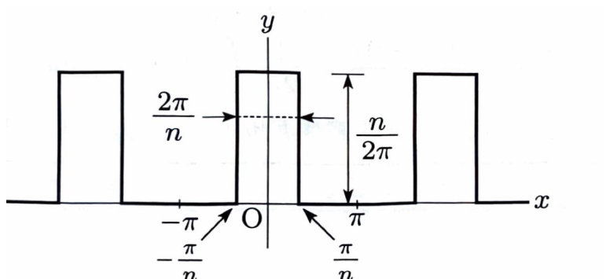

周期 $2\pi$ の偶関数 $f(x)$ は、

$$
f(x)
=
\frac{a_0}{2}
+
\sum_{k=1}^{\infty}a_k\cos kx
$$

と展開できる。余弦係数は、

$$
a_k
=
\frac{1}{\pi}
\int_{-\pi}^{\pi}f(x)\cos kx\,dx
=
\frac{2}{\pi}
\int_0^\pi f(x)\cos kx\,dx
$$

である。

> パルスの幅は $2\pi/n$、高さは $n/(2\pi)$ であるため、1周期内のパルスの面積は
>
> $$
> \frac{2\pi}{n}\cdot\frac{n}{2\pi}=1
> $$
>
> で一定である。
>
> $n\to\infty$ では、幅が $0$ へ、高さが無限大へ向かり、面積を $1$ に保つのでデルタ関数列となる。

---

問題 254　下図のような周期 $2\pi$ の周期的パルス列 $f(x)$ を考える。パルスの幅は $2\pi/n$、高さは $n/(2\pi)$ であり、面積は常に $1$ とする。ただし、$n$ は $2$ 以上の整数である。この波形は $y$ 軸に関して軸対称であり、

$$
f(x)
=
\frac{a_0}{2}
+
\sum_{k=1}^{\infty}a_k\cos kx
$$

と展開できる。

> 資料の難度・出典表記: B・北海道大

---

## (1)

$n=2$ のとき、$a_k\ (k\ge1)$ を求めよ。

---

## (1) 解答

> $n=2$ のとき、パルスの幅は $\pi$、高さは $1/\pi$ であり、1周期の中央では
>
> $$
> -\frac{\pi}{2}\le x\le\frac{\pi}{2}
> $$
>
> で一定値を取る。偶関数なので、$0$ から $\pi/2$ まで積分する。
>
> 区分積分を $-\pi$ から $\pi$ まで直接行う方法もあるが、対称性を使う方が簡潔である。

一般の余弦係数は、

$$
a_k
=
\frac{2}{\pi}
\int_0^\pi f(x)\cos kx\,dx
$$

である。

$n=2$ のとき、パルスの高さは、

$$
\frac{n}{2\pi}
$$

に、値を代入する前の式へ

$$
n=2
$$

を代入して、

$$
\frac{2}{2\pi}
=
\frac{1}{\pi}
$$

となる。

また、半幅は、

$$
\frac{\pi}{n}
$$

に $n=2$ を代入して、

$$
\frac{\pi}{2}
$$

である。

したがって、

$$
f(x)
=
\begin{cases}
\dfrac{1}{\pi}
&
\left(
0\le x\le\dfrac{\pi}{2}
\right),\\
0
&
\left(
\dfrac{\pi}{2}<x\le\pi
\right)
\end{cases}
$$

である。

よって、

$$
a_k
=
\frac{2}{\pi}
\int_0^{\pi/2}
\frac{1}{\pi}\cos kx\,dx
$$

定数を外へ出すと、

$$
a_k
=
\frac{2}{\pi^2}
\int_0^{\pi/2}\cos kx\,dx
$$

である。

不定積分

$$
\int\cos kx\,dx
=
\frac{1}{k}\sin kx+C
$$

を用いると、

$$
a_k
=
\frac{2}{\pi^2}
\left[
\frac{1}{k}\sin kx
\right]_0^{\pi/2}
$$

上下端を代入すると、

$$
a_k
=
\frac{2}{k\pi^2}
\left(
\sin\frac{k\pi}{2}-\sin0
\right)
$$

したがって、

$$
\boxed{
a_k
=
\frac{2}{k\pi^2}
\sin\frac{k\pi}{2}
\qquad(k\ge1)
}
$$

である。

> 具体的には、
>
> $$
> a_1=\frac{2}{\pi^2},
> \quad
> a_2=0,
> \quad
> a_3=-\frac{2}{3\pi^2},
> \quad
> a_4=0,
> \quad
> a_5=\frac{2}{5\pi^2},
> \ldots
> $$
>
> となる。

---

## (2)

$2$ 以上の整数 $n$ について、$a_k\ (k\ge1)$ を $n$ の関数として表せ。

---

## (2) 解答

> 一般の $n$ では、中央のパルスは
>
> $$
> -\frac{\pi}{n}\le x\le\frac{\pi}{n}
> $$
>
> にあり、高さが $n/(2\pi)$ である。偶関数なので、$0$ から $\pi/n$ まで積分すればよい。

余弦係数は、

$$
a_k
=
\frac{2}{\pi}
\int_0^\pi f(x)\cos kx\,dx
$$

である。

一般の $n$ に対して、

$$
f(x)
=
\begin{cases}
\dfrac{n}{2\pi}
&
\left(
0\le x\le\dfrac{\pi}{n}
\right),\\
0
&
\left(
\dfrac{\pi}{n}<x\le\pi
\right)
\end{cases}
$$

である。

したがって、

$$
a_k
=
\frac{2}{\pi}
\int_0^{\pi/n}
\frac{n}{2\pi}
\cos kx\,dx
$$

定数を整理すると、

$$
\frac{2}{\pi}\cdot\frac{n}{2\pi}
=
\frac{n}{\pi^2}
$$

なので、

$$
a_k
=
\frac{n}{\pi^2}
\int_0^{\pi/n}\cos kx\,dx
$$

となる。

積分すると、

$$
a_k
=
\frac{n}{\pi^2}
\left[
\frac{1}{k}\sin kx
\right]_0^{\pi/n}
$$

上下端を代入して、

$$
a_k
=
\frac{n}{k\pi^2}
\left(
\sin\frac{k\pi}{n}-\sin0
\right)
$$

したがって、

$$
\boxed{
a_k
=
\frac{n}{k\pi^2}
\sin\frac{k\pi}{n}
\qquad(k\ge1)
}
$$

である。

> 参考として定数係数も求めると、1周期の面積が $1$ なので、
>
> $$
> a_0
> =
> \frac{1}{\pi}
> \int_{-\pi}^{\pi}f(x)\,dx
> =
> \frac{1}{\pi}
> $$
>
> であり、定数項は
>
> $$
> \frac{a_0}{2}
> =
> \frac{1}{2\pi}
> $$
>
> となる。

---

## (3)

(2) の結果において、$n$ を $\infty$ に漸近させると、与えられたパルス列はデルタ関数列になる。この条件における $a_k$ を求めよ。

---

## (3) 解答

> (2) の係数
>
> $$
> a_k
> =
> \frac{n}{k\pi^2}
> \sin\frac{k\pi}{n}
> $$
>
> に対して、$\sin\theta/\theta\to1$ を使う。変数
>
> $$
> \theta=\frac{k\pi}{n}
> $$
>
> と置けば、$n\to\infty$ のとき $\theta\to0$ となる。

(2) より、

$$
a_k
=
\frac{n}{k\pi^2}
\sin\frac{k\pi}{n}
$$

である。

ここで、

$$
\theta=\frac{k\pi}{n}
$$

と置く。

この式を $n$ について解くと、

$$
n=\frac{k\pi}{\theta}
$$

である。

これを $a_k$ の式へ代入すると、

$$
a_k
=
\frac{\dfrac{k\pi}{\theta}}{k\pi^2}
\sin\theta
$$

分数を整理すると、

$$
a_k
=
\frac{1}{\pi\theta}\sin\theta
$$

したがって、

$$
a_k
=
\frac{1}{\pi}
\frac{\sin\theta}{\theta}
$$

である。

$n\to\infty$ のとき、

$$
\theta=\frac{k\pi}{n}\to0
$$

である。

基本極限

$$
\lim_{\theta\to0}
\frac{\sin\theta}{\theta}
=
1
$$

を用いると、

$$
\lim_{n\to\infty}a_k
=
\frac{1}{\pi}
$$

となる。

したがって、

$$
\boxed{
a_k=\frac{1}{\pi}
\qquad(k\ge1)
}
$$

である。

> これは周期 $2\pi$ のデルタ関数列の余弦係数が、すべて同じ値 $1/\pi$ へ近づくことを表している。
