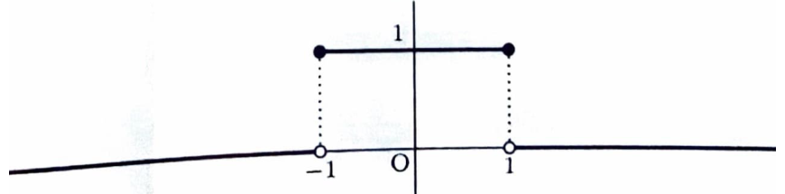
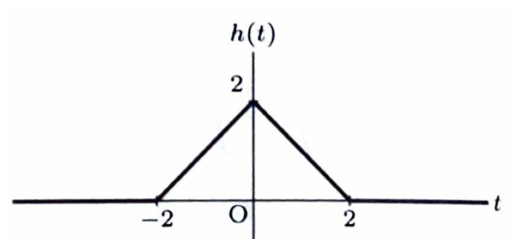

周波数を $f$ とするフーリエ変換を、

$$
\mathcal{F}[g(t)]
=
\int_{-\infty}^{\infty}
g(t)e^{-i2\pi ft}\,dt
$$

とする。

時間関数 $p(t)$ と $q(t)$ のたたみこみは、

$$
p(t)*q(t)
=
\int_{-\infty}^{\infty}
p(\tau)q(t-\tau)\,d\tau
$$

である。

> たたみこみのフーリエ変換は積になる。
>
> $$
> \mathcal{F}[p*q]
> =
> \mathcal{F}[p]\mathcal{F}[q]
> $$
>
> また、矩形関数どうしをたたみこむと、2つの区間の重なりの長さが値となるため、三角形関数が得られる。

---

問題 259　次の関数を考える。

$$
g(t)
=
\begin{cases}
1 & (|t|\le1),\\
0 & (|t|>1)
\end{cases}
$$

また、

$$
h(t)
=
g(t)*g(t)
=
\int_{-\infty}^{\infty}
g(\tau)g(t-\tau)\,d\tau
$$

とする。以下の設問に答えよ。

> 資料の難度・出典表記: B・北海道大

---

## (1)

$g(t)$ を横軸 $t$ として図示せよ。

---

## (1) 解答

> $|t|\le1$ は
>
> $$
> -1\le t\le1
> $$
>
> と同値である。したがって、この区間では高さ $1$、外側では高さ $0$ の矩形になる。
>
> 端点 $t=\pm1$ は不等号に等号を含むため、関数値は $1$ である。

$$
g(t)
=
\begin{cases}
1 & (-1\le t\le1),\\
0 & (t<-1\text{ または }t>1)
\end{cases}
$$

である。

したがって、グラフは次のとおりである。

---

## (2)

$$
h(t)
=
g(t)*g(t)
=
\int_{-\infty}^{\infty}
g(\tau)g(t-\tau)\,d\tau
$$

を横軸 $t$ として図示せよ。

---

## (2) 解答

> 積 $g(\tau)g(t-\tau)$ が $1$ になるのは、両方の因子が同時に $1$ になる範囲である。積分値は、その共通範囲の長さに等しい。
>
> 区分積分を直接行う方法と、2つの区間の重なりを幾何的に考える方法がある。ここでは重なりの範囲を不等式で求め、積分によって長さを確認する。

まず、

$$
g(\tau)=1
$$

となる条件は、

$$
|\tau|\le1
$$

すなわち、

$$
-1\le\tau\le1
$$

である。

次に、

$$
g(t-\tau)=1
$$

となる条件は、

$$
|t-\tau|\le1
$$

である。

絶対値不等式を外すと、

$$
-1\le t-\tau\le1
$$

である。

この不等式を $\tau$ について解く。

左側の不等式

$$
-1\le t-\tau
$$

から、

$$
\tau\le t+1
$$

を得る。

右側の不等式

$$
t-\tau\le1
$$

から、

$$
t-1\le\tau
$$

を得る。

したがって、

$$
g(t-\tau)=1
$$

となるのは、

$$
t-1\le\tau\le t+1
$$

のときである。

よって、積

$$
g(\tau)g(t-\tau)
$$

が $1$ になる範囲は、2つの区間

$$
[-1,1]
$$

と

$$
[t-1,t+1]
$$

の共通部分である。

### $t<-2$ の場合

$t<-2$ ならば、

$$
t+1<-1
$$

である。

したがって、区間 $[t-1,t+1]$ は $[-1,1]$ の左側にあり、共通部分はない。

よって、

$$
h(t)=0
$$

である。

### $-2\le t\le0$ の場合

このとき、

$$
-1\le t+1\le1
$$

である。

共通部分は、

$$
-1\le\tau\le t+1
$$

となる。

したがって、

$$
h(t)
=
\int_{-1}^{t+1}1\,d\tau
$$

である。

積分すると、

$$
h(t)
=
\left[
\tau
\right]_{-1}^{t+1}
$$

上下端を代入して、

$$
h(t)
=
(t+1)-(-1)
=
t+2
$$

となる。

### $0<t\le2$ の場合

このとき、

$$
-1<t-1\le1
$$

である。

共通部分は、

$$
t-1\le\tau\le1
$$

となる。

したがって、

$$
h(t)
=
\int_{t-1}^{1}1\,d\tau
$$

である。

積分すると、

$$
h(t)
=
\left[
\tau
\right]_{t-1}^{1}
$$

上下端を代入して、

$$
h(t)
=
1-(t-1)
=
2-t
$$

となる。

### $t>2$ の場合

$t>2$ ならば、

$$
t-1>1
$$

である。

したがって、区間 $[t-1,t+1]$ は $[-1,1]$ の右側にあり、共通部分はない。

よって、

$$
h(t)=0
$$

である。

以上より、

$$
\boxed{
h(t)
=
\begin{cases}
t+2 & (-2\le t\le0),\\
-t+2 & (0<t\le2),\\
0 & (\text{その他})
\end{cases}
}
$$

である。

グラフは次のとおりである。

> $t=0$ では、2つの矩形が完全に重なり、重なりの長さは $2$ なので、
>
> $$
> h(0)=2
> $$
>
> となる。$t=\pm2$ では重なりの長さが $0$ である。

---

## (3)

$g(t)$ のフーリエ変換を求めよ。

---

## (3) 解答

> $g(t)$ は $[-1,1]$ でのみ $1$ なので、定義積分の区間を $[-1,1]$ に縮める。複素指数関数を直接積分する方法と、偶関数として余弦積分に直す方法がある。
>
> 資料の主解答では複素指数関数を直接積分し、別解で偶奇性を使っている。ここでも主解法を先に示す。

定義より、

$$
\mathcal{F}[g(t)]
=
\int_{-\infty}^{\infty}
g(t)e^{-i2\pi ft}\,dt
$$

である。

$g(t)$ は $-1\le t\le1$ で $1$、それ以外で $0$ なので、

$$
\mathcal{F}[g(t)]
=
\int_{-1}^{1}
e^{-i2\pi ft}\,dt
$$

となる。

$f\ne0$ のとき、不定積分は、

$$
\int e^{-i2\pi ft}\,dt
=
-\frac{1}{i2\pi f}e^{-i2\pi ft}+C
$$

である。

したがって、

$$
\mathcal{F}[g(t)]
=
\left[
-\frac{1}{i2\pi f}
e^{-i2\pi ft}
\right]_{-1}^{1}
$$

となる。

上端と下端を代入すると、

$$
\mathcal{F}[g(t)]
=
-\frac{e^{-i2\pi f}}{i2\pi f}
+
\frac{e^{i2\pi f}}{i2\pi f}
$$

分子をまとめると、

$$
\mathcal{F}[g(t)]
=
\frac{
e^{i2\pi f}-e^{-i2\pi f}
}{i2\pi f}
$$

である。

正弦の指数表示

$$
\sin\theta
=
\frac{e^{i\theta}-e^{-i\theta}}{2i}
$$

より、

$$
e^{i\theta}-e^{-i\theta}
=
2i\sin\theta
$$

である。

ここへ、

$$
\theta=2\pi f
$$

を代入すると、

$$
e^{i2\pi f}-e^{-i2\pi f}
=
2i\sin(2\pi f)
$$

となる。

したがって、

$$
\mathcal{F}[g(t)]
=
\frac{
2i\sin(2\pi f)
}{i2\pi f}
$$

分子と分母の $2i$ を約分すると、

$$
\boxed{
\mathcal{F}[g(t)]
=
\frac{\sin(2\pi f)}{\pi f}
}
$$

である。

> $f=0$ では、
>
> $$
> \mathcal{F}[g](0)
> =
> \int_{-1}^{1}1\,dt
> =
> 2
> $$
>
> である。また、
>
> $$
> \lim_{f\to0}
> \frac{\sin(2\pi f)}{\pi f}
> =
> 2
> $$
>
> なので、連続的に $2$ と定められる。
>
> 偶関数であることを使う別解では、
>
> $$
> \mathcal{F}[g(t)]
> =
> \int_{-1}^{1}\cos(2\pi ft)\,dt
> -
> i\int_{-1}^{1}\sin(2\pi ft)\,dt
> $$
>
> であり、正弦の積分は $0$ になる。したがって、
>
> $$
> \mathcal{F}[g(t)]
> =
> 2\int_0^1\cos(2\pi ft)\,dt
> =
> \frac{\sin(2\pi f)}{\pi f}
> $$
>
> となる。

---

## (4)

$h(t)$ のフーリエ変換を求めよ。

---

## (4) 解答

> $h(t)$ は (2) で得た区分関数なので、定義積分を直接計算できる。一方、
>
> $$
> h=g*g
> $$
>
> であるため、たたみこみの定理を使えば、
>
> $$
> \mathcal{F}[h]
> =
> \{\mathcal{F}[g]\}^2
> $$
>
> と直ちに求められる。資料では直接積分を主解答、たたみこみの定理を別解としている。本解答でも直接積分の構造を示した後、簡潔な確認を行う。

(2) より、

$$
h(t)
=
\begin{cases}
t+2 & (-2\le t\le0),\\
-t+2 & (0<t\le2),\\
0 & (\text{その他})
\end{cases}
$$

である。

定義より、

$$
\mathcal{F}[h(t)]
=
\int_{-\infty}^{\infty}
h(t)e^{-i2\pi ft}\,dt
$$

である。

区分的な定義を代入すると、

$$
\mathcal{F}[h(t)]
=
\int_{-2}^{0}
(t+2)e^{-i2\pi ft}\,dt
+
\int_0^{2}
(-t+2)e^{-i2\pi ft}\,dt
$$

となる。

ただし、直接部分積分を2回行うより、$h(t)$ が偶関数であることを利用すると計算が簡潔になる。

実際、

$$
h(-t)=h(t)
$$

なので、虚部は消え、

$$
\mathcal{F}[h(t)]
=
2\int_0^2
(2-t)\cos(2\pi ft)\,dt
$$

である。

積分を分けると、

$$
\mathcal{F}[h(t)]
=
4\int_0^2\cos(2\pi ft)\,dt
-
2\int_0^2 t\cos(2\pi ft)\,dt
$$

となる。

第1項は、

$$
\int\cos(2\pi ft)\,dt
=
\frac{\sin(2\pi ft)}{2\pi f}+C
$$

なので、

$$
4\int_0^2\cos(2\pi ft)\,dt
=
4
\left[
\frac{\sin(2\pi ft)}{2\pi f}
\right]_0^2
$$

である。

上下端を代入すると、

$$
4\int_0^2\cos(2\pi ft)\,dt
=
\frac{2\sin(4\pi f)}{\pi f}
$$

となる。

次に、

$$
\int_0^2 t\cos(2\pi ft)\,dt
$$

を部分積分する。

文字を

$$
u=t,
\qquad
dv=\cos(2\pi ft)\,dt
$$

と置くと、

$$
du=dt,
\qquad
v=\frac{\sin(2\pi ft)}{2\pi f}
$$

である。

したがって、

$$
\int_0^2 t\cos(2\pi ft)\,dt
=
\left[
\frac{t\sin(2\pi ft)}{2\pi f}
\right]_0^2
-
\frac{1}{2\pi f}
\int_0^2\sin(2\pi ft)\,dt
$$

となる。

第1項は、

$$
\left[
\frac{t\sin(2\pi ft)}{2\pi f}
\right]_0^2
=
\frac{\sin(4\pi f)}{\pi f}
$$

である。

第2項について、

$$
\int\sin(2\pi ft)\,dt
=
-\frac{\cos(2\pi ft)}{2\pi f}+C
$$

なので、

$$
-\frac{1}{2\pi f}
\int_0^2\sin(2\pi ft)\,dt
=
\frac{1}{(2\pi f)^2}
\left[
\cos(2\pi ft)
\right]_0^2
$$

となる。

上下端を代入すると、

$$
\frac{1}{(2\pi f)^2}
\{\cos(4\pi f)-1\}
$$

である。

したがって、

$$
\int_0^2 t\cos(2\pi ft)\,dt
=
\frac{\sin(4\pi f)}{\pi f}
+
\frac{\cos(4\pi f)-1}{4\pi^2f^2}
$$

となる。

これを元の式へ代入すると、

$$
\mathcal{F}[h(t)]
=
\frac{2\sin(4\pi f)}{\pi f}
-
2
\left[
\frac{\sin(4\pi f)}{\pi f}
+
\frac{\cos(4\pi f)-1}{4\pi^2f^2}
\right]
$$

である。

正弦の項は打ち消し合うので、

$$
\mathcal{F}[h(t)]
=
-\frac{\cos(4\pi f)-1}{2\pi^2f^2}
$$

となる。

符号を整理すると、

$$
\mathcal{F}[h(t)]
=
\frac{1-\cos(4\pi f)}{2\pi^2f^2}
$$

である。

恒等式

$$
1-\cos2\theta
=
2\sin^2\theta
$$

に

$$
\theta=2\pi f
$$

を代入すると、

$$
1-\cos(4\pi f)
=
2\sin^2(2\pi f)
$$

である。

したがって、

$$
\mathcal{F}[h(t)]
=
\frac{
2\sin^2(2\pi f)
}{
2\pi^2f^2
}
$$

よって、

$$
\boxed{
\mathcal{F}[h(t)]
=
\frac{\sin^2(2\pi f)}{\pi^2f^2}
}
$$

となる。

> たたみこみの定理による確認では、
>
> $$
> h(t)=g(t)*g(t)
> $$
>
> なので、
>
> $$
> \mathcal{F}[h(t)]
> =
> \mathcal{F}[g(t)]\mathcal{F}[g(t)]
> $$
>
> である。
>
> (3) の結果
>
> $$
> \mathcal{F}[g(t)]
> =
> \frac{\sin(2\pi f)}{\pi f}
> $$
>
> を代入すると、
>
> $$
> \mathcal{F}[h(t)]
> =
> \left(
> \frac{\sin(2\pi f)}{\pi f}
> \right)^2
> =
> \frac{\sin^2(2\pi f)}{\pi^2f^2}
> $$
>
> となり、直接積分の結果と一致する。
>
> $f=0$ では、
>
> $$
> \mathcal{F}[h](0)
> =
> \int_{-\infty}^{\infty}h(t)\,dt
> =
> 4
> $$
>
> であり、上の式の極限も $4$ となる。
