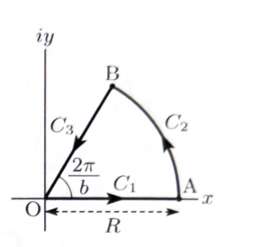

> **前提知識（極・留数・留数定理）**
>
> $z=\alpha$ が $f(z)$ の1位の極であるとき、
>
> $$
> \operatorname{Res}[f,\alpha]
> =
> \lim_{z\to\alpha}(z-\alpha)f(z)
> $$
>
> である。$k$ 位の極であるときは、
>
> $$
> \operatorname{Res}[f,\alpha]
> =
> \frac1{(k-1)!}
> \lim_{z\to\alpha}
> \frac{d^{k-1}}{dz^{k-1}}
> \left\{(z-\alpha)^k f(z)\right\}
> $$
>
> を用いる。
>
> 単純閉曲線 $C$ の内部にある孤立特異点を $\alpha_1,\ldots,\alpha_n$ とすると、留数定理より
>
> $$
> \int_C f(z)\,dz
> =
> 2\pi i
> \sum_{j=1}^n\operatorname{Res}[f,\alpha_j]
> $$
>
> である。

---
問題 270

積分

$$
I=\int_0^\infty\frac1{x^b+1}\,dx
$$

を考える。ただし、$b$ は正の整数とする。この積分を計算するため、複素平面上で、偏角が $0$ から $2\pi/b$ までの扇形の周に沿う単純閉曲線 $C$ を考える。半径を $R>1$ とし、経路を次のように定める。

$$
C_1:\ \text{原点 }O\text{ から正の実軸上を点 }A\text{ まで進む}
$$

$$
C_2:\ \text{点 }A\text{ から半径 }R\text{、中心角 }\frac{2\pi}{b}\text{ の円弧を通って点 }B\text{ まで進む}
$$

$$
C_3:\ \text{点 }B\text{ から偏角 }\frac{2\pi}{b}\text{ の半直線上を原点 }O\text{ まで戻る}
$$

---

## (1)

$$
I_3=\int_{C_3}\frac1{z^b+1}\,dz
$$

を、

$$
I_1=\int_{C_1}\frac1{z^b+1}\,dz
$$

を用いて表せ。

---

## (1) 解答

> $C_3$ 上では、偏角が一定で絶対値だけが $R$ から $0$ へ減少する。したがって $z=t e^{2\pi i/b}$ と置く。$b$ 乗すると回転因子が $e^{2\pi i}=1$ になることが、この扇形を選ぶ理由である。

$C_1$ 上では、

$$
z=t
\qquad(0\leq t\leq R)
$$

と表せる。したがって、

$$
dz=dt
$$

であり、

$$
I_1
=
\int_0^R\frac1{t^b+1}\,dt
$$

である。

次に $C_3$ を考える。$C_3$ は点 $B$ から原点へ向かうため、パラメータ $t$ は $R$ から $0$ へ減少する。よって、

$$
z=t e^{2\pi i/b}
\qquad(R\geq t\geq0)
$$

とおく。このとき、

$$
dz=e^{2\pi i/b}\,dt
$$

である。

また、

$$
z^b
=
\left(t e^{2\pi i/b}\right)^b
$$

$$
=
t^b e^{2\pi i}
$$

であり、

$$
e^{2\pi i}=1
$$

だから、

$$
z^b=t^b
$$

となる。

したがって、

$$
I_3
=
\int_R^0
\frac1{t^b+1}
e^{2\pi i/b}\,dt
$$

である。定数を積分の外へ出すと、

$$
I_3
=
e^{2\pi i/b}
\int_R^0\frac1{t^b+1}\,dt
$$

となる。

積分区間を反転すると符号が変わるため、

$$
\int_R^0\frac1{t^b+1}\,dt
=
-\int_0^R\frac1{t^b+1}\,dt
$$

である。よって、

$$
I_3
=
-e^{2\pi i/b}
\int_0^R\frac1{t^b+1}\,dt
$$

となる。

ここで、

$$
I_1
=
\int_0^R\frac1{t^b+1}\,dt
$$

だから、

$$
\boxed{
I_3=-e^{2\pi i/b}I_1
}
$$

である。

---

## (2)

閉曲線 $C$ で囲まれた領域内における

$$
f(z)=\frac1{z^b+1}
$$

の特異点を求め、そこでの留数を計算せよ。

---

## (2) 解答

> 特異点は $z^b=-1$ の解である。すべての根は単位円上に等間隔で並ぶ。扇形 $0<\arg z<2\pi/b$ の内部にある根を偏角から選び、その単純極の留数を分母の導関数で求める。

特異点は分母が0となる点である。したがって、

$$
z^b+1=0
$$

すなわち、

$$
z^b=-1
$$

を解く。

$-1$ は、

$$
-1=e^{i(\pi+2n\pi)}
$$

と表せる。したがって、$b$ 乗根は、

$$
z_n
=
e^{i(2n+1)\pi/b}
\qquad(n=0,1,\ldots,b-1)
$$

である。

閉曲線 $C$ が囲む扇形の偏角は、

$$
0<\arg z<\frac{2\pi}{b}
$$

である。この範囲に入る根は、

$$
z_0=e^{i\pi/b}
$$

だけである。

したがって、$C$ の内部にある特異点は、

$$
\boxed{
z_0=e^{i\pi/b}
}
$$

である。

分母を

$$
h(z)=z^b+1
$$

とおくと、

$$
h'(z)=bz^{b-1}
$$

である。$z_0$ は単純零点なので、$f(z)=1/h(z)$ の留数は、

$$
\operatorname{Res}[f,z_0]
=
\frac1{h'(z_0)}
$$

である。したがって、

$$
\operatorname{Res}[f,z_0]
=
\frac1{bz_0^{b-1}}
$$

となる。

ここで、

$$
z_0^b=-1
$$

である。したがって、

$$
\frac1{z_0^{b-1}}
=
\frac{z_0}{z_0^b}
$$

$$
=
-z_0
$$

である。よって、

$$
\operatorname{Res}[f,z_0]
=
-\frac{z_0}{b}
$$

となる。

さらに、

$$
z_0=e^{i\pi/b}
$$

を代入すると、

$$
\boxed{
\operatorname{Res}[f,z_0]
=
-\frac1b e^{i\pi/b}
}
$$

である。

---

## (3)

留数定理および

$$
\lim_{R\to\infty}
\int_{C_2}\frac1{z^b+1}\,dz=0
$$

を用いて $I$ を計算せよ。ただし、$i$ を用いずに表せ。

---

## (3) 解答

> 閉曲線積分を $C_1,C_2,C_3$ に分け、第(1)問で $C_3$ を $C_1$ に結びつける。第(2)問の留数を留数定理へ代入し、最後に指数関数の差を正弦で表して $i$ を消去する。なお、$b=1$ のときはもとの実積分が発散するため、収束する $b\geq2$ を分けて扱う。

まず $b=1$ の場合を確認する。このとき、

$$
I=\int_0^\infty\frac1{x+1}\,dx
$$

である。上端を $R$ とすると、

$$
\int_0^R\frac1{x+1}\,dx
=
\left[\log(x+1)\right]_0^R
$$

$$
=
\log(R+1)
$$

である。したがって、

$$
\lim_{R\to\infty}\log(R+1)=\infty
$$

だから、

$$
\boxed{b=1\text{ のとき }I\text{ は発散する}}
$$

ことが分かる。

以下では、

$$
b\geq2
$$

とする。

留数定理より、

$$
\int_Cf(z)\,dz
=
2\pi i\operatorname{Res}[f,z_0]
$$

である。第(2)問の結果

$$
\operatorname{Res}[f,z_0]
=
-\frac1b e^{i\pi/b}
$$

を代入すると、

$$
\int_Cf(z)\,dz
=
2\pi i
\left(
-\frac1b e^{i\pi/b}
\right)
$$

$$
=
-\frac{2\pi i}{b}e^{i\pi/b}
$$

である。

一方、閉曲線 $C$ は、

$$
C=C_1+C_2+C_3
$$

だから、

$$
\int_Cf(z)\,dz
=
I_1
+
\int_{C_2}f(z)\,dz
+
I_3
$$

である。

第(1)問より、

$$
I_3=-e^{2\pi i/b}I_1
$$

である。したがって、

$$
\int_Cf(z)\,dz
=
\left(1-e^{2\pi i/b}\right)I_1
+
\int_{C_2}f(z)\,dz
$$

となる。

$R\to\infty$ とすると、

$$
I_1
=
\int_0^R\frac1{x^b+1}\,dx
\longrightarrow I
$$

であり、問題で与えられた条件より、

$$
\int_{C_2}f(z)\,dz\longrightarrow0
$$

である。したがって、

$$
-\frac{2\pi i}{b}e^{i\pi/b}
=
\left(1-e^{2\pi i/b}\right)I
$$

となる。

ここで、

$$
\alpha=\frac{\pi}{b}
$$

とおく。指数関数の差を整理すると、

$$
1-e^{2i\alpha}
=
e^{i\alpha}
\left(e^{-i\alpha}-e^{i\alpha}\right)
$$

である。正弦の指数表示

$$
\sin\alpha
=
\frac{e^{i\alpha}-e^{-i\alpha}}{2i}
$$

より、

$$
e^{-i\alpha}-e^{i\alpha}
=
-2i\sin\alpha
$$

である。したがって、

$$
1-e^{2i\alpha}
=
-2i e^{i\alpha}\sin\alpha
$$

となる。

$\alpha=\pi/b$ を戻すと、

$$
1-e^{2\pi i/b}
=
-2i e^{i\pi/b}
\sin\frac{\pi}{b}
$$

である。

よって、

$$
-\frac{2\pi i}{b}e^{i\pi/b}
=
-2i e^{i\pi/b}
\sin\frac{\pi}{b}\,I
$$

となる。両辺を

$$
-2i e^{i\pi/b}
$$

で割ると、

$$
\frac{\pi}{b}
=
\sin\frac{\pi}{b}\,I
$$

である。したがって、

$$
I
=
\frac{\pi}
{b\sin(\pi/b)}
$$

となる。

よって、

$$
\boxed{
\int_0^\infty\frac1{x^b+1}\,dx
=
\frac{\pi}{b\sin(\pi/b)}
\qquad(b\geq2)
}
$$

であり、$b=1$ では発散する。
