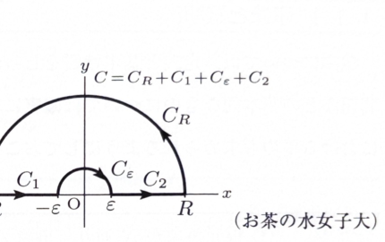

> **前提知識（極・留数・留数定理）**
>
> $z=\alpha$ が $f(z)$ の1位の極であるとき、
>
> $$
> \operatorname{Res}[f,\alpha]
> =
> \lim_{z\to\alpha}(z-\alpha)f(z)
> $$
>
> である。$k$ 位の極であるときは、
>
> $$
> \operatorname{Res}[f,\alpha]
> =
> \frac1{(k-1)!}
> \lim_{z\to\alpha}
> \frac{d^{k-1}}{dz^{k-1}}
> \left\{(z-\alpha)^k f(z)\right\}
> $$
>
> を用いる。
>
> 単純閉曲線 $C$ の内部にある孤立特異点を $\alpha_1,\ldots,\alpha_n$ とすると、留数定理より
>
> $$
> \int_C f(z)\,dz
> =
> 2\pi i
> \sum_{j=1}^n\operatorname{Res}[f,\alpha_j]
> $$
>
> である。

---
問題 271

右図のような複素平面上の経路 $C$ で

$$
\int_C\frac{e^{iz}}{z}\,dz
$$

を計算することにより、

$$
\int_0^\infty\frac{\sin x}{x}\,dx
$$

の値を求めよ。

経路 $C$ は、実軸上の $-R$ から $-\varepsilon$ までの線分 $C_1$、原点を上側から避ける半径 $\varepsilon$ の小半円 $C_\varepsilon$、$\varepsilon$ から $R$ までの線分 $C_2$、および半径 $R$ の上半円 $C_R$ からなる。

---

解答

> 被積分関数 $e^{iz}/z$ は $z=0$ に極を持ち、積分路が実軸を通るため、そのまま上半円を使うことはできない。そこで原点を小半円で上側から避ける。大半円積分を0へ、小半円積分を $-i\pi$ へ収束させ、実軸部分から $\sin x/x$ を取り出す。

複素関数を

$$
f(z)=\frac{e^{iz}}{z}
$$

とする。

経路の向きは、外側の上半円を反時計回り、小半円を時計回りとする。閉曲線は、

$$
C=C_R+C_1+C_\varepsilon+C_2
$$

と表される。

この閉曲線が囲む領域では、特異点 $z=0$ は小半円の内側へ除かれている。したがって、$f(z)$ は $C$ の内部および境界上で正則である。コーシーの積分定理より、

$$
\int_Cf(z)\,dz=0
$$

である。

よって、

$$
\int_{C_R}f(z)\,dz
+
\int_{C_1}f(z)\,dz
+
\int_{C_\varepsilon}f(z)\,dz
+
\int_{C_2}f(z)\,dz
=
0
$$

となる。

まず実軸部分をまとめる。

$C_1$ 上では、

$$
z=t
\qquad(-R\leq t\leq-\varepsilon)
$$

であり、

$$
dz=dt
$$

だから、

$$
\int_{C_1}f(z)\,dz
=
\int_{-R}^{-\varepsilon}
\frac{e^{it}}t\,dt
$$

である。

ここで、

$$
t=-s
$$

と置換する。すると、

$$
dt=-ds
$$

であり、積分端は、

$$
t=-R\Rightarrow s=R,
\qquad
t=-\varepsilon\Rightarrow s=\varepsilon
$$

となる。したがって、

$$
\int_{-R}^{-\varepsilon}
\frac{e^{it}}t\,dt
=
\int_R^\varepsilon
\frac{e^{-is}}{-s}(-ds)
$$

$$
=
-\int_\varepsilon^R
\frac{e^{-is}}s\,ds
$$

である。

一方、$C_2$ 上では、

$$
z=t
\qquad(\varepsilon\leq t\leq R)
$$

だから、

$$
\int_{C_2}f(z)\,dz
=
\int_\varepsilon^R
\frac{e^{it}}t\,dt
$$

である。

よって、

$$
\int_{C_1}f(z)\,dz
+
\int_{C_2}f(z)\,dz
=
\int_\varepsilon^R
\frac{e^{it}-e^{-it}}t\,dt
$$

となる。

正弦の指数表示

$$
\sin t=\frac{e^{it}-e^{-it}}{2i}
$$

より、

$$
e^{it}-e^{-it}=2i\sin t
$$

である。したがって、

$$
\int_{C_1}f(z)\,dz
+
\int_{C_2}f(z)\,dz
=
2i\int_\varepsilon^R
\frac{\sin t}{t}\,dt
$$

となる。

次に小半円 $C_\varepsilon$ を調べる。時計回りなので、

$$
z=\varepsilon e^{it}
\qquad(\pi\geq t\geq0)
$$

とおく。このとき、

$$
dz=i\varepsilon e^{it}\,dt
$$

である。

したがって、

$$
\int_{C_\varepsilon}f(z)\,dz
=
\int_\pi^0
\frac{e^{i\varepsilon e^{it}}}
{\varepsilon e^{it}}
i\varepsilon e^{it}\,dt
$$

$$
=
i\int_\pi^0
e^{i\varepsilon e^{it}}\,dt
$$

である。

$\varepsilon\to0+$ のとき、

$$
e^{i\varepsilon e^{it}}\to1
$$

なので、

$$
\lim_{\varepsilon\to0+}
\int_{C_\varepsilon}f(z)\,dz
=
i\int_\pi^0 1\,dt
$$

$$
=
i(0-\pi)
$$

$$
=
-i\pi
$$

となる。

次に大半円 $C_R$ 上の積分を評価する。大半円上で、

$$
z=Re^{it}
\qquad(0\leq t\leq\pi)
$$

とおく。このとき、

$$
dz=iRe^{it}\,dt
$$

である。したがって、

$$
\int_{C_R}\frac{e^{iz}}z\,dz
=
\int_0^\pi
\frac{e^{iRe^{it}}}{Re^{it}}
iRe^{it}\,dt
$$

$$
=
i\int_0^\pi e^{iRe^{it}}\,dt
$$

である。

ここで、

$$
iRe^{it}
=
iR\cos t-R\sin t
$$

だから、

$$
\left|e^{iRe^{it}}\right|
=
e^{-R\sin t}
$$

である。よって、

$$
\left|
\int_{C_R}\frac{e^{iz}}z\,dz
\right|
\leq
\int_0^\pi e^{-R\sin t}\,dt
$$

となる。

$\sin(\pi-t)=\sin t$ なので、

$$
\int_0^\pi e^{-R\sin t}\,dt
=
2\int_0^{\pi/2}e^{-R\sin t}\,dt
$$

である。また、

$$
0\leq t\leq\frac\pi2
$$

では、

$$
\sin t\geq\frac{2}{\pi}t
$$

が成り立つ。したがって、

$$
e^{-R\sin t}
\leq
e^{-(2R/\pi)t}
$$

であり、

$$
\int_0^\pi e^{-R\sin t}\,dt
\leq
2\int_0^{\pi/2}e^{-(2R/\pi)t}\,dt
$$

となる。右辺を積分すると、

$$
2\int_0^{\pi/2}e^{-(2R/\pi)t}\,dt
=
2\left[
-\frac{\pi}{2R}e^{-(2R/\pi)t}
\right]_0^{\pi/2}
$$

$$
=
\frac{\pi}{R}(1-e^{-R})
$$

である。

ここで、

$$
\lim_{R\to\infty}
\frac{\pi}{R}(1-e^{-R})
=0
$$

だから、はさみうちの原理より、

$$
\lim_{R\to\infty}
\int_{C_R}\frac{e^{iz}}z\,dz
=
0
$$

である。

したがって、閉曲線積分の式

$$
0
=
\int_{C_R}f(z)\,dz
+
2i\int_\varepsilon^R
\frac{\sin t}{t}\,dt
+
\int_{C_\varepsilon}f(z)\,dz
$$

において、

$$
R\to\infty,
\qquad
\varepsilon\to0+
$$

とすると、

$$
0
=
0
+
2i\int_0^\infty
\frac{\sin x}{x}\,dx
-i\pi
$$

となる。

したがって、

$$
2i\int_0^\infty
\frac{\sin x}{x}\,dx
=
i\pi
$$

である。両辺を $2i$ で割ると、

$$
\boxed{
\int_0^\infty
\frac{\sin x}{x}\,dx
=
\frac\pi2
}
$$

である。
