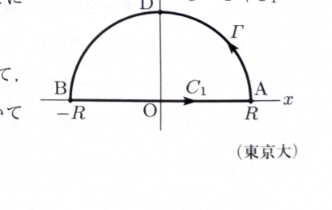

> **前提知識（極・留数・留数定理）**
>
> $z=\alpha$ が $f(z)$ の1位の極であるとき、
>
> $$
> \operatorname{Res}[f,\alpha]
> =
> \lim_{z\to\alpha}(z-\alpha)f(z)
> $$
>
> である。$k$ 位の極であるときは、
>
> $$
> \operatorname{Res}[f,\alpha]
> =
> \frac1{(k-1)!}
> \lim_{z\to\alpha}
> \frac{d^{k-1}}{dz^{k-1}}
> \left\{(z-\alpha)^k f(z)\right\}
> $$
>
> を用いる。
>
> 単純閉曲線 $C$ の内部にある孤立特異点を $\alpha_1,\ldots,\alpha_n$ とすると、留数定理より
>
> $$
> \int_C f(z)\,dz
> =
> 2\pi i
> \sum_{j=1}^n\operatorname{Res}[f,\alpha_j]
> $$
>
> である。

---
問題 272

実積分

$$
J=
\int_0^\infty
\frac{\cos x}{(x^2+1)^2}\,dx
$$

の値を留数定理により求めることを考える。

---

## (1)

$J$ の積分範囲を $(-\infty,\infty)$ と変形して、被積分関数に $e^{ix}$ を用いて $J$ を表せ。

---

## (1) 解答

> $\cos x/(x^2+1)^2$ は偶関数なので、半区間の積分は実軸全体の積分の半分である。さらに $e^{ix}=\cos x+i\sin x$ を用いると、虚部の被積分関数は奇関数となって全実軸上で0になるため、複素指数関数を使った積分で $J$ を表せる。

関数

$$
\frac{\cos x}{(x^2+1)^2}
$$

について、$\cos x$ は偶関数であり、$(x^2+1)^2$ も偶関数である。したがって、商も偶関数である。

偶関数 $g(x)$ について、

$$
\int_{-\infty}^{\infty}g(x)\,dx
=
2\int_0^\infty g(x)\,dx
$$

だから、

$$
J
=
\frac12
\int_{-\infty}^{\infty}
\frac{\cos x}{(x^2+1)^2}\,dx
$$

である。

オイラーの公式は、

$$
e^{ix}=\cos x+i\sin x
$$

である。したがって、

$$
\int_{-\infty}^{\infty}
\frac{e^{ix}}{(x^2+1)^2}\,dx
=
\int_{-\infty}^{\infty}
\frac{\cos x}{(x^2+1)^2}\,dx
+
i
\int_{-\infty}^{\infty}
\frac{\sin x}{(x^2+1)^2}\,dx
$$

である。

ここで、$\sin x$ は奇関数、$(x^2+1)^2$ は偶関数なので、

$$
\frac{\sin x}{(x^2+1)^2}
$$

は奇関数である。したがって、

$$
\int_{-\infty}^{\infty}
\frac{\sin x}{(x^2+1)^2}\,dx
=0
$$

である。

よって、

$$
\int_{-\infty}^{\infty}
\frac{e^{ix}}{(x^2+1)^2}\,dx
=
\int_{-\infty}^{\infty}
\frac{\cos x}{(x^2+1)^2}\,dx
$$

となる。

以上より、

$$
\boxed{
J
=
\frac12
\int_{-\infty}^{\infty}
\frac{e^{ix}}{(x^2+1)^2}\,dx
}
$$

である。

---

## (2)

関数

$$
f(z)=\frac1{(z^2+1)^2}
$$

とする。複素平面において、上半円 $\Gamma$ の半径 $R$ が十分に大きいとき、

$$
\lim_{R\to\infty}
\int_\Gamma f(z)\,dz=0
$$

が成り立つことを示せ。

---

## (2) 解答

> 円弧積分の絶対値を、円弧上での $|f(z)|$ の上界と円弧長の積で評価する。分母は4次の大きさで増える一方、円弧長は1次で増えるため、積は0へ収束する。

上半円弧を、

$$
\Gamma:\ z=Re^{it}
\qquad(0\leq t\leq\pi)
$$

とする。このとき、

$$
dz=iRe^{it}\,dt
$$

であり、

$$
|dz|=R\,dt
$$

である。

円弧上では、

$$
|z|=R
$$

である。逆三角不等式より、

$$
|z^2+1|
\geq
\left||z|^2-1\right|
$$

である。$R>1$ のとき、

$$
|z^2+1|
\geq
R^2-1
$$

となる。

したがって、

$$
|(z^2+1)^2|
=
|z^2+1|^2
\geq
(R^2-1)^2
$$

である。よって、

$$
|f(z)|
=
\frac1{|(z^2+1)^2|}
\leq
\frac1{(R^2-1)^2}
$$

である。

積分の絶対値を評価すると、

$$
\left|
\int_\Gamma f(z)\,dz
\right|
\leq
\int_0^\pi
|f(Re^{it})|\,R\,dt
$$

である。上の評価を代入すると、

$$
\left|
\int_\Gamma f(z)\,dz
\right|
\leq
\int_0^\pi
\frac{R}{(R^2-1)^2}\,dt
$$

$$
=
\frac{\pi R}{(R^2-1)^2}
$$

となる。

ここで、

$$
\lim_{R\to\infty}
\frac{\pi R}{(R^2-1)^2}
=0
$$

だから、はさみうちの原理より、

$$
\boxed{
\lim_{R\to\infty}
\int_\Gamma f(z)\,dz=0
}
$$

である。

> 第(3)問で実際に使う関数は $f(z)e^{iz}$ である。上半円では $|e^{iz}|=e^{-R\sin t}\leq1$ なので、同じ上界
>
> $$
> |f(z)e^{iz}|\leq|f(z)|
> $$
>
> を使うことができる。

---

## (3)

右図の閉曲線 $C=\Gamma+C_1$ に関する周回積分を考えることにより、$J$ の値を求めよ。このとき、複素平面の上半平面において、

$$
\lim_{R\to\infty}
\int_\Gamma f(z)e^{iz}\,dz=0
$$

であることを用いてよい。

---

## (3) 解答

> 第(1)問で $J$ を複素指数関数を含む全実軸積分に直した。そこで
>
> $$
> g(z)=\frac{e^{iz}}{(z^2+1)^2}
> $$
>
> を上半円積分路で積分する。上半平面内の極 $z=i$ は2位の極なので、2位の極の留数公式を用いる。

複素関数を

$$
g(z)
=
f(z)e^{iz}
=
\frac{e^{iz}}{(z^2+1)^2}
$$

とする。

分母を因数分解すると、

$$
(z^2+1)^2
=
(z-i)^2(z+i)^2
$$

である。したがって、$g(z)$ の極は、

$$
z=i,\qquad z=-i
$$

であり、どちらも2位の極である。

上半平面内にある極は、

$$
z=i
$$

だけである。

2位の極の留数公式は、

$$
\operatorname{Res}[g,i]
=
\lim_{z\to i}
\frac{d}{dz}
\left\{
(z-i)^2g(z)
\right\}
$$

である。

$g(z)$ を代入すると、

$$
(z-i)^2g(z)
=
\frac{e^{iz}}{(z+i)^2}
$$

だから、

$$
\operatorname{Res}[g,i]
=
\lim_{z\to i}
\frac{d}{dz}
\left\{
\frac{e^{iz}}{(z+i)^2}
\right\}
$$

である。

積の形

$$
e^{iz}(z+i)^{-2}
$$

として微分する。積の微分公式

$$
(uv)'=u'v+uv'
$$

を用いると、

$$
\frac{d}{dz}
\left\{
e^{iz}(z+i)^{-2}
\right\}
=
ie^{iz}(z+i)^{-2}
-2e^{iz}(z+i)^{-3}
$$

である。

したがって、

$$
\operatorname{Res}[g,i]
=
\lim_{z\to i}
\left\{
\frac{ie^{iz}}{(z+i)^2}
-
\frac{2e^{iz}}{(z+i)^3}
\right\}
$$

となる。

ここで、

$$
e^{i\cdot i}=e^{-1}=\frac1e
$$

および

$$
i+i=2i
$$

である。これらを代入すると、

$$
\operatorname{Res}[g,i]
=
\frac{i/e}{(2i)^2}
-
\frac{2/e}{(2i)^3}
$$

である。

まず、

$$
(2i)^2=4i^2=-4
$$

だから、第1項は、

$$
\frac{i/e}{(2i)^2}
=
-\frac{i}{4e}
$$

である。

次に、

$$
(2i)^3=8i^3=-8i
$$

だから、第2項を符号も含めて計算すると、

$$
-\frac{2/e}{(2i)^3}
=
-\frac{2/e}{-8i}
$$

$$
=
\frac1{4ei}
$$

である。$1/i=-i$ なので、

$$
\frac1{4ei}
=
-\frac{i}{4e}
$$

である。

したがって、

$$
\operatorname{Res}[g,i]
=
-\frac{i}{4e}
-\frac{i}{4e}
$$

$$
=
-\frac{i}{2e}
$$

である。これは、

$$
-\frac{i}{2e}
=
\frac1{2ei}
$$

とも書ける。

留数定理より、

$$
\int_Cg(z)\,dz
=
2\pi i\operatorname{Res}[g,i]
$$

である。留数を代入すると、

$$
\int_Cg(z)\,dz
=
2\pi i
\left(
-\frac{i}{2e}
\right)
$$

$$
=
\frac{\pi}{e}
$$

となる。

一方、閉曲線 $C$ は実軸上の線分 $C_1$ と上半円弧 $\Gamma$ からなるので、

$$
\int_Cg(z)\,dz
=
\int_{-R}^{R}
\frac{e^{ix}}{(x^2+1)^2}\,dx
+
\int_\Gamma
\frac{e^{iz}}{(z^2+1)^2}\,dz
$$

である。

$R\to\infty$ とすると、問題で使用を許された評価より、

$$
\int_\Gamma
\frac{e^{iz}}{(z^2+1)^2}\,dz
\longrightarrow0
$$

である。したがって、

$$
\int_{-\infty}^{\infty}
\frac{e^{ix}}{(x^2+1)^2}\,dx
=
\frac{\pi}{e}
$$

となる。

第(1)問より、

$$
J
=
\frac12
\int_{-\infty}^{\infty}
\frac{e^{ix}}{(x^2+1)^2}\,dx
$$

である。ここに求めた値を代入すると、

$$
J
=
\frac12\cdot\frac{\pi}{e}
$$

である。

したがって、

$$
\boxed{
J=
\int_0^\infty
\frac{\cos x}{(x^2+1)^2}\,dx
=
\frac{\pi}{2e}
}
$$

である。
