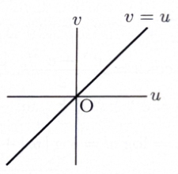

> **前提知識（極形式とオイラーの公式）**
>
> 複素数 $z=x+iy$ は、絶対値 $r=|z|$ と偏角 $\theta$ を用いて
>
> $$
> z=re^{i\theta}=r(\cos\theta+i\sin\theta)
> $$
>
> と表せる。偏角は $2\pi$ の整数倍だけ異なっても同じ複素数を表すため、
>
> $$
> r_1e^{i\theta_1}=r_2e^{i\theta_2}
> $$
>
> ならば
>
> $$
> r_1=r_2,\qquad \theta_1=\theta_2+2k\pi\quad(k\in\mathbb Z)
> $$
>
> である。積や累乗は極形式で扱うと、
>
> $$
> (re^{i\theta})^n=r^ne^{in\theta}
> $$
>
> となる。

---
例題 85

複素数 $z$ について、以下の設問に答えよ。

---

## (1)

方程式

$$
z^3=27
$$

を解け。

---

## (1) 解答

> 3乗を含む方程式なので、直交形式 $z=x+iy$ を代入して実部・虚部を比較する方法もある。しかし、その方法では3次式を展開する必要がある。今回は累乗が簡単になる極形式を用いるのが最も自然である。

$z$ を極形式で

$$
z=re^{i\theta}\qquad(r>0,\ 0\leq\theta<2\pi)
$$

とおく。すると、

$$
z^3=r^3e^{3i\theta}
$$

である。

一方、右辺の $27$ は

$$
27=3^3e^{2k\pi i}\qquad(k\in\mathbb Z)
$$

と表せる。したがって、

$$
r^3e^{3i\theta}=3^3e^{2k\pi i}
$$

である。

絶対値を比較すると、

$$
r^3=3^3
$$

より、

$$
r=3
$$

である。

偏角を比較すると、

$$
3\theta=2k\pi
$$

より、

$$
\theta=\frac{2k\pi}{3}
$$

である。

$0\leq\theta<2\pi$ の範囲で異なる解を与えるのは $k=0,1,2$ である。したがって、

$$
\theta=0,\quad \frac{2\pi}{3},\quad \frac{4\pi}{3}
$$

となる。

それぞれを

$$
z=r(\cos\theta+i\sin\theta)
$$

に代入する。

まず $\theta=0$ のとき、

$$
z=3(\cos0+i\sin0)=3
$$

である。

次に $\theta=\frac{2\pi}{3}$ のとき、

$$
z=3\left(\cos\frac{2\pi}{3}+i\sin\frac{2\pi}{3}\right)
$$

であり、

$$
\cos\frac{2\pi}{3}=-\frac12,\qquad
\sin\frac{2\pi}{3}=\frac{\sqrt3}{2}
$$

だから、

$$
z=-\frac32+\frac{3\sqrt3}{2}i
$$

である。

最後に $\theta=\frac{4\pi}{3}$ のとき、

$$
z=3\left(\cos\frac{4\pi}{3}+i\sin\frac{4\pi}{3}\right)
$$

であり、

$$
\cos\frac{4\pi}{3}=-\frac12,\qquad
\sin\frac{4\pi}{3}=-\frac{\sqrt3}{2}
$$

だから、

$$
z=-\frac32-\frac{3\sqrt3}{2}i
$$

である。

したがって、すべての解は

$$
\boxed{
z=3,\quad
-\frac32+\frac{3\sqrt3}{2}i,\quad
-\frac32-\frac{3\sqrt3}{2}i
}
$$

である。

---

## (2)

$z$ が複素平面上の原点を中心とする半径 $1$ の円周上を動くとき、一次変換

$$
w=\frac{1+iz}{1+z}
$$

により得られる $w$ の軌跡を描け。

---

## (2) 解答

> 一次分数変換の軌跡は、$z$ を $w$ で表し、もとの条件 $|z|=1$ に代入して求める方法が標準的である。幾何学的には「2点からの距離が等しい点の集合」として直ちに垂直二等分線を得る方法もあるが、ここでは式変形によって確実に導く。

与式

$$
w=\frac{1+iz}{1+z}
$$

の両辺に $1+z$ を掛けると、

$$
w(1+z)=1+iz
$$

である。展開して、

$$
w+wz=1+iz
$$

となる。$z$ を含む項を一方にまとめると、

$$
wz-iz=1-w
$$

すなわち、

$$
(w-i)z=1-w
$$

である。したがって、

$$
z=\frac{1-w}{w-i}
$$

を得る。

もとの条件は

$$
|z|=1
$$

である。ここに $z$ の式を代入すると、

$$
\left|\frac{1-w}{w-i}\right|=1
$$

である。絶対値の商の性質

$$
\left|\frac{a}{b}\right|=\frac{|a|}{|b|}
$$

を用いると、

$$
\frac{|1-w|}{|w-i|}=1
$$

したがって、

$$
|w-1|=|w-i|
$$

となる。

> この式は、$w$ が複素平面上の点 $1$ と点 $i$ から等距離にあることを表す。したがって、軌跡は点 $1$ と点 $i$ を結ぶ線分の垂直二等分線である。

式で確認するため、

$$
w=u+iv\qquad(u,v\in\mathbb R)
$$

とおく。すると、

$$
w-1=(u-1)+iv
$$

および

$$
w-i=u+i(v-1)
$$

であるから、

$$
|w-1|^2=(u-1)^2+v^2
$$

および

$$
|w-i|^2=u^2+(v-1)^2
$$

である。

条件

$$
|w-1|^2=|w-i|^2
$$

に代入すると、

$$
(u-1)^2+v^2=u^2+(v-1)^2
$$

である。両辺を展開して、

$$
u^2-2u+1+v^2=u^2+v^2-2v+1
$$

となる。共通項を消すと、

$$
-2u=-2v
$$

より、

$$
v=u
$$

を得る。

したがって、$w$ の軌跡は

$$
\boxed{v=u}
$$

という直線である。

