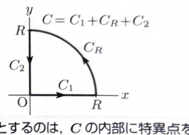

> **前提知識（極・留数・留数定理）**
>
> $z=\alpha$ が $f(z)$ の1位の極であるとき、
>
> $$
> \operatorname{Res}[f,\alpha]
> =
> \lim_{z\to\alpha}(z-\alpha)f(z)
> $$
>
> である。$k$ 位の極であるときは、
>
> $$
> \operatorname{Res}[f,\alpha]
> =
> \frac1{(k-1)!}
> \lim_{z\to\alpha}
> \frac{d^{k-1}}{dz^{k-1}}
> \left\{(z-\alpha)^k f(z)\right\}
> $$
>
> を用いる。
>
> 単純閉曲線 $C$ の内部にある孤立特異点を $\alpha_1,\ldots,\alpha_n$ とすると、留数定理より
>
> $$
> \int_C f(z)\,dz
> =
> 2\pi i
> \sum_{j=1}^n\operatorname{Res}[f,\alpha_j]
> $$
>
> である。

> **前提知識（積分の絶対値評価）**
>
> 曲線 $C:z=z(t)$（$a\leq t\leq b$）に沿う複素積分について、
>
> $$
> \left|\int_C f(z)\,dz\right|
> \leq
> \int_a^b
> |f(z(t))|\,|z'(t)|\,dt
> $$
>
> が成り立つ。半径 $R$ の円弧では、分母の大きさを下から評価し、円弧上の積分が $R\to\infty$ で0になることを示す。

---
例題 91

実積分

$$
\int_0^\infty\frac{x}{1+x^4}\,dx
$$

を、留数の定理を用いて求めたい。適切な複素平面での積分路を定めて図示し、積分値を求めよ。

---

解答

> 被積分関数を
>
> $$
> f(z)=\frac{z}{1+z^4}
> $$
>
> とすると、$f(iz)$ と $f(z)$ の関係により、実軸と虚軸上の積分が同じ実積分へまとまる。したがって、第1象限の扇形積分路を用いる。上半円全体を使う方法もあるが、奇関数的な性質によって実軸上の積分が打ち消し合うため、第1象限の4分円が適している。

複素関数を

$$
f(z)=\frac{z}{1+z^4}
$$

とする。

積分路を次の3つの部分からなる閉曲線 $C$ とする。

$$
C_1:\ z=t
\qquad(0\leq t\leq R)
$$

$$
C_R:\ z=Re^{it}
\qquad\left(0\leq t\leq\frac{\pi}{2}\right)
$$

$$
C_2:\ z=it
\qquad(R\geq t\geq0)
$$

すなわち、

$$
C=C_1+C_R+C_2
$$

である。ただし、$R>1$ とする。

まず、$f(z)$ の特異点を求める。分母が0となる条件は、

$$
1+z^4=0
$$

すなわち、

$$
z^4=-1
$$

である。

$-1$ の極形式は、

$$
-1=e^{i(\pi+2n\pi)}
$$

である。したがって、4乗根は、

$$
z=e^{i(2n+1)\pi/4}
\qquad(n=0,1,2,3)
$$

である。

第1象限の積分路内部にある特異点は、

$$
z_0=e^{i\pi/4}
$$

だけである。

$z_0$ は1位の極である。分母

$$
h(z)=1+z^4
$$

の導関数は、

$$
h'(z)=4z^3
$$

である。分子を

$$
g(z)=z
$$

とすると、単純零点に対する留数公式

$$
\operatorname{Res}\left[\frac{g}{h},z_0\right]
=
\frac{g(z_0)}{h'(z_0)}
$$

より、

$$
\operatorname{Res}[f,z_0]
=
\frac{z_0}{4z_0^3}
$$

$$
=
\frac1{4z_0^2}
$$

である。

ここで、

$$
z_0=e^{i\pi/4}
$$

だから、

$$
z_0^2=e^{i\pi/2}=i
$$

である。したがって、

$$
\operatorname{Res}[f,z_0]
=
\frac1{4i}
$$

となる。

留数定理より、

$$
\int_Cf(z)\,dz
=
2\pi i\operatorname{Res}[f,z_0]
$$

である。留数を代入すると、

$$
\int_Cf(z)\,dz
=
2\pi i\cdot\frac1{4i}
$$

$$
=
\frac\pi2
$$

となる。

次に、閉曲線上の積分を各部分へ分ける。

$$
\int_Cf(z)\,dz
=
\int_{C_1}f(z)\,dz
+
\int_{C_R}f(z)\,dz
+
\int_{C_2}f(z)\,dz
$$

である。

$C_1$ 上では、

$$
z=t,\qquad dz=dt
$$

だから、

$$
\int_{C_1}f(z)\,dz
=
\int_0^R\frac{t}{1+t^4}\,dt
$$

である。

$C_2$ は $iR$ から0へ向かうので、

$$
z=it,\qquad R\geq t\geq0,\qquad dz=i\,dt
$$

とおく。すると、

$$
z^4=(it)^4=t^4
$$

であり、

$$
f(it)
=
\frac{it}{1+t^4}
$$

である。したがって、

$$
\int_{C_2}f(z)\,dz
=
\int_R^0
\frac{it}{1+t^4}i\,dt
$$

$$
=
\int_R^0
\frac{-t}{1+t^4}\,dt
$$

$$
=
\int_0^R
\frac{t}{1+t^4}\,dt
$$

となる。

よって、

$$
\int_{C_1}f(z)\,dz
+
\int_{C_2}f(z)\,dz
=
2\int_0^R\frac{t}{1+t^4}\,dt
$$

である。

次に円弧 $C_R$ 上の積分を評価する。$C_R$ では、

$$
z=Re^{it},
\qquad
0\leq t\leq\frac{\pi}{2}
$$

であり、

$$
dz=iRe^{it}\,dt
$$

である。

積分の絶対値は、

$$
\left|
\int_{C_R}\frac{z}{1+z^4}\,dz
\right|
\leq
\int_0^{\pi/2}
\left|
\frac{Re^{it}}{1+R^4e^{4it}}
iRe^{it}
\right|dt
$$

である。

分子の絶対値は、

$$
|Re^{it}\cdot iRe^{it}|=R^2
$$

である。また、逆三角不等式より、

$$
|1+R^4e^{4it}|
\geq
\left||R^4e^{4it}|-|1|\right|
=R^4-1
$$

である。したがって、

$$
\left|
\int_{C_R}\frac{z}{1+z^4}\,dz
\right|
\leq
\int_0^{\pi/2}
\frac{R^2}{R^4-1}\,dt
$$

$$
=
\frac{\pi}{2}\frac{R^2}{R^4-1}
$$

となる。

ここで、

$$
\lim_{R\to\infty}
\frac{\pi}{2}\frac{R^2}{R^4-1}
=0
$$

だから、

$$
\lim_{R\to\infty}
\int_{C_R}\frac{z}{1+z^4}\,dz
=0
$$

である。

以上より、

$$
\frac\pi2
=
2\int_0^R\frac{t}{1+t^4}\,dt
+
\int_{C_R}\frac{z}{1+z^4}\,dz
$$

である。$R\to\infty$ とすると、

$$
\frac\pi2
=
2\int_0^\infty\frac{x}{1+x^4}\,dx
$$

となる。両辺を $2$ で割って、

$$
\boxed{
\int_0^\infty\frac{x}{1+x^4}\,dx
=
\frac\pi4
}
$$

である。

> 実変数だけでも、
>
> $$
> u=x^2,\qquad du=2x\,dx
> $$
>
> と置けば
>
> $$
> \int_0^\infty\frac{x}{1+x^4}\,dx
> =
> \frac12\int_0^\infty\frac{du}{1+u^2}
> =
> \frac\pi4
> $$
>
> と確認できる。
