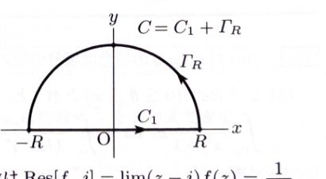

> **前提知識（極・留数・留数定理）**
>
> $z=\alpha$ が $f(z)$ の1位の極であるとき、
>
> $$
> \operatorname{Res}[f,\alpha]
> =
> \lim_{z\to\alpha}(z-\alpha)f(z)
> $$
>
> である。$k$ 位の極であるときは、
>
> $$
> \operatorname{Res}[f,\alpha]
> =
> \frac1{(k-1)!}
> \lim_{z\to\alpha}
> \frac{d^{k-1}}{dz^{k-1}}
> \left\{(z-\alpha)^k f(z)\right\}
> $$
>
> を用いる。
>
> 単純閉曲線 $C$ の内部にある孤立特異点を $\alpha_1,\ldots,\alpha_n$ とすると、留数定理より
>
> $$
> \int_C f(z)\,dz
> =
> 2\pi i
> \sum_{j=1}^n\operatorname{Res}[f,\alpha_j]
> $$
>
> である。

> **前提知識（半円弧上の指数因子）**
>
> 上半円上で
>
> $$
> z=Re^{i\theta}
> \qquad(0\leq\theta\leq\pi)
> $$
>
> とおくと、
>
> $$
> e^{iz}
> =
> e^{iR\cos\theta-R\sin\theta}
> $$
>
> であるため、
>
> $$
> |e^{iz}|=e^{-R\sin\theta}
> $$
>
> となる。上半平面では $\sin\theta\geq0$ なので、この指数因子が円弧積分を減衰させる。

---
例題 92

以下の問いに答えよ。

---

## (1)

$R>0$ に対し、

$$
\Gamma_R
=
\left\{
Re^{i\theta}\mid0\leq\theta\leq\pi
\right\}
$$

とするとき、次を示せ。

$$
\lim_{R\to\infty}
\int_{\Gamma_R}
\frac{z}{z^2+1}e^{iz}\,dz
=
0
$$

---

## (1) 解答

> 円弧上の積分が0へ収束することを示すため、積分の絶対値を評価する。単純に $|e^{iz}|\leq1$ とするだけでは円弧長 $\pi R$ を打ち消せず不十分なので、$e^{-R\sin\theta}$ の減衰を利用する。

円弧上で、

$$
z=Re^{i\theta}
\qquad(0\leq\theta\leq\pi)
$$

とおく。このとき、

$$
dz=iRe^{i\theta}\,d\theta
$$

である。

また、

$$
iz=iRe^{i\theta}
$$

であり、

$$
e^{i\theta}
=
\cos\theta+i\sin\theta
$$

だから、

$$
iz
=
iR\cos\theta-R\sin\theta
$$

である。したがって、

$$
e^{iz}
=
e^{iR\cos\theta-R\sin\theta}
$$

であり、

$$
|e^{iz}|
=
e^{-R\sin\theta}
$$

となる。

積分へパラメータ表示を代入すると、

$$
\int_{\Gamma_R}
\frac{z}{z^2+1}e^{iz}\,dz
=
\int_0^\pi
\frac{Re^{i\theta}}
{R^2e^{2i\theta}+1}
e^{iRe^{i\theta}}
iRe^{i\theta}\,d\theta
$$

である。

絶対値を取ると、

$$
\left|
\int_{\Gamma_R}
\frac{z}{z^2+1}e^{iz}\,dz
\right|
\leq
\int_0^\pi
\frac{R^2e^{-R\sin\theta}}
{|R^2e^{2i\theta}+1|}
\,d\theta
$$

となる。

逆三角不等式より、

$$
|R^2e^{2i\theta}+1|
\geq
R^2-1
$$

である。したがって、$R>1$ に対し、

$$
\left|
\int_{\Gamma_R}
\frac{z}{z^2+1}e^{iz}\,dz
\right|
\leq
\frac{R^2}{R^2-1}
\int_0^\pi
e^{-R\sin\theta}\,d\theta
$$

である。

次に、指数積分を評価する。$\sin(\pi-\theta)=\sin\theta$ なので、

$$
\int_0^\pi
e^{-R\sin\theta}\,d\theta
=
2\int_0^{\pi/2}
e^{-R\sin\theta}\,d\theta
$$

である。

区間

$$
0\leq\theta\leq\frac\pi2
$$

では、

$$
\sin\theta\geq\frac{2}{\pi}\theta
$$

が成り立つ。したがって、

$$
e^{-R\sin\theta}
\leq
e^{-(2R/\pi)\theta}
$$

である。よって、

$$
\int_0^\pi
e^{-R\sin\theta}\,d\theta
\leq
2\int_0^{\pi/2}
e^{-(2R/\pi)\theta}\,d\theta
$$

となる。

右辺を積分すると、

$$
2\int_0^{\pi/2}
e^{-(2R/\pi)\theta}\,d\theta
=
2
\left[
-\frac{\pi}{2R}
e^{-(2R/\pi)\theta}
\right]_0^{\pi/2}
$$

$$
=
\frac{\pi}{R}(1-e^{-R})
$$

である。

したがって、

$$
\left|
\int_{\Gamma_R}
\frac{z}{z^2+1}e^{iz}\,dz
\right|
\leq
\frac{R^2}{R^2-1}
\frac{\pi}{R}(1-e^{-R})
$$

$$
=
\frac{\pi R}{R^2-1}(1-e^{-R})
$$

となる。

ここで、

$$
\lim_{R\to\infty}
\frac{\pi R}{R^2-1}(1-e^{-R})
=0
$$

だから、はさみうちの原理より、

$$
\boxed{
\lim_{R\to\infty}
\int_{\Gamma_R}
\frac{z}{z^2+1}e^{iz}\,dz
=
0
}
$$

である。

---

## (2)

積分

$$
I=
\int_{-\infty}^{\infty}
\frac{x}{x^2+1}\sin x\,dx
$$

の値を求めよ。

---

## (2) 解答

> 第(1)問で円弧積分が0になることを示したので、実軸と上半円からなる閉曲線に留数定理を適用する。$e^{ix}=\cos x+i\sin x$ の虚部を取れば、求める積分が得られる。

複素関数を

$$
f(z)=\frac{z}{z^2+1}e^{iz}
$$

とする。

積分路 $C$ を、実軸上の線分

$$
C_1:\ z=x
\qquad(-R\leq x\leq R)
$$

と上半円弧

$$
\Gamma_R:\ z=Re^{i\theta}
\qquad(0\leq\theta\leq\pi)
$$

からなる正向きの閉曲線

$$
C=C_1+\Gamma_R
$$

とする。

$f(z)$ の特異点は、

$$
z^2+1=0
$$

の解、すなわち、

$$
z=\pm i
$$

である。上半平面内にあるのは、

$$
z=i
$$

だけである。

$z=i$ は1位の極なので、

$$
\operatorname{Res}[f,i]
=
\lim_{z\to i}
(z-i)
\frac{z e^{iz}}{(z-i)(z+i)}
$$

$$
=
\lim_{z\to i}
\frac{z e^{iz}}{z+i}
$$

である。値を代入すると、

$$
\operatorname{Res}[f,i]
=
\frac{i e^{i\cdot i}}{i+i}
$$

である。ここで、

$$
e^{i\cdot i}=e^{-1}=\frac1e
$$

および

$$
i+i=2i
$$

だから、

$$
\operatorname{Res}[f,i]
=
\frac{i/e}{2i}
$$

$$
=
\frac1{2e}
$$

である。

留数定理より、

$$
\int_Cf(z)\,dz
=
2\pi i\operatorname{Res}[f,i]
$$

である。留数を代入すると、

$$
\int_Cf(z)\,dz
=
2\pi i\cdot\frac1{2e}
$$

$$
=
\frac{\pi i}{e}
$$

となる。

一方、

$$
\int_Cf(z)\,dz
=
\int_{-R}^R
\frac{x}{x^2+1}e^{ix}\,dx
+
\int_{\Gamma_R}
\frac{z}{z^2+1}e^{iz}\,dz
$$

である。

$R\to\infty$ とすると、第(1)問より円弧積分は0へ収束する。したがって、

$$
\frac{\pi i}{e}
=
\int_{-\infty}^{\infty}
\frac{x}{x^2+1}e^{ix}\,dx
$$

である。

オイラーの公式

$$
e^{ix}=\cos x+i\sin x
$$

を代入すると、

$$
\frac{\pi i}{e}
=
\int_{-\infty}^{\infty}
\frac{x\cos x}{x^2+1}\,dx
+
i
\int_{-\infty}^{\infty}
\frac{x\sin x}{x^2+1}\,dx
$$

である。

左辺の実部は $0$、虚部は $\pi/e$ である。右辺の虚部を比較すると、

$$
\int_{-\infty}^{\infty}
\frac{x\sin x}{x^2+1}\,dx
=
\frac\pi e
$$

である。

したがって、

$$
\boxed{
I=
\int_{-\infty}^{\infty}
\frac{x}{x^2+1}\sin x\,dx
=
\frac\pi e
}
$$

である。

> 実部の被積分関数
>
> $$
> \frac{x\cos x}{x^2+1}
> $$
>
> は奇関数なので、その積分が0になることとも一致する。
