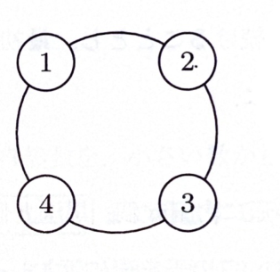

> **前提知識**
>
> さいころで1から4が出る確率は
>
> $$
> \frac{4}{6}=\frac{2}{3}
> $$
>
> であり、このとき右回りに1つ進む。5または6が出る確率は
>
> $$
> \frac{2}{6}=\frac{1}{3}
> $$
>
> であり、このとき左回りに1つ進む。
>
> 2段階ごとの漸化式を解くときも、定常値を引いて等比数列に変形する方法が使える。

---

問題 281

図1のように、4つのマスが円状に並べられた双六を一人で行う。最初、駒は①に置かれている。1から6の目があるさいころを振り、1から4の目が出たとき右回りに一つ進み、5または6の目が出たとき左回りに一つ進む。1から6のさいころの目は等しい確率で出るものとする。$n$ 回さいころを振ったとき駒が①のマスに居る確率を $a(n)$ とする。

---

## (1)

$a(1),a(2)$ を求めよ。

---

## (1) 解答

> **解法選択**
>
> 1回後と2回後は、移動経路を直接列挙するのが最も簡単である。1回で①に戻ることはできず、2回で戻るには右・左または左・右の組合せが必要である。

1回の移動では、①から②または④へ移るため、①にはいない。したがって、

$$
a(1)=0
$$

である。

2回後に①へ戻る経路は、

$$
①\to②\to①
$$

または

$$
①\to④\to①
$$

の2通りである。

右回りの確率は

$$
\frac{2}{3}
$$

左回りの確率は

$$
\frac{1}{3}
$$

である。

したがって、

$$
a(2)
=
\frac{2}{3}\cdot\frac{1}{3}
+
\frac{1}{3}\cdot\frac{2}{3}
$$

$$
=
\frac{2}{9}+\frac{2}{9}
=
\frac{4}{9}
$$

よって、

$$
\boxed{a(1)=0,\qquad a(2)=\frac{4}{9}}
$$

---

## (2)

$a(n)$ を求めよ。

---

## (2) 解答

> **解法選択**
>
> 1回移動するたびにマス番号の偶奇が入れ替わる。したがって、奇数回後には②または④にしかおらず、①にいる確率は0である。偶数回については、2回後に①へ戻る確率を、現在①にいる場合と③にいる場合に分けて漸化式を作る。
>
> 4状態の遷移行列を使う方法もあるが、この問題では偶奇と対称性を使う方が短い。

1回移動するたびに、①・③の組と②・④の組の間を行き来する。最初は①にいるので、$n$ が奇数のときは②または④にいる。したがって、

$$
a(n)=0\qquad(n\text{ が奇数})
$$

である。

次に $n$ が偶数の場合を考える。このとき駒は①または③にいる。

$n$ 回後に①にいる確率は

$$
a(n)
$$

であり、③にいる確率は

$$
1-a(n)
$$

である。

①から2回で①へ戻る確率は、右・左または左・右なので、

$$
\frac{2}{3}\cdot\frac{1}{3}
+
\frac{1}{3}\cdot\frac{2}{3}
=
\frac{4}{9}
$$

である。

③から2回で①へ移るには、右・右または左・左である。したがって、その確率は

$$
\frac{2}{3}\cdot\frac{2}{3}
+
\frac{1}{3}\cdot\frac{1}{3}
=
\frac{4}{9}+\frac{1}{9}
=
\frac{5}{9}
$$

である。

よって、全確率の公式から、

$$
a(n+2)
=
a(n)\cdot\frac{4}{9}
+
(1-a(n))\cdot\frac{5}{9}
$$

整理すると、

$$
a(n+2)
=
\frac{4}{9}a(n)+\frac{5}{9}-\frac{5}{9}a(n)
$$

$$
a(n+2)
=
-\frac{1}{9}a(n)+\frac{5}{9}
$$

である。

定常値 $L$ は

$$
L=-\frac{1}{9}L+\frac{5}{9}
$$

を満たす。整理すると、

$$
\frac{10}{9}L=\frac{5}{9}
$$

$$
L=\frac{1}{2}
$$

である。

したがって、

$$
a(n+2)-\frac{1}{2}
=
-\frac{1}{9}\left(a(n)-\frac{1}{2}\right)
$$

となる。

偶数 $n$ に対して、$n=2m$ とおく。初期値は

$$
a(0)=1
$$

であるから、

$$
a(2m)-\frac{1}{2}
=
\left(-\frac{1}{9}\right)^m
\left(a(0)-\frac{1}{2}\right)
$$

値を代入すると、

$$
a(2m)-\frac{1}{2}
=
\left(-\frac{1}{9}\right)^m
\left(1-\frac{1}{2}\right)
=
\frac{1}{2}
\left(-\frac{1}{9}\right)^m
$$

したがって、

$$
a(2m)
=
\frac{1}{2}
\left\{
1+\left(-\frac{1}{9}\right)^m
\right\}
$$

$n=2m$ なので、

$$
a(n)
=
\frac{1}{2}
\left\{
1+\left(-\frac{1}{9}\right)^{n/2}
\right\}
\qquad(n\text{ が偶数})
$$

以上より、

$$
\boxed{
a(n)=
\begin{cases}
\dfrac{1}{2}\left\{1+\left(-\dfrac{1}{9}\right)^{n/2}\right\}
& (n\text{ が偶数})\\[6pt]
0
& (n\text{ が奇数})
\end{cases}
}
$$

> **補足**
>
> 資料では、②・③・④にいる確率もそれぞれ $b(n),c(n),d(n)$ とおき、1段階ごとの連立漸化式を作る方法にも触れている。たとえば、
>
> $$
> a(n+1)=\frac{2}{3}d(n)+\frac{1}{3}b(n)
> $$
>
> である。今回は偶奇と対称性を利用した2段階漸化式の方が計算量が少ない。
