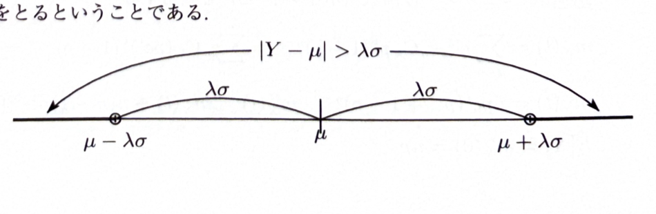

> **前提知識**
>
> 確率変数 $Y$ が値 $y_k$ を確率 $p_k$ でとり、期待値を $\mu$、分散を $\sigma^2$ とすると、
>
> $$
> \mu=\sum_k y_kp_k
> $$
>
> $$
> \sigma^2=\sum_k(y_k-\mu)^2p_k
> $$
>
> である。
>
> チェビシェフの不等式は、任意の $\lambda>0$ に対して
>
> $$
> P(|Y-\mu|>\lambda\sigma)\le\frac1{\lambda^2}
> $$
>
> と表される。

---

問題 292

確率 $p$ で成功し、確率 $1-p$ で失敗する独立な実験を $n$ 回繰り返す。$X_i$ は $i$ 回目の実験が成功したときに $X_i=1$、失敗したときに $X_i=0$ となる確率変数とする。

---

## (1)

「確率変数 $X_1,X_2,\ldots,X_n$ が独立である」ことの定義を述べよ。

---

## (1) 解答

> **解法選択**
>
> 独立性は、単に各変数の相関が0という意味ではない。任意の部分集合と、それぞれの変数に関する任意の事象について、同時確率が積に分解することを述べる。

事象 $A_1,A_2,\ldots,A_n$ について、任意に選んだ添字

$$
i_1,i_2,\ldots,i_r
$$

に対して、

$$
P(A_{i_1}\cap A_{i_2}\cap\cdots\cap A_{i_r})
=
P(A_{i_1})P(A_{i_2})\cdots P(A_{i_r})
$$

が成り立つとき、事象 $A_1,\ldots,A_n$ は独立であるという。

確率変数 $X_1,\ldots,X_n$ について、各 $X_j$ に関する任意の事象を $A_j$ とするとき、それらの事象が上の意味で独立であるならば、確率変数 $X_1,\ldots,X_n$ は独立であるという。

したがって定義は、

$$
\boxed{
\text{任意の部分集合の各変数に関する事象の同時確率が、各確率の積に等しいこと}
}
$$

である。

---

## (2)

確率変数 $Y$ が確率 $p_1,p_2,\ldots,p_n$ で値 $y_1,y_2,\ldots,y_n$ をとるとき、その期待値を $\mu$、分散を $\sigma^2$ とする。任意の正の実数 $\lambda$ に対して、

$$
P(|Y-\mu|>\lambda\sigma)\le\frac1{\lambda^2}
$$

を、分散 $\sigma^2$ の定義を変形することにより示せ。

---

## (2) 解答

> **解法選択**
>
> 分散の和を、平均から $\lambda\sigma$ より離れた値と、それ以外の値に分ける。離れた値では $(y_k-\mu)^2>\lambda^2\sigma^2$ なので、その部分の確率和を下から評価できる。
>
> マルコフの不等式を $Z=(Y-\mu)^2$ に適用する方法もあるが、この小問は分散の定義からの変形を要求しているため、直接証明する。

分散の定義は

$$
\sigma^2
=
\sum_{k=1}^{n}(y_k-\mu)^2p_k
$$

である。

この和を、次の3つの範囲に分ける。

1. $y_k<\mu-\lambda\sigma$
2. $\mu-\lambda\sigma\le y_k\le\mu+\lambda\sigma$
3. $y_k>\mu+\lambda\sigma$

したがって、

$$
\sigma^2
=
\sum_{y_k<\mu-\lambda\sigma}(y_k-\mu)^2p_k
+
\sum_{\mu-\lambda\sigma\le y_k\le\mu+\lambda\sigma}(y_k-\mu)^2p_k
+
\sum_{y_k>\mu+\lambda\sigma}(y_k-\mu)^2p_k
$$

である。

中央の和は非負なので、それを取り除けば、

$$
\sigma^2
\ge
\sum_{y_k<\mu-\lambda\sigma}(y_k-\mu)^2p_k
+
\sum_{y_k>\mu+\lambda\sigma}(y_k-\mu)^2p_k
$$

である。

外側の範囲では、

$$
|y_k-\mu|>\lambda\sigma
$$

なので、

$$
(y_k-\mu)^2>\lambda^2\sigma^2
$$

である。したがって、

$$
\sigma^2
\ge
\sum_{y_k<\mu-\lambda\sigma}\lambda^2\sigma^2p_k
+
\sum_{y_k>\mu+\lambda\sigma}\lambda^2\sigma^2p_k
$$

$$
=
\lambda^2\sigma^2
\left(
\sum_{y_k<\mu-\lambda\sigma}p_k
+
\sum_{y_k>\mu+\lambda\sigma}p_k
\right)
$$

括弧内は

$$
P(|Y-\mu|>\lambda\sigma)
$$

であるから、

$$
\sigma^2
\ge
\lambda^2\sigma^2P(|Y-\mu|>\lambda\sigma)
$$

である。

$\sigma^2>0$ の場合、両辺を $\lambda^2\sigma^2$ で割ると、

$$
P(|Y-\mu|>\lambda\sigma)
\le
\frac1{\lambda^2}
$$

となる。$\sigma^2=0$ なら $Y=\mu$ が確率1であり、左辺は0なので不等式は自明に成り立つ。

したがって、

$$
\boxed{
P(|Y-\mu|>\lambda\sigma)\le\frac1{\lambda^2}
}
$$

である。

---

## (3)

(2)で得られた不等式を用いて、成功確率が $0.5$ の独立な試行を $n$ 回行ったとき、「成功割合が40%以上で、かつ60%以下となる」確率が $0.99$ 以上となるような $n$ の下限を示せ。

---

## (3) 解答

> **解法選択**
>
> 成功回数 $Y$ は二項分布 $B(n,0.5)$ に従う。成功割合が40%から60%の範囲とは、成功回数が平均 $0.5n$ から $0.1n$ 以内にあることを意味する。チェビシェフの不等式で、この区間に入る確率を下から0.99以上にする。
>
> 正規近似ならより小さい必要回数を得られるが、この問題はチェビシェフの不等式による保証を求めている。

成功回数を $Y$ とする。二項分布の平均と分散の一般式は

$$
E[Y]=np
$$

$$
V[Y]=np(1-p)
$$

である。

ここで

$$
p=0.5
$$

を代入すると、

$$
\mu=E[Y]=n\cdot0.5=0.5n
$$

$$
\sigma^2=V[Y]=n\cdot0.5\cdot0.5=0.25n
$$

である。

求める事象は

$$
0.4n\le Y\le0.6n
$$

である。これは平均からの距離で書くと、

$$
|Y-\mu|\le0.1n
$$

である。

チェビシェフの不等式は

$$
P(|Y-\mu|>\lambda\sigma)\le\frac1{\lambda^2}
$$

である。

区間外の確率を0.01以下にしたいので、

$$
\frac1{\lambda^2}=0.01
$$

とおく。すると、

$$
\lambda^2=100
$$

$$
\lambda=10
$$

である。

したがって、

$$
P(|Y-\mu|>10\sigma)\le0.01
$$

より、

$$
P(|Y-\mu|\le10\sigma)\ge0.99
$$

である。

区間

$$
|Y-\mu|\le10\sigma
$$

が、求める区間

$$
|Y-\mu|\le0.1n
$$

に含まれるためには、

$$
10\sigma\le0.1n
$$

であればよい。

両辺を2乗すると、

$$
(10\sigma)^2\le(0.1n)^2
$$

である。

$\sigma^2=0.25n$ を代入すると、

$$
100\cdot0.25n\le0.01n^2
$$

$$
25n\le0.01n^2
$$

$n>0$ なので両辺を $n$ で割ると、

$$
25\le0.01n
$$

したがって、

$$
n\ge2500
$$

である。

よって、チェビシェフの不等式によって保証される最小の下限は

$$
\boxed{n\ge2500}
$$

すなわち最低必要実験回数は

$$
\boxed{2500\text{回}}
$$

である。
