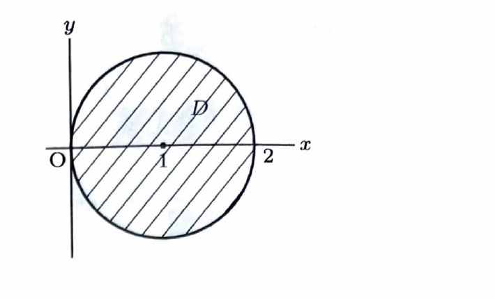

問題 305

2重積分

$$
\iint_D x^2\,dx\,dy
$$

を求めよ。ただし、

$$
D=\{(x,y)\mid x^2+y^2\le 2x\}
$$

とする。

（信州大）

---

## 解答

> 領域 $D$ の境界は円であり、被積分関数 $x^2$ も極座標で簡単に表せる。そのため、直交座標のまま $y$ の上下端を平方根で表す方法より、極座標変換を用いる方が計算しやすい。
>
> 別の方法として、円の中心を原点に移す変数変換 $X=x-1$, $Y=y$ を用いることもできる。しかし、その場合は被積分関数が $(X+1)^2$ となる。対称性を利用すれば解けるが、今回は資料の解答に沿って極座標を用いる。
>
> まず領域の不等式
>
> $$
> x^2+y^2\le 2x
> $$
>
> を平方完成すると、
>
> $$
> x^2-2x+y^2\le0
> $$
>
> $$
> (x-1)^2-1+y^2\le0
> $$
>
> $$
> (x-1)^2+y^2\le1
> $$
>
> となる。したがって、$D$ は中心 $(1,0)$、半径 $1$ の円盤である。
>
> 資料に示された領域図は次のとおりである。

> 極座標変換
>
> $$
> x=r\cos\theta,
> \qquad
> y=r\sin\theta
> $$
>
> を用いる。
>
> このとき、
>
> $$
> x^2+y^2=r^2
> $$
>
> なので、領域条件は
>
> $$
> r^2\le2r\cos\theta
> $$
>
> となる。極座標では $r\ge0$ であるため、$r=0$ を含めて
>
> $$
> 0\le r\le2\cos\theta
> $$
>
> と表せる。
>
> 上端 $2\cos\theta$ が非負である必要があるから、
>
> $$
> \cos\theta\ge0
> $$
>
> すなわち、
>
> $$
> -\frac{\pi}{2}\le\theta\le\frac{\pi}{2}
> $$
>
> である。
>
> 極座標変換のヤコビアンは
>
> $$
> \left|
> \frac{\partial(x,y)}{\partial(r,\theta)}
> \right|
> =r
> $$
>
> なので、面積要素は
>
> $$
> dx\,dy=r\,dr\,d\theta
> $$
>
> となる。
>
> また、被積分関数は
>
> $$
> x^2=(r\cos\theta)^2=r^2\cos^2\theta
> $$
>
> である。したがって、
>
> $$
> x^2\,dx\,dy
> =
> r^2\cos^2\theta\cdot r\,dr\,d\theta
> =
> r^3\cos^2\theta\,dr\,d\theta
> $$
>
> となる。
>
> よって、
>
> $$
> \iint_Dx^2\,dx\,dy
> =
> \int_{-\frac{\pi}{2}}^{\frac{\pi}{2}}
> \int_0^{2\cos\theta}
> r^3\cos^2\theta\,dr\,d\theta
> $$
>
> である。
>
> まず $r$ について積分する。$\cos^2\theta$ は $r$ に関して定数なので、
>
> $$
> \int_0^{2\cos\theta}r^3\cos^2\theta\,dr
> =
> \cos^2\theta
> \left[\frac14r^4\right]_0^{2\cos\theta}
> $$
>
> である。上端を代入すると、
>
> $$
> \cos^2\theta\cdot
> \frac14(2\cos\theta)^4
> =
> \cos^2\theta\cdot
> \frac14\cdot16\cos^4\theta
> =
> 4\cos^6\theta
> $$
>
> となる。
>
> したがって、
>
> $$
> \iint_Dx^2\,dx\,dy
> =
> 4\int_{-\frac{\pi}{2}}^{\frac{\pi}{2}}\cos^6\theta\,d\theta
> $$
>
> である。
>
> $\cos^6\theta$ は偶関数なので、
>
> $$
> \int_{-a}^{a}\cos^6\theta\,d\theta
> =
> 2\int_0^a\cos^6\theta\,d\theta
> $$
>
> が成り立つ。したがって、
>
> $$
> 4\int_{-\frac{\pi}{2}}^{\frac{\pi}{2}}\cos^6\theta\,d\theta
> =
> 8\int_0^{\frac{\pi}{2}}\cos^6\theta\,d\theta
> $$
>
> となる。
>
> 偶数乗の余弦積分には漸化式
>
> $$
> \int_0^{\frac{\pi}{2}}\cos^n\theta\,d\theta
> =
> \frac{n-1}{n}
> \int_0^{\frac{\pi}{2}}\cos^{n-2}\theta\,d\theta
> \qquad (n\ge2)
> $$
>
> を用いる。まず $n=6$ を代入すると、
>
> $$
> \int_0^{\frac{\pi}{2}}\cos^6\theta\,d\theta
> =
> \frac56
> \int_0^{\frac{\pi}{2}}\cos^4\theta\,d\theta
> $$
>
> である。次に $n=4$ を代入すると、
>
> $$
> \int_0^{\frac{\pi}{2}}\cos^4\theta\,d\theta
> =
> \frac34
> \int_0^{\frac{\pi}{2}}\cos^2\theta\,d\theta
> $$
>
> である。さらに $n=2$ を代入すると、
>
> $$
> \int_0^{\frac{\pi}{2}}\cos^2\theta\,d\theta
> =
> \frac12
> \int_0^{\frac{\pi}{2}}1\,d\theta
> =
> \frac12\cdot\frac{\pi}{2}
> $$
>
> である。したがって、
>
> $$
> \int_0^{\frac{\pi}{2}}\cos^6\theta\,d\theta
> =
> \frac56\cdot\frac34\cdot\frac12\cdot\frac{\pi}{2}
> =
> \frac{5\pi}{32}
> $$
>
> となる。
>
> よって、
>
> $$
> 8\int_0^{\frac{\pi}{2}}\cos^6\theta\,d\theta
> =
> 8\cdot\frac{5\pi}{32}
> =
> \frac{5\pi}{4}
> $$
>
> である。

以上より、

$$
\boxed{\displaystyle \iint_Dx^2\,dx\,dy=\frac{5\pi}{4}}
$$
