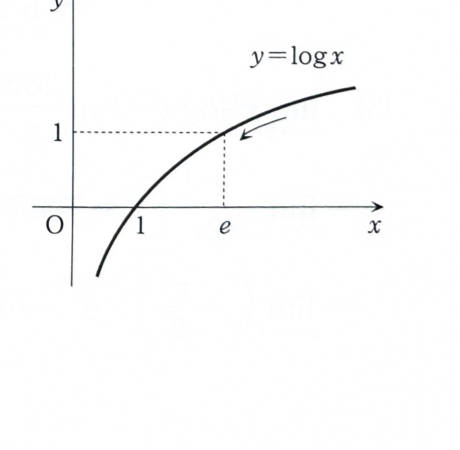

指数にも底にも変数を含む極限では、直接には $\dfrac00$ 型や $\dfrac{\infty}{\infty}$ 型にならないことがある。その場合、正の量

$$
y=M(x)^{r(x)}
$$

に対して対数を取り、

$$
\log y=r(x)\log M(x)
$$

と変形すると、ロピタルの定理を使える形になることが多い。

> 対数の極限から元の極限へ戻すときは、指数関数の連続性を使う。すなわち、$\log y\to L$ なら $y\to e^L$ である。

---
例題 1-5（ロピタルの定理 ②）

次の極限値を求めよ。

$$
\lim_{x\to+0}\left(\frac1x\right)^{\sin x}
$$

---
## 解答

> 底 $\dfrac1x$ は $+\infty$、指数 $\sin x$ は $0$ に近づくため、全体は $\infty^0$ 型の不定形である。直接ロピタルの定理を使うことはできないので、対数を取って積を分数へ直す方法を選ぶ。
>
> $\sin x\sim x$ を用いて
>
> $$
> \left(\frac1x\right)^{\sin x}
> \approx
> \left(\frac1x\right)^x
> $$
>
> と考える方法もあるが、近似の正当化が必要になる。対数を取る方法なら厳密に計算できる。

求める式を

$$
y=\left(\frac1x\right)^{\sin x}
$$

とおく。$x\to+0$ では $x>0$ なので $y>0$ であり、対数を取ることができる。

対数の公式

$$
\log(M^r)=r\log M
$$

を使うと、

$$
\log y
=
\sin x\log\left(\frac1x\right)
$$

となる。

さらに、

$$
\log\left(\frac1x\right)=-\log x
$$

なので、

$$
\log y=-\sin x\log x
$$

である。

$x\to+0$ のとき、$\sin x\to0$、$\log x\to-\infty$ なので、積の形では不定形である。分数形にすると、

$$
-\sin x\log x
=
-\frac{\log x}{(\sin x)^{-1}}
$$

である。

したがって、

$$
\lim_{x\to+0}\log y
=
\lim_{x\to+0}
\left\{
-\frac{\log x}{(\sin x)^{-1}}
\right\}
$$

となる。

分子・分母の絶対値はいずれも無限大に発散するので、ロピタルの定理を用いる。

分子の微分前の式は

$$
-\log x
$$

であり、その導関数は

$$
-\frac1x=-x^{-1}
$$

である。

分母の微分前の式は

$$
(\sin x)^{-1}
$$

である。合成関数の微分より、

$$
\frac{d}{dx}(\sin x)^{-1}
=
-(\sin x)^{-2}\cos x
$$

である。

したがって、

$$
\lim_{x\to+0}\log y
=
\lim_{x\to+0}
\frac{-x^{-1}}{-(\sin x)^{-2}\cos x}
$$

となる。

分数を整理すると、

$$
\frac{-x^{-1}}{-(\sin x)^{-2}\cos x}
=
\frac{\sin^2 x}{x\cos x}
$$

である。

さらに、

$$
\frac{\sin^2 x}{x\cos x}
=
\tan x\cdot\frac{\sin x}{x}
$$

と変形できる。

基本極限

$$
\lim_{x\to0}\frac{\sin x}{x}=1
$$

および $\tan x\to0$ より、

$$
\lim_{x\to+0}\log y
=
0\cdot1
=0
$$

である。

対数の極限が $0$ なので、

$$
\lim_{x\to+0}y=e^0=1
$$

よって、

$$
\boxed{
\lim_{x\to+0}\left(\frac1x\right)^{\sin x}=1
}
$$

---
> 対数関数 $y=\log x$ のグラフでは、$\log 1=0$、$\log e=1$ である。したがって、$\log f(x)\to0$ なら $f(x)\to1$、$\log f(x)\to1$ なら $f(x)\to e$ と読み取れる。

