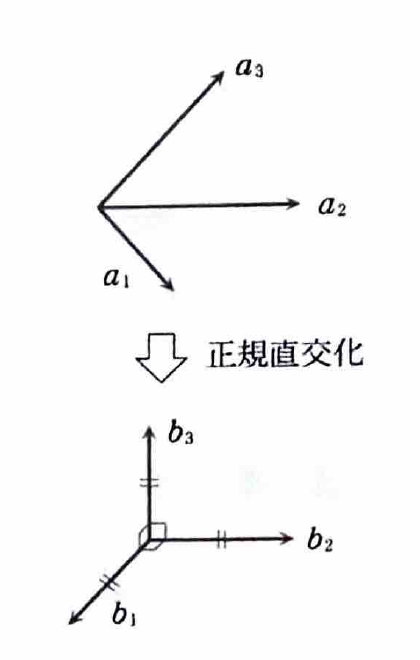

> **前提知識：内積・大きさ・正規直交系**
>
> 標準内積では、ベクトル
>
> $$
> u=\begin{pmatrix}u_1\\u_2\\\vdots\\u_n\end{pmatrix},
> \qquad
> v=\begin{pmatrix}v_1\\v_2\\\vdots\\v_n\end{pmatrix}
> $$
>
> の内積は
>
> $$
> (u,v)=u_1v_1+u_2v_2+\cdots+u_nv_n
> $$
>
> である。ベクトルの大きさは
>
> $$
> |u|=\sqrt{(u,u)}
> $$
>
> であり、 $(u,v)=0$ のとき、 $u$ と $v$ は直交するという。
>
> **グラム・シュミットの正規直交化**
>
> 一次独立な基底 $\{a_1,a_2,\ldots,a_n\}$ から、同じ部分空間を張る正規直交基底
> $\{b_1,b_2,\ldots,b_n\}$ を作るには、
>
> $$
> b_1=\frac{a_1}{|a_1|}
> $$
>
> とし、以後は、すでに作った単位ベクトル方向への成分を引いてから大きさを $1$ にする。
>
> $$
> u_2=a_2-(a_2,b_1)b_1,
> \qquad
> b_2=\frac{u_2}{|u_2|}
> $$
>
> $$
> u_3=a_3-(a_3,b_1)b_1-(a_3,b_2)b_2,
> \qquad
> b_3=\frac{u_3}{|u_3|}
> $$
>
> ここで $(a_k,b_j)b_j$ は、 $a_k$ の $b_j$ 方向への正射影である。

> **資料の要項：内積空間の基本事項**
>
> ベクトル $a,b,c$ と実数 $k$ に対して、内積 $(a,b)$ は次を満たす。
>
> $$
> (a,b)=(b,a)
> $$
>
> $$
> (a+b,c)=(a,c)+(b,c)
> $$
>
> $$
> (ka,b)=k(a,b)
> $$
>
> $$
> (a,a)\ge0
> $$
>
> 最後の等号が成立するのは $a=0$ のときに限る。
>
> 内積から定まる大きさは
>
> $$
> |a|=\sqrt{(a,a)}
> $$
>
> である。また、次の2つの重要な不等式が成り立つ。
>
> **コーシー・シュワルツの不等式**
>
> $$
> |(a,b)|\le |a||b|
> $$
>
> **三角不等式**
>
> $$
> |a+b|\le |a|+|b|
> $$
>
> $R^n$ の標準内積は、
>
> $$
> a=
> \begin{pmatrix}a_1\\a_2\\\vdots\\a_n\end{pmatrix},
> \qquad
> b=
> \begin{pmatrix}b_1\\b_2\\\vdots\\b_n\end{pmatrix}
> $$
>
> に対して
>
> $$
> (a,b)=a_1b_1+a_2b_2+\cdots+a_nb_n
> $$
>
> である。
>
> ベクトルの組 $\{a_1,\ldots,a_n\}$ が
>
> $$
> |a_k|=1\qquad(k=1,\ldots,n)
> $$
>
> および
>
> $$
> (a_k,a_l)=0\qquad(k\ne l)
> $$
>
> を満たすとき、正規直交系という。それが基底でもあるとき、正規直交基底という。

---

例題13-1（正規直交化①）

$R^3$ の次の基底 $\{a_1,a_2,a_3\}$ から正規直交基底 $\{b_1,b_2,b_3\}$ をつくれ。

$$
a_1=\begin{pmatrix}1\\0\\1\end{pmatrix},
\qquad
a_2=\begin{pmatrix}0\\1\\2\end{pmatrix},
\qquad
a_3=\begin{pmatrix}1\\1\\1\end{pmatrix}
$$

---

## 解答

> **この解法を選ぶ理由**
>
> 与えられているのは一次独立な基底であり、求めるものは正規直交基底である。
> この状況では、各ベクトルからそれ以前のベクトル方向への射影を順に取り除く
> グラム・シュミットの正規直交化が最も直接的である。
>
> 別の方法として、これらを列にもつ行列に QR 分解を施す方法がある。
> ただし QR 分解の手計算は結局グラム・シュミット法と同じ計算を含むため、ここでは公式を順に適用する。

最初のベクトルを正規化する。

> まず、代入前の公式は
>
> $$
> b_1=\frac{a_1}{|a_1|}
> $$
>
> である。 $a_1$ の大きさは
>
> $$
> |a_1|=\sqrt{(a_1,a_1)}
> $$
>
> である。ここに $a_1=\begin{pmatrix}1\\0\\1\end{pmatrix}$ を代入すると、
>
> $$
> |a_1|=\sqrt{1^2+0^2+1^2}=\sqrt2
> $$
>
> となる。したがって、
>
> $$
> b_1=\frac1{\sqrt2}\begin{pmatrix}1\\0\\1\end{pmatrix}
> $$

$$
\boxed{b_1=\frac1{\sqrt2}\begin{pmatrix}1\\0\\1\end{pmatrix}}
$$

次に、 $a_2$ から $b_1$ 方向の成分を取り除く。

> 代入前の式は
>
> $$
> u_2=a_2-(a_2,b_1)b_1
> $$
>
> である。まず内積を計算する。
>
> $$
> (a_2,b_1)
> =
> \begin{pmatrix}0\\1\\2\end{pmatrix}
> \cdot
> \frac1{\sqrt2}
> \begin{pmatrix}1\\0\\1\end{pmatrix}
> $$
>
> $$
> (a_2,b_1)
> =\frac1{\sqrt2}(0\cdot1+1\cdot0+2\cdot1)
> =\frac2{\sqrt2}
> =\sqrt2
> $$
>
> よって、
>
> $$
> u_2
> =
> \begin{pmatrix}0\\1\\2\end{pmatrix}
> -
> \sqrt2\cdot
> \frac1{\sqrt2}
> \begin{pmatrix}1\\0\\1\end{pmatrix}
> =
> \begin{pmatrix}-1\\1\\1\end{pmatrix}
> $$
>
> この大きさは
>
> $$
> |u_2|=\sqrt{(-1)^2+1^2+1^2}=\sqrt3
> $$
>
> である。したがって、代入前の正規化公式
>
> $$
> b_2=\frac{u_2}{|u_2|}
> $$
>
> に代入すると、
>
> $$
> b_2=\frac1{\sqrt3}\begin{pmatrix}-1\\1\\1\end{pmatrix}
> $$

$$
\boxed{b_2=\frac1{\sqrt3}\begin{pmatrix}-1\\1\\1\end{pmatrix}}
$$

最後に、 $a_3$ から $b_1$ と $b_2$ の両方向の成分を取り除く。

> 代入前の式は
>
> $$
> u_3=a_3-(a_3,b_1)b_1-(a_3,b_2)b_2
> $$
>
> である。まず、
>
> $$
> (a_3,b_1)
> =
> \begin{pmatrix}1\\1\\1\end{pmatrix}
> \cdot
> \frac1{\sqrt2}
> \begin{pmatrix}1\\0\\1\end{pmatrix}
> =\frac1{\sqrt2}(1+0+1)
> =\sqrt2
> $$
>
> である。また、
>
> $$
> (a_3,b_2)
> =
> \begin{pmatrix}1\\1\\1\end{pmatrix}
> \cdot
> \frac1{\sqrt3}
> \begin{pmatrix}-1\\1\\1\end{pmatrix}
> =\frac1{\sqrt3}(-1+1+1)
> =\frac1{\sqrt3}
> $$
>
> である。これらを代入すると、
>
> $$
> u_3
> =
> \begin{pmatrix}1\\1\\1\end{pmatrix}
> -
> \sqrt2\cdot\frac1{\sqrt2}
> \begin{pmatrix}1\\0\\1\end{pmatrix}
> -
> \frac1{\sqrt3}\cdot\frac1{\sqrt3}
> \begin{pmatrix}-1\\1\\1\end{pmatrix}
> $$
>
> $$
> u_3
> =
> \begin{pmatrix}1\\1\\1\end{pmatrix}
> -
> \begin{pmatrix}1\\0\\1\end{pmatrix}
> -
> \frac13
> \begin{pmatrix}-1\\1\\1\end{pmatrix}
> =
> \begin{pmatrix}\frac13\\\frac23\\-\frac13\end{pmatrix}
> $$
>
> 大きさは
>
> $$
> |u_3|
> =
> \sqrt{\left(\frac13\right)^2+\left(\frac23\right)^2+\left(-\frac13\right)^2}
> =\sqrt{\frac{1+4+1}{9}}
> =\frac{\sqrt6}{3}
> $$
>
> である。したがって、
>
> $$
> b_3=\frac{u_3}{|u_3|}
> =
> \frac3{\sqrt6}
> \begin{pmatrix}\frac13\\\frac23\\-\frac13\end{pmatrix}
> =
> \frac1{\sqrt6}
> \begin{pmatrix}1\\2\\-1\end{pmatrix}
> $$

$$
\boxed{b_3=\frac1{\sqrt6}\begin{pmatrix}1\\2\\-1\end{pmatrix}}
$$

> 最後に確認する。
>
> $$
> |b_1|=|b_2|=|b_3|=1
> $$
>
> であり、
>
> $$
> (b_1,b_2)=0,\qquad
> (b_1,b_3)=0,\qquad
> (b_2,b_3)=0
> $$
>
> であるため、確かに正規直交基底である。

したがって、求める正規直交基底は

$$
\boxed{
\left\{
\frac1{\sqrt2}\begin{pmatrix}1\\0\\1\end{pmatrix},
\frac1{\sqrt3}\begin{pmatrix}-1\\1\\1\end{pmatrix},
\frac1{\sqrt6}\begin{pmatrix}1\\2\\-1\end{pmatrix}
\right\}
}
$$
