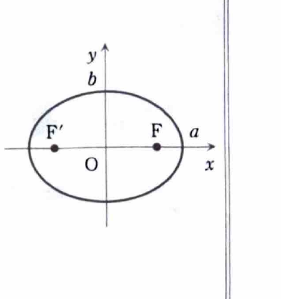
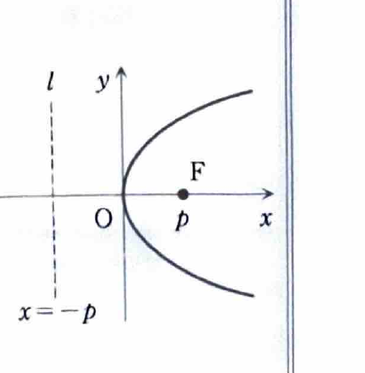
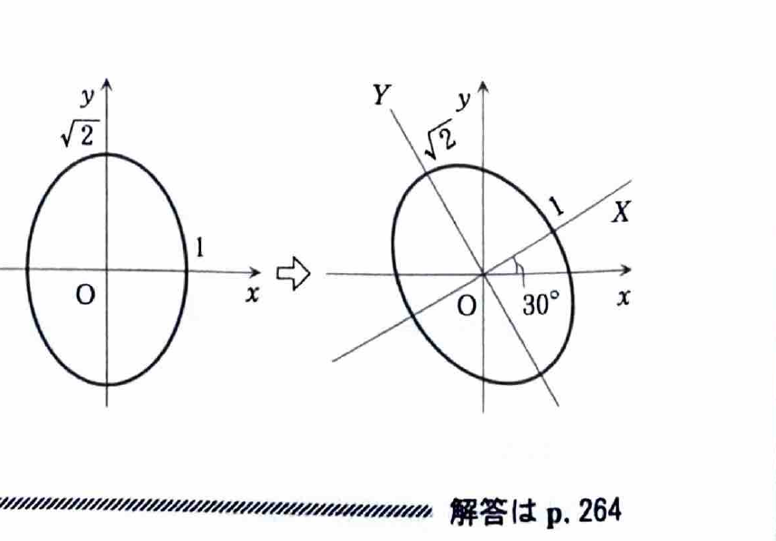

> **前提知識：2次形式と対称行列**
>
> 2変数の2次形式
>
> $$
> Q(x,y)=ax^2+2bxy+cy^2
> $$
>
> は、対称行列
>
> $$
> A=\begin{pmatrix}a&b\\b&c\end{pmatrix}
> $$
>
> を用いて
>
> $$
> Q(x,y)=
> \begin{pmatrix}x&y\end{pmatrix}
> A
> \begin{pmatrix}x\\y\end{pmatrix}
> $$
>
> と表せる。交差項の係数が $2b$ であるため、行列の非対角成分には交差項の係数の半分を入れる。
>
> 実対称行列 $A$ を直交行列 $P$ で
>
> $$
> {}^tPAP=\begin{pmatrix}\lambda_1&0\\0&\lambda_2\end{pmatrix}
> $$
>
> と対角化し、
>
> $$
> \begin{pmatrix}x\\y\end{pmatrix}
> =
> P
> \begin{pmatrix}X\\Y\end{pmatrix}
> $$
>
> と変数変換すると、
>
> $$
> Q(x,y)=\lambda_1X^2+\lambda_2Y^2
> $$
>
> となる。これを2次形式の標準形という。

> **前提知識：楕円と双曲線の標準形**
>
> 楕円の標準形は
>
> $$
> \frac{X^2}{a^2}+\frac{Y^2}{b^2}=1
> $$
>
> である。半径ではなく、 $X$ 軸方向の半軸長が $a$、 $Y$ 軸方向の半軸長が $b$ である。
>
> 双曲線の標準形は
>
> $$
> \frac{X^2}{a^2}-\frac{Y^2}{b^2}=1
> $$
>
> である。正の符号をもつ変数の軸方向に開く。
>
> 直交行列
>
> $$
> P=
> \begin{pmatrix}
> \cos\theta&-\sin\theta\\
> \sin\theta&\cos\theta
> \end{pmatrix}
> $$
>
> を用いて
>
> $$
> \begin{pmatrix}x\\y\end{pmatrix}
> =
> P
> \begin{pmatrix}X\\Y\end{pmatrix}
> $$
>
> とすると、新しい $X$ 軸は元の $x$ 軸から反時計回りに $\theta$ 回転している。

> **資料の補足：2次曲線**
>
> **放物線（横型）**
>
> 定点 $F$ と定直線 $l$ からの距離が等しい点の軌跡である。標準形は
>
> $$
> y^2=4px
> $$
>
> で、焦点は
>
> $$
> F(p,0)
> $$
>
> 準線は
>
> $$
> x=-p
> $$
>
> である。
>
> 
>
> **楕円（横型）**
>
> 2つの定点 $F,F'$ からの距離の和が一定である点の軌跡である。 $a>b>0$ のとき標準形は
>
> $$
> \frac{x^2}{a^2}+\frac{y^2}{b^2}=1
> $$
>
> で、焦点は
>
> $$
> F\left(\sqrt{a^2-b^2},0\right),
> \qquad
> F'\left(-\sqrt{a^2-b^2},0\right)
> $$
>
> である。また、楕円上の点は媒介変数 $\theta$ を用いて
>
> $$
> x=a\cos\theta,
> \qquad
> y=b\sin\theta
> $$
>
> と表せる。
>
> **双曲線（横型）**
>
> 2つの定点 $F,F'$ からの距離の差の絶対値が一定である点の軌跡である。標準形は
>
> $$
> \frac{x^2}{a^2}-\frac{y^2}{b^2}=1
> $$
>
> で、焦点は
>
> $$
> F\left(\sqrt{a^2+b^2},0\right),
> \qquad
> F'\left(-\sqrt{a^2+b^2},0\right)
> $$
>
> である。漸近線は
>
> $$
> y=\pm\frac{b}{a}x
> $$
>
> である。

---

例題13-5（2次形式の応用）

曲線

$$
7x^2+2\sqrt3xy+5y^2=8
$$

の概形を描け。

---

## 解答

> **この解法を選ぶ理由**
>
> $xy$ の交差項があるため、元の $x,y$ 軸に平行な楕円・双曲線の標準形にはなっていない。
> 対応する対称行列を直交対角化すれば、座標軸の回転によって交差項を消し、
> 曲線の種類、半軸長、回転角を同時に求められる。
>
> 角度を直接求める公式
>
> $$
> \tan2\theta=\frac{2b}{a-c}
> $$
>
> を使う方法もある。しかし、この方法だけでは各軸方向の係数を別に求める必要があるため、
> 今回は固有値・固有ベクトルを使う。

2次形式を行列で表す。

> 一般式
>
> $$
> ax^2+2bxy+cy^2
> $$
>
> に対応する行列は
>
> $$
> \begin{pmatrix}a&b\\b&c\end{pmatrix}
> $$
>
> である。今回、
>
> $$
> a=7,\qquad 2b=2\sqrt3,\qquad c=5
> $$
>
> なので、
>
> $$
> b=\sqrt3
> $$
>
> である。したがって、
>
> $$
> A=
> \begin{pmatrix}
> 7&\sqrt3\\
> \sqrt3&5
> \end{pmatrix}
> $$
>
> とおけば、
>
> $$
> 7x^2+2\sqrt3xy+5y^2
> =
> \begin{pmatrix}x&y\end{pmatrix}
> A
> \begin{pmatrix}x\\y\end{pmatrix}
> $$
>
> となる。

固有値を求める。

> 固有方程式は
>
> $$
> |A-\lambda E|=0
> $$
>
> である。代入すると、
>
> $$
> \left|
> \begin{matrix}
> 7-\lambda&\sqrt3\\
> \sqrt3&5-\lambda
> \end{matrix}
> \right|=0
> $$
>
> $$
> (7-\lambda)(5-\lambda)-3=0
> $$
>
> $$
> \lambda^2-12\lambda+32=0
> $$
>
> $$
> (\lambda-4)(\lambda-8)=0
> $$
>
> よって、
>
> $$
> \lambda=4,\qquad \lambda=8
> $$
>
> である。

固有値 $4$ の単位固有ベクトルを求める。

> 代入前の式
>
> $$
> (A-\lambda E)v=0
> $$
>
> に $\lambda=4$ を代入すると、
>
> $$
> \begin{pmatrix}
> 3&\sqrt3\\
> \sqrt3&1
> \end{pmatrix}
> \begin{pmatrix}x\\y\end{pmatrix}
> =
> \begin{pmatrix}0\\0\end{pmatrix}
> $$
>
> となる。したがって、
>
> $$
> \sqrt3x+y=0
> $$
>
> であり、
>
> $$
> a_1=\begin{pmatrix}-1\\\sqrt3\end{pmatrix}
> $$
>
> を選べる。大きさは
>
> $$
> |a_1|=\sqrt{1+3}=2
> $$
>
> なので、
>
> $$
> b_1=\frac12
> \begin{pmatrix}-1\\\sqrt3\end{pmatrix}
> =
> \begin{pmatrix}-\frac12\\\frac{\sqrt3}{2}\end{pmatrix}
> $$

固有値 $8$ の単位固有ベクトルを求める。

> $\lambda=8$ を代入すると、
>
> $$
> \begin{pmatrix}
> -1&\sqrt3\\
> \sqrt3&-3
> \end{pmatrix}
> \begin{pmatrix}x\\y\end{pmatrix}
> =
> \begin{pmatrix}0\\0\end{pmatrix}
> $$
>
> となる。したがって、
>
> $$
> x=\sqrt3y
> $$
>
> であり、
>
> $$
> a_2=\begin{pmatrix}\sqrt3\\1\end{pmatrix}
> $$
>
> を選べる。大きさは $2$ なので、
>
> $$
> b_2=
> \begin{pmatrix}\frac{\sqrt3}{2}\\\frac12\end{pmatrix}
> $$

回転行列の形になるよう、固有値 $8$ のベクトルを第1列、固有値 $4$ のベクトルを第2列に置く。

$$
P=(b_2\ b_1)
=
\begin{pmatrix}
\frac{\sqrt3}{2}&-\frac12\\
\frac12&\frac{\sqrt3}{2}
\end{pmatrix}
=
\begin{pmatrix}
\cos30^\circ&-\sin30^\circ\\
\sin30^\circ&\cos30^\circ
\end{pmatrix}
$$

> 列の順序に対応して、
>
> $$
> {}^tPAP=
> \begin{pmatrix}
> 8&0\\
> 0&4
> \end{pmatrix}
> $$
>
> となる。

変数変換

$$
\begin{pmatrix}x\\y\end{pmatrix}
=
P
\begin{pmatrix}X\\Y\end{pmatrix}
$$

を行う。

> 代入前の公式は
>
> $$
> \begin{pmatrix}x&y\end{pmatrix}
> A
> \begin{pmatrix}x\\y\end{pmatrix}
> =
> \begin{pmatrix}X&Y\end{pmatrix}
> {}^tPAP
> \begin{pmatrix}X\\Y\end{pmatrix}
> $$
>
> である。対角行列を代入すると、
>
> $$
> 7x^2+2\sqrt3xy+5y^2
> =8X^2+4Y^2
> $$
>
> となる。元の方程式の右辺は $8$ だから、
>
> $$
> 8X^2+4Y^2=8
> $$
>
> 両辺を $8$ で割ると、
>
> $$
> X^2+\frac{Y^2}{2}=1
> $$
>
> である。

したがって、新しい座標では半軸長が

$$
X\text{ 軸方向}:1,
\qquad
Y\text{ 軸方向}:\sqrt2
$$

の楕円である。

> $P$ は $30^\circ$ の回転行列なので、新しい $X$ 軸は元の $x$ 軸から反時計回りに $30^\circ$ 回転している。
> したがって、標準楕円
>
> $$
> X^2+\frac{Y^2}{2}=1
> $$
>
> を原点のまわりに反時計回りに $30^\circ$ 回転した曲線が、元の曲線である。

$$
\boxed{
X^2+\frac{Y^2}{2}=1,
\qquad
\begin{pmatrix}x\\y\end{pmatrix}
=
\begin{pmatrix}
\cos30^\circ&-\sin30^\circ\\
\sin30^\circ&\cos30^\circ
\end{pmatrix}
\begin{pmatrix}X\\Y\end{pmatrix}
}
$$

