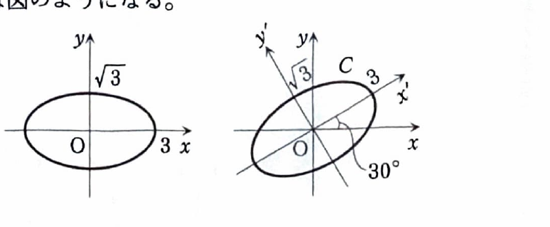

> **前提知識：2次形式と対称行列**
>
> 2変数の2次形式
>
> $$
> Q(x,y)=ax^2+2bxy+cy^2
> $$
>
> は、対称行列
>
> $$
> A=\begin{pmatrix}a&b\\b&c\end{pmatrix}
> $$
>
> を用いて
>
> $$
> Q(x,y)=
> \begin{pmatrix}x&y\end{pmatrix}
> A
> \begin{pmatrix}x\\y\end{pmatrix}
> $$
>
> と表せる。交差項の係数が $2b$ であるため、行列の非対角成分には交差項の係数の半分を入れる。
>
> 実対称行列 $A$ を直交行列 $P$ で
>
> $$
> {}^tPAP=\begin{pmatrix}\lambda_1&0\\0&\lambda_2\end{pmatrix}
> $$
>
> と対角化し、
>
> $$
> \begin{pmatrix}x\\y\end{pmatrix}
> =
> P
> \begin{pmatrix}X\\Y\end{pmatrix}
> $$
>
> と変数変換すると、
>
> $$
> Q(x,y)=\lambda_1X^2+\lambda_2Y^2
> $$
>
> となる。これを2次形式の標準形という。

> **前提知識：実対称行列の直交対角化**
>
> 実対称行列 $A$ は、適当な直交行列 $P$ によって対角化できる。
> 直交行列とは
>
> $$
> {}^tPP=E
> $$
>
> を満たす行列であり、その逆行列は
>
> $$
> P^{-1}={}^tP
> $$
>
> である。
>
> $A$ の互いに正規直交する固有ベクトルを列ベクトルとして
>
> $$
> P=(b_1\ b_2\ \cdots\ b_n)
> $$
>
> と並べると、
>
> $$
> P^{-1}AP={}^tPAP
> $$
>
> は、それぞれの列に対応する固有値を対角成分にもつ対角行列になる。
>
> 異なる固有値に属する実対称行列の固有ベクトルは互いに直交する。
> したがって、異なる固有値の固有ベクトルは正規化するだけでよい。
> 同じ固有値に属する固有ベクトルが複数ある場合だけ、その固有空間の中でグラム・シュミットの正規直交化を行う。

> **前提知識：楕円と双曲線の標準形**
>
> 楕円の標準形は
>
> $$
> \frac{X^2}{a^2}+\frac{Y^2}{b^2}=1
> $$
>
> である。半径ではなく、 $X$ 軸方向の半軸長が $a$、 $Y$ 軸方向の半軸長が $b$ である。
>
> 双曲線の標準形は
>
> $$
> \frac{X^2}{a^2}-\frac{Y^2}{b^2}=1
> $$
>
> である。正の符号をもつ変数の軸方向に開く。
>
> 直交行列
>
> $$
> P=
> \begin{pmatrix}
> \cos\theta&-\sin\theta\\
> \sin\theta&\cos\theta
> \end{pmatrix}
> $$
>
> を用いて
>
> $$
> \begin{pmatrix}x\\y\end{pmatrix}
> =
> P
> \begin{pmatrix}X\\Y\end{pmatrix}
> $$
>
> とすると、新しい $X$ 軸は元の $x$ 軸から反時計回りに $\theta$ 回転している。

> **資料の補足：2次曲線**
>
> **放物線（横型）**
>
> 定点 $F$ と定直線 $l$ からの距離が等しい点の軌跡である。標準形は
>
> $$
> y^2=4px
> $$
>
> で、焦点は
>
> $$
> F(p,0)
> $$
>
> 準線は
>
> $$
> x=-p
> $$
>
> である。
>
> 
>
> **楕円（横型）**
>
> 2つの定点 $F,F'$ からの距離の和が一定である点の軌跡である。 $a>b>0$ のとき標準形は
>
> $$
> \frac{x^2}{a^2}+\frac{y^2}{b^2}=1
> $$
>
> で、焦点は
>
> $$
> F\left(\sqrt{a^2-b^2},0\right),
> \qquad
> F'\left(-\sqrt{a^2-b^2},0\right)
> $$
>
> である。また、楕円上の点は媒介変数 $\theta$ を用いて
>
> $$
> x=a\cos\theta,
> \qquad
> y=b\sin\theta
> $$
>
> と表せる。
>
> **双曲線（横型）**
>
> 2つの定点 $F,F'$ からの距離の差の絶対値が一定である点の軌跡である。標準形は
>
> $$
> \frac{x^2}{a^2}-\frac{y^2}{b^2}=1
> $$
>
> で、焦点は
>
> $$
> F\left(\sqrt{a^2+b^2},0\right),
> \qquad
> F'\left(-\sqrt{a^2+b^2},0\right)
> $$
>
> である。漸近線は
>
> $$
> y=\pm\frac{b}{a}x
> $$
>
> である。

---

第13章 章末問題4

2次曲線

$$
C:\ 3x^2-2\sqrt3xy+5y^2-18=0
$$

は、行列

$$
A=
\begin{pmatrix}
3&-\sqrt3\\
-\sqrt3&5
\end{pmatrix}
$$

とベクトル

$$
p=
\begin{pmatrix}x\\y\end{pmatrix}
$$

を用いて、

$$
{}^tpAp-18=0
$$

と表すことができる。ただし、 ${}^tp=\begin{pmatrix}x&y\end{pmatrix}$ である。

---

## (1)

行列 $A$ の固有値 $\lambda_1,\lambda_2$ を求め、それぞれに対応する大きさ $1$ の固有ベクトル $u_1,u_2$ を求めよ。

---

## (1) 解答

> **この解法を選ぶ理由**
>
> 曲線の交差項を消す座標軸は、2次形式の対称行列 $A$ の固有ベクトル方向である。
> そこで、まず固有方程式から固有値を求め、各固有空間のベクトルを正規化する。
>
> 交差項を消す回転角を直接求める方法もあるが、
> (2) で変換行列 $U$ が必要になるため、固有ベクトルを求める方法が自然である。

固有値を求める。

> 代入前の固有方程式は
>
> $$
> |A-\lambda E|=0
> $$
>
> である。 $A$ を代入すると、
>
> $$
> \left|
> \begin{matrix}
> 3-\lambda&-\sqrt3\\
> -\sqrt3&5-\lambda
> \end{matrix}
> \right|=0
> $$
>
> $$
> (3-\lambda)(5-\lambda)-3=0
> $$
>
> 展開すると、
>
> $$
> 15-8\lambda+\lambda^2-3=0
> $$
>
> $$
> \lambda^2-8\lambda+12=0
> $$
>
> $$
> (\lambda-2)(\lambda-6)=0
> $$
>
> したがって、
>
> $$
> \lambda_1=2,\qquad \lambda_2=6
> $$
>
> である。

固有値 $2$ に対応する大きさ $1$ の固有ベクトルを求める。

> 代入前の式は
>
> $$
> (A-\lambda E)v=0
> $$
>
> である。 $\lambda=2$ を代入すると、
>
> $$
> \begin{pmatrix}
> 1&-\sqrt3\\
> -\sqrt3&3
> \end{pmatrix}
> \begin{pmatrix}x\\y\end{pmatrix}
> =
> \begin{pmatrix}0\\0\end{pmatrix}
> $$
>
> となる。第1行から
>
> $$
> x-\sqrt3y=0
> $$
>
> なので、
>
> $$
> x=\sqrt3y
> $$
>
> である。 $y=a$ とおくと、
>
> $$
> \begin{pmatrix}x\\y\end{pmatrix}
> =
> a\begin{pmatrix}\sqrt3\\1\end{pmatrix}
> \qquad(a\ne0)
> $$
>
> となる。
>
> 基本ベクトルの大きさは
>
> $$
> \sqrt{(\sqrt3)^2+1^2}
> =\sqrt4
> =2
> $$
>
> なので、大きさ $1$ の固有ベクトルとして
>
> $$
> u_1
> =\frac12\begin{pmatrix}\sqrt3\\1\end{pmatrix}
> =
> \begin{pmatrix}\frac{\sqrt3}{2}\\\frac12\end{pmatrix}
> $$
>
> を選べる。

$$
\boxed{
\lambda_1=2,
\qquad
u_1=
\begin{pmatrix}\frac{\sqrt3}{2}\\\frac12\end{pmatrix}
}
$$

固有値 $6$ に対応する大きさ $1$ の固有ベクトルを求める。

> $\lambda=6$ を代入すると、
>
> $$
> \begin{pmatrix}
> -3&-\sqrt3\\
> -\sqrt3&-1
> \end{pmatrix}
> \begin{pmatrix}x\\y\end{pmatrix}
> =
> \begin{pmatrix}0\\0\end{pmatrix}
> $$
>
> となる。第2行から
>
> $$
> -\sqrt3x-y=0
> $$
>
> なので、
>
> $$
> y=-\sqrt3x
> $$
>
> である。 $x=-b$ とおくと、
>
> $$
> \begin{pmatrix}x\\y\end{pmatrix}
> =
> b\begin{pmatrix}-1\\\sqrt3\end{pmatrix}
> \qquad(b\ne0)
> $$
>
> となる。
>
> 基本ベクトルの大きさは
>
> $$
> \sqrt{(-1)^2+(\sqrt3)^2}=2
> $$
>
> なので、
>
> $$
> u_2
> =\frac12\begin{pmatrix}-1\\\sqrt3\end{pmatrix}
> =
> \begin{pmatrix}-\frac12\\\frac{\sqrt3}{2}\end{pmatrix}
> $$
>
> を選べる。

$$
\boxed{
\lambda_2=6,
\qquad
u_2=
\begin{pmatrix}-\frac12\\\frac{\sqrt3}{2}\end{pmatrix}
}
$$

> それぞれの符号を同時または個別に反転しても大きさ $1$ の固有ベクトルである。
> ここでは、後で $30^\circ$ の回転行列になるように符号を選んだ。
>
> また、
>
> $$
> (u_1,u_2)
> =\frac{\sqrt3}{2}\left(-\frac12\right)
> +\frac12\cdot\frac{\sqrt3}{2}
> =0
> $$
>
> であり、2本は正規直交している。

---

## (2)

ベクトル

$$
p'=
\begin{pmatrix}x'\\y'\end{pmatrix}
$$

とし、ある行列 $U$ を用いて線形変換 $p=Up'$ を行えば、2次曲線 $C$ は標準形になる。行列 $U$ を求め、2次曲線 $C$ の標準形を $x',y'$ を用いて表せ。

---

## (2) 解答

> **この解法を選ぶ理由**
>
> (1) で得た正規直交固有ベクトルを列に並べれば、
> $A$ を直交対角化する行列 $U$ が得られる。
> 変換 $p=Up'$ を使うと、2次形式の行列が ${}^tUAU$ に変わり、
> 交差項が消える。
>
> 固有ベクトルの列の順序を逆にすることもできるが、その場合は標準形の $x',y'$ の係数も入れ替わる。

(1) の固有ベクトルを固有値 $2,6$ の順に列に並べる。

$$
U=(u_1\ u_2)
=
\begin{pmatrix}
\frac{\sqrt3}{2}&-\frac12\\
\frac12&\frac{\sqrt3}{2}
\end{pmatrix}
$$

> $u_1,u_2$ は正規直交系なので、
>
> $$
> {}^tUU=E
> $$
>
> であり、 $U$ は直交行列である。
> また、各列に対応する固有値は $2,6$ なので、
>
> $$
> {}^tUAU=
> \begin{pmatrix}
> 2&0\\
> 0&6
> \end{pmatrix}
> $$
>
> となる。

変数変換を具体的に書く。

$$
p=Up'
$$

に行列とベクトルを代入すると、

$$
\begin{pmatrix}x\\y\end{pmatrix}
=
\begin{pmatrix}
\frac{\sqrt3}{2}&-\frac12\\
\frac12&\frac{\sqrt3}{2}
\end{pmatrix}
\begin{pmatrix}x'\\y'\end{pmatrix}
$$

である。

> 成分で書けば、
>
> $$
> x=\frac{\sqrt3}{2}x'-\frac12y'
> $$
>
> $$
> y=\frac12x'+\frac{\sqrt3}{2}y'
> $$
>
> である。

2次形式を変換する。

> 代入前の曲線の式は
>
> $$
> {}^tpAp-18=0
> $$
>
> である。 $p=Up'$ なら、
>
> $$
> {}^tp={}^tp'{}^tU
> $$
>
> だから、
>
> $$
> {}^tpAp-18
> ={}^tp'{}^tUAUp'-18
> $$
>
> となる。ここに
>
> $$
> {}^tUAU=
> \begin{pmatrix}2&0\\0&6\end{pmatrix}
> $$
>
> を代入すると、
>
> $$
> \begin{pmatrix}x'&y'\end{pmatrix}
> \begin{pmatrix}2&0\\0&6\end{pmatrix}
> \begin{pmatrix}x'\\y'\end{pmatrix}
> -18=0
> $$
>
> $$
> 2(x')^2+6(y')^2-18=0
> $$
>
> となる。定数項を右辺に移すと、
>
> $$
> 2(x')^2+6(y')^2=18
> $$
>
> 両辺を $18$ で割ると、
>
> $$
> \frac{(x')^2}{9}+\frac{(y')^2}{3}=1
> $$
>
> である。

したがって、

$$
\boxed{
U=
\begin{pmatrix}
\frac{\sqrt3}{2}&-\frac12\\
\frac12&\frac{\sqrt3}{2}
\end{pmatrix}
}
$$

であり、標準形は

$$
\boxed{
\frac{(x')^2}{9}+\frac{(y')^2}{3}=1
}
$$

である。

> これは、 $x'$ 軸方向の半軸長が $3$、 $y'$ 軸方向の半軸長が $\sqrt3$ の楕円である。

---

## (3)

$x$ 軸と $x'$ 軸のなす角度を求め、 $x$ 軸、 $y$ 軸と $x'$ 軸、 $y'$ 軸の関係を図示し、2次曲線 $C$ の概形を描け。

---

## (3) 解答

> **この解法を選ぶ理由**
>
> (2) で求めた行列 $U$ を回転行列の標準形と比較すれば、
> 座標軸の回転角を直接読み取れる。
> 固有ベクトル $u_1$ と $x$ 軸のなす角を内積から求める方法もあるが、
> 回転行列との比較が最も簡潔である。

回転行列の一般形は

$$
R(\theta)=
\begin{pmatrix}
\cos\theta&-\sin\theta\\
\sin\theta&\cos\theta
\end{pmatrix}
$$

である。

> (2) の行列は
>
> $$
> U=
> \begin{pmatrix}
> \frac{\sqrt3}{2}&-\frac12\\
> \frac12&\frac{\sqrt3}{2}
> \end{pmatrix}
> $$
>
> である。係数を比較すると、
>
> $$
> \cos\theta=\frac{\sqrt3}{2},
> \qquad
> \sin\theta=\frac12
> $$
>
> である。したがって、
>
> $$
> \theta=30^\circ
> $$
>
> となる。

$$
\boxed{x\text{ 軸と }x'\text{ 軸のなす角は }30^\circ}
$$

> 変換
>
> $$
> p=Up'
> $$
>
> は、新しい座標軸の基底ベクトルを元の座標で表している。
> 第1列
>
> $$
> u_1=
> \begin{pmatrix}\cos30^\circ\\\sin30^\circ\end{pmatrix}
> $$
>
> が $x'$ 軸の正方向であるため、 $x'$ 軸は $x$ 軸から反時計回りに $30^\circ$ 回転している。
> 第2列
>
> $$
> u_2=
> \begin{pmatrix}-\sin30^\circ\\\cos30^\circ\end{pmatrix}
> $$
>
> が $y'$ 軸の正方向であり、 $x'$ 軸に直交する。

> 新しい座標では、
>
> $$
> \frac{(x')^2}{9}+\frac{(y')^2}{3}=1
> $$
>
> であるため、長半軸は $x'$ 軸方向で長さ $3$、短半軸は $y'$ 軸方向で長さ $\sqrt3$ である。
> したがって、元の $x,y$ 座標で見ると、この楕円全体が原点のまわりに反時計回りに $30^\circ$ 回転している。

曲線 $C$ の概形は次のとおりである。

