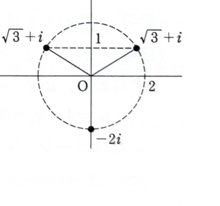

例題15-1（複素平面）

方程式
$$
z^3=8i
$$
の解を求め、複素平面に図示せよ。

---

## 解答

> **解法の選択**
>
> 複素数のべき乗方程式には、実部・虚部を比較する方法もあるが、3乗すると偏角が3倍になることを直接使えるため、極形式とド・モアブルの定理を用いるのが最も見通しがよい。
>
> **前提知識：極形式**
>
> 複素数 $z=x+yi$ は、絶対値を $r=|z|$、偏角を $\theta$ とすると、
> $$
> z=r(\cos\theta+i\sin\theta)
> $$
> と表せる。ここでは解の重複を避けるため、
> $$
> r>0,\qquad 0\le \theta<2\pi
> $$
> とする。
>
> **前提知識：ド・モアブルの定理**
>
> 整数 $n$ に対して、
> $$
> (\cos\theta+i\sin\theta)^n=\cos n\theta+i\sin n\theta
> $$
> が成り立つ。
>
> なお、オイラーの公式
> $$
> e^{i\theta}=\cos\theta+i\sin\theta
> $$
> を使えば、極形式を $z=re^{i\theta}$ と書いて同じ計算を行うこともできる。

未知数 $z$ を極形式で
$$
z=r(\cos\theta+i\sin\theta)
$$
とおく。

まず、代入前の3乗の式は
$$
z^3=\left\{r(\cos\theta+i\sin\theta)\right\}^3
$$
である。

ド・モアブルの定理を用いると、
$$
z^3=r^3(\cos 3\theta+i\sin 3\theta)
$$
となる。

一方、右辺の $8i$ を極形式に直す。絶対値は
$$
|8i|=8
$$
であり、偏角は
$$
\frac{\pi}{2}
$$
であるから、
$$
8i=8\left(\cos\frac{\pi}{2}+i\sin\frac{\pi}{2}\right)
$$
である。

したがって、
$$
r^3(\cos 3\theta+i\sin 3\theta)
=
8\left(\cos\frac{\pi}{2}+i\sin\frac{\pi}{2}\right)
$$
となる。

極形式で2つの複素数が等しいためには、絶対値が等しく、偏角が $2\pi$ の整数倍を除いて等しければよい。よって、
$$
r^3=8
$$
および
$$
3\theta=\frac{\pi}{2}+2n\pi
\qquad (n\in\mathbb{Z})
$$
を得る。

絶対値について、
$$
r^3=8
$$
かつ $r>0$ なので、
$$
r=2
$$
である。

偏角について、まず文字の式
$$
\theta=\frac{1}{3}\left(\frac{\pi}{2}+2n\pi\right)
$$
を得る。

整理すると、
$$
\theta=\frac{\pi}{6}+\frac{2n\pi}{3}
$$
である。

$0\le\theta<2\pi$ の範囲で異なる値を取るように $n=0,1,2$ を代入すると、
$$
\theta=\frac{\pi}{6},\quad \frac{5\pi}{6},\quad \frac{3\pi}{2}
$$
となる。

したがって、3つの解は
$$
z=2\left(\cos\frac{\pi}{6}+i\sin\frac{\pi}{6}\right),
$$
$$
z=2\left(\cos\frac{5\pi}{6}+i\sin\frac{5\pi}{6}\right),
$$
$$
z=2\left(\cos\frac{3\pi}{2}+i\sin\frac{3\pi}{2}\right)
$$
である。

それぞれ直交形式に直す。

第1の解は、
$$
z=2\left(\frac{\sqrt3}{2}+\frac12 i\right)
=\sqrt3+i
$$
である。

第2の解は、
$$
z=2\left(-\frac{\sqrt3}{2}+\frac12 i\right)
=-\sqrt3+i
$$
である。

第3の解は、
$$
z=2(0-i)
=-2i
$$
である。

よって、
$$
\boxed{z=\sqrt3+i,\quad -\sqrt3+i,\quad -2i}
$$

> 3つの解はいずれも絶対値が $2$ であり、偏角の差は $\frac{2\pi}{3}$ である。したがって、複素平面上では原点を中心とする半径 $2$ の円周上に等間隔で並ぶ。

