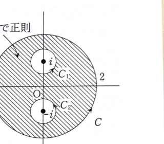

例題15-4（コーシーの積分定理）

複素平面の円
$$
|z|=2
$$
を正の向きに1周する積分路を $C$ とするとき、次の積分の値を求めよ。

$$
\int_C\frac{z}{z^2+1}\,dz
$$

---

## 解答

> **解法の選択**
>
> 被積分関数は $z=\pm i$ に特異点をもつため、円 $C$ の内部全体では正則ではない。資料の解答に従い、各特異点の周囲に小円 $C_1,C_2$ を設け、コーシーの積分定理によって外側の積分を小円上の積分へ変形する。
>
> 留数定理を使えば、2つの留数を足して直ちに求めることもできる。ただし、この例題ではコーシーの積分定理と円周積分の基本公式を使う。
>
> **前提知識：コーシーの積分定理**
>
> 関数 $f(z)$ が単一閉曲線で囲まれた領域とその境界で正則なら、
> $$
> \oint_Cf(z)\,dz=0
> $$
> である。特異点を小円で除いた領域に適用すると、外側の境界の積分を、特異点を囲む小円の積分の和へ移せる。
>
> **前提知識：円周積分**
>
> 点 $a$ を正の向きに1周する円周 $C_a$ に対して、
> $$
> \oint_{C_a}\frac{1}{z-a}\,dz=2\pi i
> $$
> である。また、$a$ が円の外側にあるとき、$1/(z-a)$ は円の内部で正則なので積分は $0$ である。

被積分関数を
$$
f(z)=\frac{z}{z^2+1}
$$
とおく。

分母を因数分解すると、
$$
z^2+1=(z-i)(z+i)
$$
である。

したがって、$f(z)$ の特異点は
$$
z=i,\qquad z=-i
$$
である。

どちらも絶対値が
$$
|i|=|-i|=1
$$
なので、半径 $2$ の円 $C$ の内部にある。

$z=i$ を囲む小円を
$$
C_1:\quad |z-i|=\frac12
$$
とし、$z=-i$ を囲む小円を
$$
C_2:\quad |z+i|=\frac12
$$
とする。

特異点を除いた領域で $f$ は正則なので、コーシーの積分定理による積分路の変形から、
$$
\int_C\frac{z}{z^2+1}\,dz
=
\int_{C_1}\frac{z}{z^2+1}\,dz
+
\int_{C_2}\frac{z}{z^2+1}\,dz
$$
となる。

まず、部分分数分解を行う。代入前の形を
$$
\frac{z}{(z-i)(z+i)}
=
\frac{A}{z-i}+\frac{B}{z+i}
$$
とおく。

両辺に $(z-i)(z+i)$ を掛けると、
$$
z=A(z+i)+B(z-i)
$$
である。

$z=i$ を代入すると、
$$
i=A(2i)
$$
より、
$$
A=\frac12
$$
である。

$z=-i$ を代入すると、
$$
-i=B(-2i)
$$
より、
$$
B=\frac12
$$
である。

したがって、
$$
\frac{z}{z^2+1}
=
\frac12\left(
\frac{1}{z-i}
+
\frac{1}{z+i}
\right)
$$
となる。

$C_1$ 上の積分を計算する。

$$
\int_{C_1}\frac{z}{z^2+1}\,dz
=
\frac12\left(
\int_{C_1}\frac{1}{z-i}\,dz
+
\int_{C_1}\frac{1}{z+i}\,dz
\right)
$$

$C_1$ は $z=i$ を1周するため、
$$
\int_{C_1}\frac{1}{z-i}\,dz=2\pi i
$$
である。

一方、$z=-i$ は $C_1$ の外側にあるため、
$$
\int_{C_1}\frac{1}{z+i}\,dz=0
$$
である。

よって、
$$
\int_{C_1}\frac{z}{z^2+1}\,dz
=
\frac12(2\pi i+0)
=
\pi i
$$
となる。

同様に、$C_2$ 上では $z=-i$ だけを囲むので、
$$
\int_{C_2}\frac{1}{z-i}\,dz=0
$$
および
$$
\int_{C_2}\frac{1}{z+i}\,dz=2\pi i
$$
である。

したがって、
$$
\int_{C_2}\frac{z}{z^2+1}\,dz
=
\frac12(0+2\pi i)
=
\pi i
$$
となる。

以上より、
$$
\int_C\frac{z}{z^2+1}\,dz
=
\pi i+\pi i
=
2\pi i
$$
である。

よって、
$$
\boxed{\displaystyle\int_C\frac{z}{z^2+1}\,dz=2\pi i}
$$

> 留数定理を使う場合は、$z=i,-i$ における留数がともに $\frac12$ なので、
> $$
> 2\pi i\left(\frac12+\frac12\right)=2\pi i
> $$
> と求められる。
