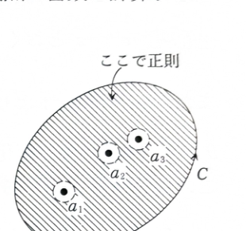

例題15-5（留数定理）

複素平面の円
$$
|z-i|=2
$$
を正の向きに1周する積分路を $C$ とするとき、次の積分の値を求めよ。

$$
\int_C\frac{z^2+z+1}{z^2-1}\,dz
$$

---

## 解答

> **解法の選択**
>
> 被積分関数は有理関数であり、積分路の内部に有限個の孤立特異点をもつ。この状況では、各特異点の留数を求めて足す留数定理が最も直接的である。
>
> 特異点の周囲に小円を設けてコーシーの積分定理で変形する方法もあるが、留数定理はその計算をまとめて行う公式であり、ここではこちらを用いる。
>
> **前提知識：特異点・極・留数**
>
> $f(z)$ が点 $a$ を除く近傍で正則であるとき、$a$ を孤立特異点という。ローラン展開
> $$
> f(z)=\sum_{n=-\infty}^{\infty}c_n(z-a)^n
> $$
> における $(z-a)^{-1}$ の係数 $c_{-1}$ が、$a$ における留数 $\operatorname{Res}(a)$ である。
>
> $a$ が1位の極なら、
> $$
> \operatorname{Res}(a)
> =
> \lim_{z\to a}(z-a)f(z)
> $$
> で求められる。
>
> **前提知識：留数定理**
>
> 正の向きの単一閉曲線 $C$ の内部にある特異点を $a_1,\dots,a_n$ とすると、
> $$
> \oint_Cf(z)\,dz
> =
> 2\pi i\sum_{k=1}^n\operatorname{Res}(a_k)
> $$
> である。
>
> 参考として、正則点 $a$ の近傍ではテーラー展開
> $$
> f(z)=\sum_{n=0}^{\infty}c_n(z-a)^n
> $$
> が成り立ち、負の次数の項は現れない。特異点の近傍で負の次数を含む展開がローラン展開であり、その主要部から極の位数や留数が読み取れる。

被積分関数を
$$
f(z)=\frac{z^2+z+1}{z^2-1}
$$
とおく。

分母を因数分解すると、
$$
z^2-1=(z-1)(z+1)
$$
である。

したがって、特異点は
$$
z=1,\qquad z=-1
$$
である。

分子がこれらの点で0にならないことを確認する。

$z=1$ を代入すると、
$$
1^2+1+1=3\ne0
$$
である。

$z=-1$ を代入すると、
$$
(-1)^2+(-1)+1=1\ne0
$$
である。

よって、$z=1,-1$ はいずれも1位の極である。

次に、積分路の内部にあるかを確認する。円 $C$ の中心は $i$、半径は $2$ である。

中心 $i$ から $z=1$ までの距離は、
$$
|1-i|=\sqrt{1^2+(-1)^2}=\sqrt2
$$
である。

中心 $i$ から $z=-1$ までの距離は、
$$
|-1-i|=\sqrt{(-1)^2+(-1)^2}=\sqrt2
$$
である。

$\sqrt2<2$ なので、両方の極が $C$ の内部にある。

> 次の図は、閉曲線の内部にある孤立特異点の留数を合計するという留数定理の考え方を示している。

まず、$z=1$ における留数を求める。代入前の公式は
$$
\operatorname{Res}(1)
=
\lim_{z\to1}(z-1)f(z)
$$
である。

$f(z)$ を代入すると、
$$
\operatorname{Res}(1)
=
\lim_{z\to1}
(z-1)
\frac{z^2+z+1}{(z-1)(z+1)}
$$
となる。

$z\ne1$ の範囲で $(z-1)$ を約分すると、
$$
\operatorname{Res}(1)
=
\lim_{z\to1}
\frac{z^2+z+1}{z+1}
$$
である。

ここで初めて $z=1$ を代入すると、
$$
\operatorname{Res}(1)
=
\frac{1^2+1+1}{1+1}
=
\frac32
$$
となる。

次に、$z=-1$ における留数を求める。代入前の公式は
$$
\operatorname{Res}(-1)
=
\lim_{z\to-1}(z+1)f(z)
$$
である。

$f(z)$ を代入すると、
$$
\operatorname{Res}(-1)
=
\lim_{z\to-1}
(z+1)
\frac{z^2+z+1}{(z-1)(z+1)}
$$
となる。

$(z+1)$ を約分すると、
$$
\operatorname{Res}(-1)
=
\lim_{z\to-1}
\frac{z^2+z+1}{z-1}
$$
である。

ここに $z=-1$ を代入すると、
$$
\operatorname{Res}(-1)
=
\frac{(-1)^2+(-1)+1}{-1-1}
=
-\frac12
$$
となる。

留数定理より、
$$
\int_Cf(z)\,dz
=
2\pi i\{\operatorname{Res}(1)+\operatorname{Res}(-1)\}
$$
である。

求めた値を代入すると、
$$
\int_Cf(z)\,dz
=
2\pi i\left(\frac32-\frac12\right)
$$
となる。

したがって、
$$
\boxed{\displaystyle
\int_C\frac{z^2+z+1}{z^2-1}\,dz
=
2\pi i
}
$$
