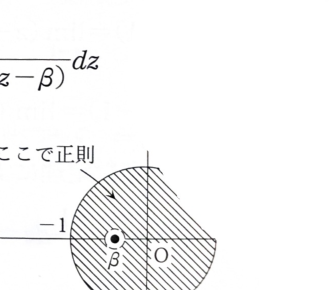

例題15-6（実積分への応用）

複素積分を利用することにより、次の定積分の値を求めよ。

$$
I=\int_0^{2\pi}\frac{1}{3+2\cos\theta}\,d\theta
$$

---

## 解答

> **解法の選択**
>
> 被積分関数に $\cos\theta$ が含まれ、積分区間が $0$ から $2\pi$ までなので、単位円上の置換
> $$
> z=e^{i\theta}
> $$
> が適している。この置換により、三角関数の実積分を単位円上の有理関数の複素積分へ変換でき、留数定理が使える。
>
> 半角置換 $t=\tan(\theta/2)$ によって実積分として計算する方法もあるが、本問は複素積分の応用を目的としているため単位円置換を用いる。
>
> **前提知識**
>
> $z=e^{i\theta}$ とおくと、
> $$
> z^{-1}=e^{-i\theta}
> $$
> であり、
> $$
> z+\frac1z
> =
> e^{i\theta}+e^{-i\theta}
> =
> 2\cos\theta
> $$
> となる。したがって、
> $$
> \cos\theta=\frac12\left(z+\frac1z\right)
> $$
> である。

置換
$$
z=e^{i\theta}
$$
を行う。

まず、微分する前の式は
$$
\frac{dz}{d\theta}
=
\frac{d}{d\theta}e^{i\theta}
$$
である。

微分すると、
$$
\frac{dz}{d\theta}=ie^{i\theta}=iz
$$
なので、
$$
dz=iz\,d\theta
$$
である。

したがって、
$$
d\theta=\frac{dz}{iz}
$$
となる。

また、
$$
2\cos\theta=z+\frac1z
$$
である。

$\theta$ が $0$ から $2\pi$ まで増加するとき、$z=e^{i\theta}$ は単位円
$$
|z|=1
$$
を正の向きに1周する。この積分路を $C$ とする。

元の積分へ、まず文字の置換式
$$
2\cos\theta=z+\frac1z,
\qquad
d\theta=\frac{dz}{iz}
$$
を代入すると、
$$
I
=
\int_C
\frac{1}{3+z+z^{-1}}
\frac{dz}{iz}
$$
となる。

分母を整理する。まず、
$$
3+z+z^{-1}
=
\frac{3z+z^2+1}{z}
$$
である。

したがって、
$$
\frac{1}{3+z+z^{-1}}
=
\frac{z}{z^2+3z+1}
$$
である。

これを代入すると、
$$
I
=
\int_C
\frac{z}{z^2+3z+1}
\frac{dz}{iz}
$$
となる。

$z$ を約分して、
$$
I
=
\frac1i
\int_C
\frac{1}{z^2+3z+1}\,dz
$$
を得る。

次に、分母の零点を求める。代入前の2次方程式の解の公式は、
$$
z=\frac{-b\pm\sqrt{b^2-4ac}}{2a}
$$
である。

方程式
$$
z^2+3z+1=0
$$
では、
$$
a=1,\qquad b=3,\qquad c=1
$$
なので、
$$
z
=
\frac{-3\pm\sqrt{3^2-4\cdot1\cdot1}}{2\cdot1}
$$
となる。

よって、
$$
z=\frac{-3\pm\sqrt5}{2}
$$
である。

小さい方を $\alpha$、大きい方を $\beta$ とし、
$$
\alpha=\frac{-3-\sqrt5}{2},
\qquad
\beta=\frac{-3+\sqrt5}{2}
$$
とおく。

数値の大小を確認すると、
$$
\alpha<-1
$$
であり、
$$
-1<\beta<0
$$
である。

したがって、
$$
|\alpha|>1,\qquad |\beta|<1
$$
となり、単位円 $C$ の内部にある極は $\beta$ だけである。

分母は
$$
z^2+3z+1=(z-\alpha)(z-\beta)
$$
と因数分解できる。

したがって、
$$
\frac{1}{z^2+3z+1}
=
\frac{1}{(z-\alpha)(z-\beta)}
$$
である。

$\beta$ における留数の代入前の公式は
$$
\operatorname{Res}(\beta)
=
\lim_{z\to\beta}
(z-\beta)
\frac{1}{(z-\alpha)(z-\beta)}
$$
である。

$(z-\beta)$ を約分すると、
$$
\operatorname{Res}(\beta)
=
\lim_{z\to\beta}
\frac{1}{z-\alpha}
$$
となる。

ここに $z=\beta$ を代入すると、
$$
\operatorname{Res}(\beta)
=
\frac{1}{\beta-\alpha}
$$
である。

$\alpha,\beta$ の値を代入する前の差は
$$
\beta-\alpha
=
\frac{-3+\sqrt5}{2}
-
\frac{-3-\sqrt5}{2}
$$
である。

整理すると、
$$
\beta-\alpha=\sqrt5
$$
なので、
$$
\operatorname{Res}(\beta)=\frac1{\sqrt5}
$$
である。

留数定理より、
$$
\int_C\frac{1}{z^2+3z+1}\,dz
=
2\pi i\,\operatorname{Res}(\beta)
$$
である。

これを $I$ の式へ代入すると、
$$
I
=
\frac1i
\cdot
2\pi i
\cdot
\frac1{\sqrt5}
$$
となる。

$\frac1i\cdot i=1$ より、
$$
\boxed{I=\frac{2\pi}{\sqrt5}}
$$
