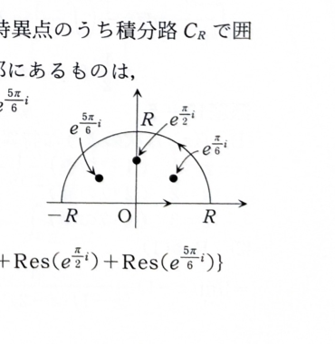

第15章 章末問題2

複素関数
$$
f(z)=\frac{z^4}{z^6+1}
$$
について、次の問いに答えよ。

## (1)

$f(z)$ の極を極形式
$$
re^{i\theta}
$$
の形で表せ。

---

## (1) 解答

> **解法の選択**
>
> 極は分母 $z^6+1$ の零点である。方程式 $z^6=-1$ を極形式とド・モアブルの定理で解けば、6個の根を等間隔に求められる。
>
> 6次方程式を実部と虚部に分ける方法は計算が複雑になるため採用しない。

極は、
$$
z^6+1=0
$$
を満たす点である。

したがって、
$$
z^6=-1
$$
を解く。

未知数を
$$
z=r(\cos\theta+i\sin\theta)
=
re^{i\theta}
$$
とおく。ただし、
$$
r>0,\qquad 0\le\theta<2\pi
$$
とする。

ド・モアブルの定理より、
$$
z^6
=
r^6(\cos6\theta+i\sin6\theta)
$$
である。

一方、
$$
-1=\cos\pi+i\sin\pi
$$
である。

したがって、
$$
r^6(\cos6\theta+i\sin6\theta)
=
\cos\pi+i\sin\pi
$$
となるので、
$$
r^6=1
$$
および
$$
6\theta=\pi+2n\pi
\qquad(n\in\mathbb{Z})
$$
を得る。

$r>0$ より、
$$
r=1
$$
である。

偏角について、代入前の式は
$$
\theta=\frac{\pi+2n\pi}{6}
$$
である。

整理すると、
$$
\theta=\frac{\pi}{6}+\frac{n\pi}{3}
$$
となる。

$n=0,1,2,3,4,5$ を代入すると、
$$
\theta
=
\frac{\pi}{6},\quad
\frac{\pi}{2},\quad
\frac{5\pi}{6},\quad
\frac{7\pi}{6},\quad
\frac{3\pi}{2},\quad
\frac{11\pi}{6}
$$
である。

したがって、極は
$$
\boxed{
z=e^{\pi i/6},\quad
e^{\pi i/2},\quad
e^{5\pi i/6},\quad
e^{7\pi i/6},\quad
e^{3\pi i/2},\quad
e^{11\pi i/6}
}
$$
である。

> 分母の導関数は $6z^5$ であり、これらの根はいずれも0ではないため、すべて1位の極である。

---

## (2)

$z=\alpha$ を $f(z)$ の極とするとき、$f(z)$ の $z=\alpha$ における留数が
$$
\frac{1}{6\alpha}
$$
であることを示せ。

---

## (2) 解答

> **解法の選択**
>
> (1) より各極は1位の極である。1位の極に対する極限公式を用いる。
>
> 有理関数 $p(z)/q(z)$ で $q(\alpha)=0$、$q'(\alpha)\ne0$ のとき、
> $$
> \operatorname{Res}(\alpha)=\frac{p(\alpha)}{q'(\alpha)}
> $$
> とする公式を直接使うこともできる。以下では、その公式と同じ内容を極限から示す。

$z=\alpha$ は極なので、
$$
\alpha^6+1=0
$$
である。

したがって、
$$
\alpha^6=-1
$$
となる。

また、$z^6+1$ の根はすべて異なるため、$\alpha$ は1位の極である。

1位の極における留数の代入前の公式は
$$
\operatorname{Res}(\alpha)
=
\lim_{z\to\alpha}
(z-\alpha)f(z)
$$
である。

$f(z)$ を代入すると、
$$
\operatorname{Res}(\alpha)
=
\lim_{z\to\alpha}
(z-\alpha)
\frac{z^4}{z^6+1}
$$
となる。

$\alpha^6=-1$ より、
$$
z^6+1=z^6-\alpha^6
$$
と書けるので、
$$
\operatorname{Res}(\alpha)
=
\lim_{z\to\alpha}
(z-\alpha)
\frac{z^4}{z^6-\alpha^6}
$$
である。

差の商
$$
\lim_{z\to\alpha}
\frac{z^6-\alpha^6}{z-\alpha}
=
\left.\frac{d}{dz}z^6\right|_{z=\alpha}
=
6\alpha^5
$$
を用いる。

したがって、
$$
\lim_{z\to\alpha}
\frac{z-\alpha}{z^6-\alpha^6}
=
\frac{1}{6\alpha^5}
$$
である。

よって、
$$
\operatorname{Res}(\alpha)
=
\alpha^4\cdot\frac{1}{6\alpha^5}
$$
となる。

指数を整理すると、
$$
\alpha^4\cdot\frac{1}{6\alpha^5}
=
\frac{1}{6\alpha}
$$
である。

したがって、
$$
\boxed{\operatorname{Res}(\alpha)=\frac{1}{6\alpha}}
$$

---

## (3)

次の定積分を求めよ。

$$
\int_{-\infty}^{\infty}f(x)\,dx
$$

---

## (3) 解答

> **解法の選択**
>
> $f(x)=x^4/(x^6+1)$ は実軸上に極をもたず、無限遠では $1/x^2$ の速さで減衰する。実軸と上半円からなる閉曲線を使えば、上半平面内の3つの極の留数で実積分を求められる。
>
> 実関数の部分分数分解でも計算できるが、6次式の分解が煩雑になるため、留数定理が効率的である。

$R>1$ とし、実軸上の線分
$$
I_R:\quad z=x\qquad(-R\le x\le R)
$$
と上半円
$$
\Gamma_R:\quad z=Re^{i\theta}
\qquad(0\le\theta\le\pi)
$$
からなる正向きの閉曲線を $C_R$ とする。

上半平面内にある極は、(1) より、
$$
e^{\pi i/6},\qquad
e^{\pi i/2},\qquad
e^{5\pi i/6}
$$
の3つである。

(2) より、極 $e^{i\theta}$ における留数は
$$
\frac{1}{6e^{i\theta}}
=
\frac16e^{-i\theta}
$$
である。

したがって、3つの留数は、
$$
\operatorname{Res}\left(e^{\pi i/6}\right)
=
\frac16e^{-\pi i/6},
$$
$$
\operatorname{Res}\left(e^{\pi i/2}\right)
=
\frac16e^{-\pi i/2},
$$
$$
\operatorname{Res}\left(e^{5\pi i/6}\right)
=
\frac16e^{-5\pi i/6}
$$
である。

それぞれを直交形式に直す。

$$
e^{-\pi i/6}
=
\cos\left(-\frac{\pi}{6}\right)
+i\sin\left(-\frac{\pi}{6}\right)
=
\frac{\sqrt3}{2}-\frac12i
$$

$$
e^{-\pi i/2}
=
\cos\left(-\frac{\pi}{2}\right)
+i\sin\left(-\frac{\pi}{2}\right)
=
-i
$$

$$
e^{-5\pi i/6}
=
\cos\left(-\frac{5\pi}{6}\right)
+i\sin\left(-\frac{5\pi}{6}\right)
=
-\frac{\sqrt3}{2}-\frac12i
$$

したがって、留数の和は
$$
\frac16
\left[
\left(\frac{\sqrt3}{2}-\frac12i\right)
-i
+
\left(-\frac{\sqrt3}{2}-\frac12i\right)
\right]
$$
である。

実部は打ち消し合い、虚部をまとめると、
$$
-\frac12i-i-\frac12i=-2i
$$
なので、
$$
\sum\operatorname{Res}
=
\frac16(-2i)
=
-\frac{i}{3}
$$
となる。

留数定理より、
$$
\int_{C_R}\frac{z^4}{z^6+1}\,dz
=
2\pi i\left(-\frac{i}{3}\right)
=
\frac{2\pi}{3}
$$
である。

次に、上半円 $\Gamma_R$ 上の積分が0へ収束することを示す。

$\Gamma_R$ 上では
$$
|z|=R
$$
である。

したがって、
$$
|z^4|=R^4
$$
である。

また、逆三角不等式より、
$$
|z^6+1|
\ge
\bigl||z|^6-1\bigr|
=
R^6-1
$$
である。

よって、
$$
\left|
\frac{z^4}{z^6+1}
\right|
\le
\frac{R^4}{R^6-1}
$$
となる。

上半円の長さは $\pi R$ なので、ML評価から、
$$
\left|
\int_{\Gamma_R}
\frac{z^4}{z^6+1}\,dz
\right|
\le
\frac{R^4}{R^6-1}\cdot\pi R
=
\frac{\pi R^5}{R^6-1}
$$
である。

右辺は
$$
\lim_{R\to\infty}
\frac{\pi R^5}{R^6-1}
=
0
$$
なので、
$$
\lim_{R\to\infty}
\int_{\Gamma_R}
\frac{z^4}{z^6+1}\,dz
=
0
$$
である。

実軸上では $z=x$、$dz=dx$ なので、
$$
\int_{I_R}
\frac{z^4}{z^6+1}\,dz
=
\int_{-R}^R
\frac{x^4}{x^6+1}\,dx
$$
である。

したがって、
$$
\int_{C_R}
\frac{z^4}{z^6+1}\,dz
=
\int_{-R}^R
\frac{x^4}{x^6+1}\,dx
+
\int_{\Gamma_R}
\frac{z^4}{z^6+1}\,dz
$$
である。

$R\to\infty$ とすると、
$$
\int_{-\infty}^{\infty}
\frac{x^4}{x^6+1}\,dx
=
\frac{2\pi}{3}
$$
を得る。

よって、
$$
\boxed{\displaystyle
\int_{-\infty}^{\infty}f(x)\,dx
=
\frac{2\pi}{3}
}
$$
