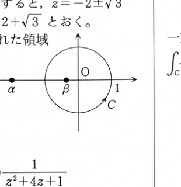

第15章 章末問題3

定積分
$$
I=\int_0^{2\pi}\frac{d\theta}{2+\cos\theta}
$$
の値を、以下の2通りの方法で計算せよ。

## (1)(i)

次の式を示せ。

$$
I=2\int_0^\pi\frac{d\theta}{2+\cos\theta}
$$

---

## (1)(i) 解答

> **解法の選択**
>
> 区間 $[\pi,2\pi]$ の積分に変数変換 $\varphi=2\pi-\theta$ を施し、区間 $[0,\pi]$ の積分と等しいことを示す。
>
> 被積分関数が $\cos\theta$ のみで表され、$\cos(2\pi-\varphi)=\cos\varphi$ が成り立つことを利用する。

元の積分を区間 $[0,\pi]$ と $[\pi,2\pi]$ に分けると、
$$
I
=
\int_0^\pi\frac{d\theta}{2+\cos\theta}
+
\int_\pi^{2\pi}\frac{d\theta}{2+\cos\theta}
$$
である。

第2項で、
$$
\varphi=2\pi-\theta
$$
とおく。

代入前の微分関係は
$$
\frac{d\varphi}{d\theta}
=
\frac{d}{d\theta}(2\pi-\theta)
$$
である。

したがって、
$$
\frac{d\varphi}{d\theta}=-1
$$
なので、
$$
d\varphi=-d\theta
$$
すなわち
$$
d\theta=-d\varphi
$$
である。

積分端を変換する。

$\theta=\pi$ のとき、
$$
\varphi=2\pi-\pi=\pi
$$
である。

$\theta=2\pi$ のとき、
$$
\varphi=2\pi-2\pi=0
$$
である。

また、
$$
\cos\theta
=
\cos(2\pi-\varphi)
=
\cos\varphi
$$
である。

したがって、
$$
\int_\pi^{2\pi}\frac{d\theta}{2+\cos\theta}
=
\int_\pi^0
\frac{-d\varphi}{2+\cos\varphi}
$$
となる。

積分区間の向きを直すと、
$$
\int_\pi^{2\pi}\frac{d\theta}{2+\cos\theta}
=
\int_0^\pi
\frac{d\varphi}{2+\cos\varphi}
$$
である。

積分変数の文字は値に影響しないので、
$$
\int_\pi^{2\pi}\frac{d\theta}{2+\cos\theta}
=
\int_0^\pi
\frac{d\theta}{2+\cos\theta}
$$
となる。

よって、
$$
I
=
2\int_0^\pi\frac{d\theta}{2+\cos\theta}
$$
である。

したがって、
$$
\boxed{
I=2\int_0^\pi\frac{d\theta}{2+\cos\theta}
}
$$

---

## (1)(ii)

積分変数を
$$
x=\tan\frac{\theta}{2}
$$
に置換せよ。ただし、
$$
\cos\theta=\frac{1-x^2}{1+x^2}
$$
を用いてよい。

---

## (1)(ii) 解答

> **解法の選択**
>
> 三角関数の有理式を実変数の有理関数へ変える標準的な半角置換を使う。この置換によって $\cos\theta$ と $d\theta$ がともに $x$ の有理式になり、積分が初等的な形になる。

置換
$$
x=\tan\frac{\theta}{2}
$$
を行う。

まず、両辺を $\theta$ で微分する前の式は
$$
\frac{dx}{d\theta}
=
\frac{d}{d\theta}
\tan\frac{\theta}{2}
$$
である。

合成関数の微分法より、
$$
\frac{dx}{d\theta}
=
\frac12
\frac{1}{\cos^2(\theta/2)}
$$
である。

したがって、
$$
dx
=
\frac12
\frac{1}{\cos^2(\theta/2)}
\,d\theta
$$
となる。

恒等式
$$
\frac{1}{\cos^2 u}=1+\tan^2u
$$
に $u=\theta/2$ を代入すると、
$$
\frac{1}{\cos^2(\theta/2)}
=
1+\tan^2\frac{\theta}{2}
=
1+x^2
$$
である。

よって、
$$
dx=\frac12(1+x^2)\,d\theta
$$
となる。

これを $d\theta$ について解くと、
$$
d\theta=\frac{2}{1+x^2}\,dx
$$
である。

また、問題のヒントより、
$$
\cos\theta=\frac{1-x^2}{1+x^2}
$$
である。

積分端を変換する。

$\theta=0$ のとき、
$$
x=\tan0=0
$$
である。

$\theta\to\pi-0$ のとき、
$$
\frac{\theta}{2}\to\frac{\pi}{2}-0
$$
なので、
$$
x=\tan\frac{\theta}{2}\to+\infty
$$
である。

(1)(i) の結果
$$
I=2\int_0^\pi\frac{d\theta}{2+\cos\theta}
$$
へ、代入前の式
$$
d\theta=\frac{2}{1+x^2}\,dx,
\qquad
\cos\theta=\frac{1-x^2}{1+x^2}
$$
を代入すると、
$$
I
=
2\int_0^\infty
\frac{\dfrac{2}{1+x^2}}
{2+\dfrac{1-x^2}{1+x^2}}
\,dx
$$
となる。

分母を通分すると、
$$
2+\frac{1-x^2}{1+x^2}
=
\frac{2(1+x^2)+(1-x^2)}{1+x^2}
$$
である。

分子を整理すると、
$$
2(1+x^2)+(1-x^2)
=
2+2x^2+1-x^2
=
3+x^2
$$
なので、
$$
2+\frac{1-x^2}{1+x^2}
=
\frac{3+x^2}{1+x^2}
$$
となる。

したがって、
$$
I
=
2\int_0^\infty
\frac{\dfrac{2}{1+x^2}}
{\dfrac{3+x^2}{1+x^2}}
\,dx
$$
である。

複分数を整理すると、
$$
I
=
2\int_0^\infty
\frac{2}{3+x^2}\,dx
$$
となる。

よって、
$$
\boxed{
I=4\int_0^\infty\frac{dx}{3+x^2}
}
$$

---

## (1)(iii)

積分を実行して $I$ を求めよ。

---

## (1)(iii) 解答

> **解法の選択**
>
> (1)(ii) で得た積分は、逆正接の基本積分
> $$
> \int\frac{dx}{a^2+x^2}
> =
> \frac1a\tan^{-1}\frac{x}{a}+C
> \qquad(a>0)
> $$
> を用いて計算できる。

(1)(ii) より、
$$
I=4\int_0^\infty\frac{dx}{3+x^2}
$$
である。

分母を
$$
3+x^2=(\sqrt3)^2+x^2
$$
と見る。

代入前の公式は
$$
\int\frac{dx}{a^2+x^2}
=
\frac1a\tan^{-1}\frac{x}{a}+C
$$
である。

ここに
$$
a=\sqrt3
$$
を代入すると、
$$
\int\frac{dx}{3+x^2}
=
\frac1{\sqrt3}
\tan^{-1}\frac{x}{\sqrt3}+C
$$
となる。

したがって、
$$
I
=
4
\lim_{\beta\to\infty}
\left[
\frac1{\sqrt3}
\tan^{-1}\frac{x}{\sqrt3}
\right]_0^\beta
$$
である。

上下端を代入すると、
$$
I
=
\frac4{\sqrt3}
\lim_{\beta\to\infty}
\left(
\tan^{-1}\frac{\beta}{\sqrt3}
-\tan^{-1}0
\right)
$$
となる。

ここで、
$$
\lim_{\beta\to\infty}
\tan^{-1}\frac{\beta}{\sqrt3}
=
\frac{\pi}{2}
$$
および
$$
\tan^{-1}0=0
$$
である。

したがって、
$$
I
=
\frac4{\sqrt3}\cdot\frac{\pi}{2}
=
\frac{2\pi}{\sqrt3}
$$
となる。

分母を有理化すると、
$$
\frac{2\pi}{\sqrt3}
=
\frac{2\sqrt3}{3}\pi
$$
である。

よって、
$$
\boxed{I=\frac{2\sqrt3}{3}\pi}
$$

---

## (2)(i)

複素数
$$
z=e^{i\theta}
$$
とおいたとき、
$$
z+\frac1z
$$
を計算せよ。

---

## (2)(i) 解答

> **解法の選択**
>
> オイラーの公式で $z$ と $1/z$ をそれぞれ三角関数表示し、和を取る。

オイラーの公式より、
$$
z=e^{i\theta}
=
\cos\theta+i\sin\theta
$$
である。

また、
$$
\frac1z=e^{-i\theta}
$$
である。

オイラーの公式に $-\theta$ を代入すると、
$$
e^{-i\theta}
=
\cos(-\theta)+i\sin(-\theta)
$$
である。

$\cos$ は偶関数、$\sin$ は奇関数なので、
$$
\cos(-\theta)=\cos\theta,
\qquad
\sin(-\theta)=-\sin\theta
$$
である。

したがって、
$$
\frac1z
=
\cos\theta-i\sin\theta
$$
となる。

よって、
$$
z+\frac1z
=
(\cos\theta+i\sin\theta)
+
(\cos\theta-i\sin\theta)
$$
である。

虚部が打ち消し合うので、
$$
\boxed{z+\frac1z=2\cos\theta}
$$

---

## (2)(ii)

(2)(i) の結果を基に、$I$ を $z$ に関する複素積分に変換せよ。

---

## (2)(ii) 解答

> **解法の選択**
>
> $\theta$ が $0$ から $2\pi$ まで変化するとき、$z=e^{i\theta}$ は単位円を正の向きに1周する。$\cos\theta$ と $d\theta$ を $z$ で表し、単位円上の積分へ変換する。

置換
$$
z=e^{i\theta}
$$
を行う。

代入前の微分式は
$$
\frac{dz}{d\theta}
=
\frac{d}{d\theta}e^{i\theta}
$$
である。

したがって、
$$
\frac{dz}{d\theta}=ie^{i\theta}=iz
$$
であり、
$$
dz=iz\,d\theta
$$
となる。

よって、
$$
d\theta=\frac{dz}{iz}
$$
である。

また、(2)(i) より、
$$
2\cos\theta=z+\frac1z
$$
なので、
$$
\cos\theta=\frac12\left(z+\frac1z\right)
$$
である。

元の積分を、分母と整合するように
$$
I
=
\int_0^{2\pi}
\frac{2}{4+2\cos\theta}
\,d\theta
$$
と書く。

ここに
$$
2\cos\theta=z+\frac1z
$$
および
$$
d\theta=\frac{dz}{iz}
$$
を代入すると、
$$
I
=
\int_C
\frac{2}{4+z+z^{-1}}
\frac{dz}{iz}
$$
となる。ただし、$C$ は単位円 $|z|=1$ を正の向きに1周する積分路である。

分母を通分すると、
$$
4+z+z^{-1}
=
\frac{4z+z^2+1}{z}
$$
である。

したがって、
$$
\frac{2}{4+z+z^{-1}}
=
\frac{2z}{z^2+4z+1}
$$
となる。

これを代入すると、
$$
I
=
\int_C
\frac{2z}{z^2+4z+1}
\frac{dz}{iz}
$$
である。

$z$ を約分して、
$$
\boxed{
I=\frac2i\int_C\frac{1}{z^2+4z+1}\,dz
}
$$
を得る。

---

## (2)(iii)

留数定理を用いて $I$ を求めよ。

---

## (2)(iii) 解答

> **解法の選択**
>
> (2)(ii) で単位円上の有理関数の積分へ変換できた。分母の2つの零点のうち単位円内にあるものを判定し、その留数を用いる。

分母の方程式
$$
z^2+4z+1=0
$$
を解く。

2次方程式の解の公式は
$$
z=\frac{-b\pm\sqrt{b^2-4ac}}{2a}
$$
である。

ここで、
$$
a=1,\qquad b=4,\qquad c=1
$$
を代入すると、
$$
z
=
\frac{-4\pm\sqrt{4^2-4\cdot1\cdot1}}{2\cdot1}
$$
となる。

したがって、
$$
z=-2\pm\sqrt3
$$
である。

$$
\alpha=-2-\sqrt3,\qquad
\beta=-2+\sqrt3
$$
とおく。

$\alpha<-1$ なので、
$$
|\alpha|>1
$$
である。

一方、
$$
-1<\beta<0
$$
なので、
$$
|\beta|<1
$$
である。

したがって、単位円 $C$ の内部にある極は $\beta$ だけである。

分母を
$$
z^2+4z+1=(z-\alpha)(z-\beta)
$$
と因数分解する。

$\beta$ における留数の代入前の公式は
$$
\operatorname{Res}(\beta)
=
\lim_{z\to\beta}
(z-\beta)
\frac{1}{(z-\alpha)(z-\beta)}
$$
である。

$(z-\beta)$ を約分すると、
$$
\operatorname{Res}(\beta)
=
\lim_{z\to\beta}
\frac{1}{z-\alpha}
$$
となる。

ここに $z=\beta$ を代入すると、
$$
\operatorname{Res}(\beta)
=
\frac{1}{\beta-\alpha}
$$
である。

差を計算すると、
$$
\beta-\alpha
=
(-2+\sqrt3)-(-2-\sqrt3)
=
2\sqrt3
$$
なので、
$$
\operatorname{Res}(\beta)
=
\frac{1}{2\sqrt3}
$$
である。

留数定理より、
$$
\int_C\frac{1}{z^2+4z+1}\,dz
=
2\pi i\cdot\frac{1}{2\sqrt3}
$$
となる。

(2)(ii) の式
$$
I=\frac2i\int_C\frac{1}{z^2+4z+1}\,dz
$$
へ代入すると、
$$
I
=
\frac2i
\cdot
2\pi i
\cdot
\frac{1}{2\sqrt3}
$$
である。

$\frac2i\cdot i=2$ より、
$$
I
=
\frac{2\pi}{\sqrt3}
=
\frac{2\sqrt3}{3}\pi
$$
となる。

したがって、
$$
\boxed{I=\frac{2\sqrt3}{3}\pi}
$$

> (1) の実変数による方法と、(2) の留数定理による方法で同じ値が得られた。
