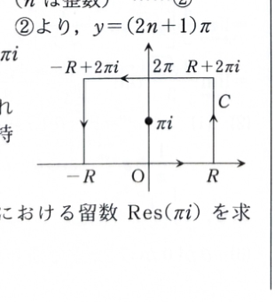

第15章 章末問題4

$z$ を複素数とする。複素平面上の経路 $C$ に沿う積分
$$
\int_C\frac{e^{az}}{1+e^z}\,dz
\qquad(0<a<1)
$$
について、次の問いに答えよ。

## (1)

積分路 $C$ を、4点
$$
-R,\quad R,\quad R+2\pi i,\quad -R+2\pi i
\qquad(R>0)
$$
を頂点とする長方形にするとき、$C$ で囲まれた領域内にある特異点、およびその点における留数を求めよ。

---

## (1) 解答

> **解法の選択**
>
> 特異点は分母 $1+e^z$ が0になる点である。$z=x+yi$ とおき、複素指数関数を実部と虚部に分けて、長方形内の解を特定する。その後、1位の極の留数公式を用いる。
>
> 方程式 $e^z=-1$ と指数関数の周期性から直ちに $z=(2n+1)\pi i$ とする方法もある。以下では、絶対値と偏角の条件も分かるように途中を示す。

特異点は、
$$
1+e^z=0
$$
を満たす点である。

したがって、
$$
e^z=-1
$$
を解けばよい。

複素数 $z$ を
$$
z=x+yi
\qquad(x,y\in\mathbb{R})
$$
とおく。

指数法則とオイラーの公式より、
$$
e^z
=
e^{x+yi}
=
e^x e^{yi}
=
e^x(\cos y+i\sin y)
$$
である。

一方、
$$
-1=\cos\pi+i\sin\pi
$$
と表せる。

したがって、絶対値を比較すると、
$$
e^x=1
$$
である。

実指数関数 $e^x$ が1になるのは $x=0$ のときなので、
$$
x=0
$$
である。

偏角を比較すると、
$$
y=\pi+2n\pi
\qquad(n\in\mathbb{Z})
$$
である。

よって、すべての特異点は
$$
z=(2n+1)\pi i
\qquad(n\in\mathbb{Z})
$$
となる。

長方形 $C$ は、実部について
$$
-R\le\operatorname{Re}z\le R
$$
を満たし、虚部について
$$
0\le\operatorname{Im}z\le2\pi
$$
を満たす領域を囲む。

この範囲内にある
$$
(2n+1)\pi
$$
は、
$$
\pi
$$
だけである。

したがって、$C$ の内部にある特異点は
$$
\boxed{z=\pi i}
$$
だけである。

次に、この点における留数を求める。

被積分関数を
$$
f(z)=\frac{e^{az}}{1+e^z}
$$
とおく。

分母
$$
g(z)=1+e^z
$$
の導関数は
$$
g'(z)=e^z
$$
である。

$z=\pi i$ において、
$$
g'(\pi i)=e^{\pi i}=-1\ne0
$$
なので、$z=\pi i$ は1位の極である。

1位の極における留数の代入前の公式は
$$
\operatorname{Res}(\pi i)
=
\lim_{z\to\pi i}
(z-\pi i)
\frac{e^{az}}{1+e^z}
$$
である。

分子と分母を分け、
$$
\operatorname{Res}(\pi i)
=
\left(\lim_{z\to\pi i}e^{az}\right)
\left(
\lim_{z\to\pi i}
\frac{z-\pi i}{e^z-e^{\pi i}}
\right)
$$
と書く。ここで、
$$
e^{\pi i}=-1
$$
を用いた。

差商の極限
$$
\lim_{z\to\pi i}
\frac{e^z-e^{\pi i}}{z-\pi i}
=
\left.\frac{d}{dz}e^z\right|_{z=\pi i}
=
e^{\pi i}
$$
より、
$$
\lim_{z\to\pi i}
\frac{z-\pi i}{e^z-e^{\pi i}}
=
\frac{1}{e^{\pi i}}
$$
である。

したがって、
$$
\operatorname{Res}(\pi i)
=
\frac{e^{a\pi i}}{e^{\pi i}}
$$
となる。

$e^{\pi i}=-1$ より、
$$
\boxed{
\operatorname{Res}(\pi i)
=
-e^{a\pi i}
}
$$

---

## (2)

次の積分を計算せよ。

$$
\int_{-\infty}^{\infty}
\frac{e^{ax}}{1+e^x}\,dx
\qquad(0<a<1)
$$

---

## (2) 解答

> **解法の選択**
>
> 実軸上の積分を長方形積分路の下辺として組み込み、複素指数関数の虚方向の周期性
> $$
> e^{z+2\pi i}=e^z
> $$
> を利用する。上辺の積分は下辺の積分の定数倍になり、左右の辺は $R\to\infty$ で0へ収束するため、留数定理から求める実積分だけを含む方程式が得られる。
>
> 実変数の置換 $t=e^x$ を行えばベータ積分
> $$
> \int_0^\infty\frac{t^{a-1}}{1+t}\,dt
> $$
> に変換する方法もあるが、その評価には別の公式が必要である。ここでは資料に沿って長方形積分路を用いる。

求める積分を
$$
J
=
\int_{-\infty}^{\infty}
\frac{e^{ax}}{1+e^x}\,dx
$$
とおく。

長方形 $C$ を正の向き、すなわち反時計回りに進むものとする。

4辺上の積分を、順に
$$
I_1
=
\int_{-R}^{R}
\frac{e^{ax}}{1+e^x}\,dx,
$$
$$
I_2
=
\int_{R}^{R+2\pi i}
\frac{e^{az}}{1+e^z}\,dz,
$$
$$
I_3
=
\int_{R+2\pi i}^{-R+2\pi i}
\frac{e^{az}}{1+e^z}\,dz,
$$
$$
I_4
=
\int_{-R+2\pi i}^{-R}
\frac{e^{az}}{1+e^z}\,dz
$$
とする。

すると、
$$
\int_C\frac{e^{az}}{1+e^z}\,dz
=
I_1+I_2+I_3+I_4
$$
である。

(1) より、長方形内の極は $z=\pi i$ のみで、その留数は
$$
\operatorname{Res}(\pi i)=-e^{a\pi i}
$$
である。

留数定理より、
$$
\int_C\frac{e^{az}}{1+e^z}\,dz
=
2\pi i\operatorname{Res}(\pi i)
$$
である。

留数を代入すると、
$$
\int_C\frac{e^{az}}{1+e^z}\,dz
=
-2\pi i e^{a\pi i}
$$
となる。

次に、各辺の極限を調べる。

下辺については、
$$
I_1
=
\int_{-R}^{R}
\frac{e^{ax}}{1+e^x}\,dx
$$
なので、
$$
\lim_{R\to\infty}I_1=J
$$
である。

右辺では、
$$
z=R+yi,
\qquad
0\le y\le2\pi
$$
とおく。

代入前の微分式は
$$
\frac{dz}{dy}
=
\frac{d}{dy}(R+yi)
$$
である。

したがって、
$$
\frac{dz}{dy}=i
$$
なので、
$$
dz=i\,dy
$$
である。

よって、
$$
I_2
=
\int_0^{2\pi}
\frac{e^{a(R+yi)}}{1+e^{R+yi}}
\,i\,dy
$$
となる。

絶対値を評価する。

まず、
$$
|e^{a(R+yi)}|
=
e^{aR}|e^{ayi}|
=
e^{aR}
$$
である。純虚数の指数の絶対値は1だからである。

また、逆三角不等式より、
$$
|1+e^{R+yi}|
\ge
\bigl||e^{R+yi}|-1\bigr|
=
e^R-1
$$
である。

したがって、
$$
\left|
\frac{e^{a(R+yi)}}{1+e^{R+yi}}
\right|
\le
\frac{e^{aR}}{e^R-1}
$$
となる。

右辺の長さは $2\pi$ なので、ML評価より、
$$
|I_2|
\le
2\pi
\frac{e^{aR}}{e^R-1}
$$
である。

右辺を
$$
2\pi
\frac{e^{-(1-a)R}}{1-e^{-R}}
$$
と書き直す。

条件
$$
0<a<1
$$
より、
$$
1-a>0
$$
なので、
$$
e^{-(1-a)R}\to0
\qquad(R\to\infty)
$$
である。

したがって、
$$
\lim_{R\to\infty}I_2=0
$$
となる。

上辺では、
$$
z=x+2\pi i
$$
とおく。積分の向きが右から左なので、$x$ は $R$ から $-R$ まで変化する。

また、
$$
dz=dx
$$
である。

よって、
$$
I_3
=
\int_R^{-R}
\frac{e^{a(x+2\pi i)}}{1+e^{x+2\pi i}}
\,dx
$$
である。

指数法則より、
$$
e^{a(x+2\pi i)}
=
e^{ax}e^{2\pi ai}
$$
である。

また、
$$
e^{x+2\pi i}
=
e^x e^{2\pi i}
=
e^x
$$
である。

したがって、
$$
I_3
=
e^{2\pi ai}
\int_R^{-R}
\frac{e^{ax}}{1+e^x}
\,dx
$$
となる。

積分区間を逆にすると符号が変わるので、
$$
I_3
=
-e^{2\pi ai}
\int_{-R}^{R}
\frac{e^{ax}}{1+e^x}
\,dx
$$
である。

すなわち、
$$
I_3=-e^{2\pi ai}I_1
$$
となる。

したがって、
$$
\lim_{R\to\infty}I_3
=
-e^{2\pi ai}J
$$
である。

左辺では、
$$
z=-R+yi
$$
とおく。ただし、積分の向きは上から下なので、$y$ は $2\pi$ から0まで変化する。

絶対値だけを評価すれば、向きは評価に影響しない。

分子について、
$$
|e^{a(-R+yi)}|
=
e^{-aR}
$$
である。

分母について、逆三角不等式より、
$$
|1+e^{-R+yi}|
\ge
1-|e^{-R+yi}|
=
1-e^{-R}
$$
である。

したがって、
$$
\left|
\frac{e^{a(-R+yi)}}{1+e^{-R+yi}}
\right|
\le
\frac{e^{-aR}}{1-e^{-R}}
$$
となる。

左辺の長さは $2\pi$ なので、
$$
|I_4|
\le
2\pi
\frac{e^{-aR}}{1-e^{-R}}
$$
である。

条件 $a>0$ より、
$$
e^{-aR}\to0
\qquad(R\to\infty)
$$
なので、
$$
\lim_{R\to\infty}I_4=0
$$
となる。

以上を
$$
I_1+I_2+I_3+I_4
=
-2\pi i e^{a\pi i}
$$
へ代入し、$R\to\infty$ とすると、
$$
J+0-e^{2\pi ai}J+0
=
-2\pi i e^{a\pi i}
$$
となる。

左辺で $J$ をくくると、
$$
(1-e^{2\pi ai})J
=
-2\pi i e^{a\pi i}
$$
である。

したがって、
$$
J
=
\frac{-2\pi i e^{a\pi i}}
{1-e^{2\pi ai}}
$$
となる。

分子・分母に $-1$ を掛けると、
$$
J
=
\frac{2\pi i e^{a\pi i}}
{e^{2\pi ai}-1}
$$
である。

分母から $e^{a\pi i}$ をくくると、
$$
e^{2\pi ai}-1
=
e^{a\pi i}
\left(
e^{a\pi i}-e^{-a\pi i}
\right)
$$
である。

これを代入すると、
$$
J
=
\frac{2\pi i e^{a\pi i}}
{e^{a\pi i}
\left(
e^{a\pi i}-e^{-a\pi i}
\right)}
$$
となる。

$e^{a\pi i}$ を約分して、
$$
J
=
\frac{2\pi i}
{e^{a\pi i}-e^{-a\pi i}}
$$
を得る。

オイラーの公式から、
$$
e^{it}-e^{-it}=2i\sin t
$$
である。

ここに
$$
t=a\pi
$$
を代入すると、
$$
e^{a\pi i}-e^{-a\pi i}
=
2i\sin(a\pi)
$$
である。

したがって、
$$
J
=
\frac{2\pi i}{2i\sin(a\pi)}
$$
となる。

$2i$ を約分すると、
$$
J
=
\frac{\pi}{\sin(a\pi)}
$$
である。

よって、
$$
\boxed{
\displaystyle
\int_{-\infty}^{\infty}
\frac{e^{ax}}{1+e^x}\,dx
=
\frac{\pi}{\sin(a\pi)}
\qquad(0<a<1)
}
$$
