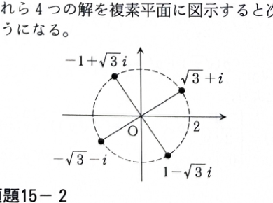

類題15-1

方程式
$$
z^4=-8+8\sqrt3\,i
$$
の解を求め、複素平面に図示せよ。

---

## 解答

> **解法の選択**
>
> 4次方程式を実部と虚部に分けて解く方法もあるが、右辺を極形式に直せば、絶対値の4乗と偏角の4倍を比較するだけで全解を漏れなく求められる。そのため、極形式とド・モアブルの定理を用いる。
>
> **前提知識**
>
> $z=r(\cos\theta+i\sin\theta)$ とおくと、
> $$
> z^4=r^4(\cos4\theta+i\sin4\theta)
> $$
> である。また、偏角は $2\pi$ の整数倍だけ異なっても同じ複素数を表す。

未知数を
$$
z=r(\cos\theta+i\sin\theta),
\qquad r>0,\quad 0\le\theta<2\pi
$$
とおく。

右辺の絶対値を求める。複素数 $a+bi$ の絶対値は
$$
|a+bi|=\sqrt{a^2+b^2}
$$
である。

文字の式に値を代入すると、
$$
|-8+8\sqrt3\,i|
=
\sqrt{(-8)^2+(8\sqrt3)^2}
$$
である。

したがって、
$$
|-8+8\sqrt3\,i|
=
\sqrt{64+192}
=
\sqrt{256}
=
16
$$
となる。

また、実部が負、虚部が正なので第2象限にあり、
$$
\cos\frac{2\pi}{3}=-\frac12,\qquad
\sin\frac{2\pi}{3}=\frac{\sqrt3}{2}
$$
であるから、
$$
-8+8\sqrt3\,i
=
16\left(
\cos\frac{2\pi}{3}
+i\sin\frac{2\pi}{3}
\right)
$$
と表せる。

一方、
$$
z^4
=
r^4(\cos4\theta+i\sin4\theta)
$$
である。

したがって、
$$
r^4(\cos4\theta+i\sin4\theta)
=
16\left(
\cos\frac{2\pi}{3}
+i\sin\frac{2\pi}{3}
\right)
$$
となるので、
$$
r^4=16
$$
および
$$
4\theta=\frac{2\pi}{3}+2n\pi
\qquad(n\in\mathbb{Z})
$$
を得る。

$r>0$ より、
$$
r=2
$$
である。

偏角について、まず文字の式
$$
\theta=\frac14\left(\frac{2\pi}{3}+2n\pi\right)
$$
を得る。

整理すると、
$$
\theta=\frac{\pi}{6}+\frac{n\pi}{2}
$$
である。

$n=0,1,2,3$ を代入すると、
$$
\theta
=
\frac{\pi}{6},\quad
\frac{2\pi}{3},\quad
\frac{7\pi}{6},\quad
\frac{5\pi}{3}
$$
となる。

したがって、
$$
z
=
2\left(\cos\frac{\pi}{6}+i\sin\frac{\pi}{6}\right),
$$
$$
z
=
2\left(\cos\frac{2\pi}{3}+i\sin\frac{2\pi}{3}\right),
$$
$$
z
=
2\left(\cos\frac{7\pi}{6}+i\sin\frac{7\pi}{6}\right),
$$
$$
z
=
2\left(\cos\frac{5\pi}{3}+i\sin\frac{5\pi}{3}\right)
$$
である。

直交形式に直すと、
$$
2\left(\frac{\sqrt3}{2}+\frac12 i\right)
=
\sqrt3+i,
$$
$$
2\left(-\frac12+\frac{\sqrt3}{2}i\right)
=
-1+\sqrt3\,i,
$$
$$
2\left(-\frac{\sqrt3}{2}-\frac12 i\right)
=
-\sqrt3-i,
$$
$$
2\left(\frac12-\frac{\sqrt3}{2}i\right)
=
1-\sqrt3\,i
$$
となる。

よって、
$$
\boxed{
z=\sqrt3+i,\quad
-1+\sqrt3\,i,\quad
-\sqrt3-i,\quad
1-\sqrt3\,i
}
$$

> 4つの解はすべて絶対値が $2$ で、偏角の差が $\frac{\pi}{2}$ である。したがって、原点を中心とする半径 $2$ の円周上に90度ずつずれて並ぶ。

