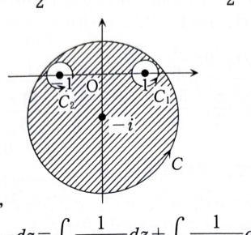

類題15-4

複素平面の円
$$
|z+i|=\sqrt3
$$
を正の向きに1周する積分路を $C$ とする。

## (1)

次の積分の値を求めよ。

$$
\int_C\frac{1}{z^2+1}\,dz
$$

---

## (1) 解答

> **解法の選択**
>
> 分母を因数分解すると特異点は $z=\pm i$ である。まず、どちらが円 $C$ の内側にあるかを距離で判定する。その後、部分分数分解と円周積分の公式を用いる。
>
> 留数定理を用いて、内部の特異点 $z=-i$ の留数だけを計算する方法もあるが、資料の解答に合わせて小円への積分路変形を明示する。

円 $C$ の中心は
$$
-i
$$
であり、半径は
$$
\sqrt3
$$
である。

特異点 $z=-i$ は円の中心なので、明らかに内部にある。

もう1つの特異点 $z=i$ と中心 $-i$ の距離は、
$$
|i-(-i)|=|2i|=2
$$
である。

ここで、
$$
2>\sqrt3
$$
なので、$z=i$ は円 $C$ の外側にある。

したがって、円 $C$ の内部にある特異点は
$$
z=-i
$$
だけである。

部分分数分解を行う。代入前の形を
$$
\frac{1}{(z-i)(z+i)}
=
\frac{A}{z-i}+\frac{B}{z+i}
$$
とおく。

両辺に $(z-i)(z+i)$ を掛けると、
$$
1=A(z+i)+B(z-i)
$$
である。

$z=i$ を代入すると、
$$
1=2iA
$$
より、
$$
A=\frac{1}{2i}
$$
である。

$z=-i$ を代入すると、
$$
1=-2iB
$$
より、
$$
B=-\frac{1}{2i}
$$
である。

よって、
$$
\frac{1}{z^2+1}
=
\frac{1}{2i}
\left(
\frac{1}{z-i}
-
\frac{1}{z+i}
\right)
$$
となる。

円 $C$ は $z=i$ を囲まないので、
$$
\int_C\frac{1}{z-i}\,dz=0
$$
である。

円 $C$ は $z=-i$ を正の向きに1周するので、
$$
\int_C\frac{1}{z+i}\,dz=2\pi i
$$
である。

したがって、
$$
\int_C\frac{1}{z^2+1}\,dz
=
\frac{1}{2i}
(0-2\pi i)
$$
である。

整理すると、
$$
\int_C\frac{1}{z^2+1}\,dz
=
-\pi
$$
となる。

よって、
$$
\boxed{\displaystyle\int_C\frac{1}{z^2+1}\,dz=-\pi}
$$

---

## (2)

次の積分の値を求めよ。

$$
\int_C\frac{1}{z^4-1}\,dz
$$

---

## (2) 解答

> **解法の選択**
>
> $z^4-1=(z^2-1)(z^2+1)$ と因数分解できる。資料では、被積分関数を $1/(z^2-1)$ と $1/(z^2+1)$ の差に分解し、(1) の結果を再利用している。この方法を採用する。
>
> 4つの極のうち円内にあるものをすべて調べて留数定理を直接使うこともできるが、ここでは計算の重複を避ける。

まず、文字の形で部分分数分解する。

$$
\frac{1}{z^4-1}
=
\frac{1}{(z^2-1)(z^2+1)}
$$

次の恒等式を考える。
$$
\frac12\left(
\frac{1}{z^2-1}
-
\frac{1}{z^2+1}
\right)
$$

通分すると、
$$
\frac12
\frac{(z^2+1)-(z^2-1)}
{(z^2-1)(z^2+1)}
$$
である。

分子を整理すると、
$$
(z^2+1)-(z^2-1)=2
$$
なので、
$$
\frac12\left(
\frac{1}{z^2-1}
-
\frac{1}{z^2+1}
\right)
=
\frac{1}{z^4-1}
$$
となる。

したがって、
$$
\int_C\frac{1}{z^4-1}\,dz
=
\frac12\left(
\int_C\frac{1}{z^2-1}\,dz
-
\int_C\frac{1}{z^2+1}\,dz
\right)
$$
である。

ここで、
$$
\frac{1}{z^2-1}
=
\frac{1}{(z-1)(z+1)}
=
\frac12\left(
\frac{1}{z-1}
-
\frac{1}{z+1}
\right)
$$
である。

円の中心 $-i$ から $z=1$ までの距離は、
$$
|1-(-i)|=|1+i|=\sqrt2
$$
である。

同様に、中心 $-i$ から $z=-1$ までの距離は、
$$
|-1-(-i)|=|-1+i|=\sqrt2
$$
である。

$\sqrt2<\sqrt3$ なので、$z=1,-1$ はともに円 $C$ の内部にある。

したがって、
$$
\int_C\frac{1}{z-1}\,dz=2\pi i
$$
および
$$
\int_C\frac{1}{z+1}\,dz=2\pi i
$$
である。

よって、
$$
\int_C\frac{1}{z^2-1}\,dz
=
\frac12(2\pi i-2\pi i)
=
0
$$
となる。

また、(1) より、
$$
\int_C\frac{1}{z^2+1}\,dz=-\pi
$$
である。

したがって、
$$
\int_C\frac{1}{z^4-1}\,dz
=
\frac12\{0-(-\pi)\}
$$
となる。

よって、
$$
\boxed{\displaystyle\int_C\frac{1}{z^4-1}\,dz=\frac{\pi}{2}}
$$
