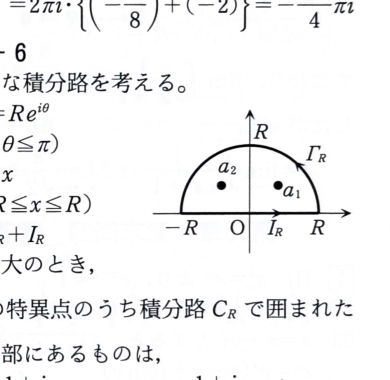

類題15-6

複素積分を利用することにより、次の定積分の値を求めよ。

$$
I=\int_{-\infty}^{\infty}\frac{1}{x^4+1}\,dx
$$

---

## 解答

> **解法の選択**
>
> 被積分関数は実軸上に極をもたない有理関数であり、無限遠で $1/x^4$ の速さで減衰する。そこで、実軸上の線分と上半円を合わせた閉曲線を取り、上半平面内の極に留数定理を適用する。
>
> 偶関数であることを用いて $2\int_0^\infty$ とし、実変数の置換で計算する方法もあるが、資料の目的に合わせて半円積分路を用いる。
>
> **前提知識：半円積分路**
>
> $R>0$ に対し、
> $$
> I_R:\quad z=x\quad(-R\le x\le R)
> $$
> と、
> $$
> \Gamma_R:\quad z=Re^{i\theta}\quad(0\le\theta\le\pi)
> $$
> を合わせた正向きの閉曲線を $C_R$ とする。上半円上の積分が $R\to\infty$ で0へ収束すれば、閉曲線積分の極限が求める実積分になる。

被積分関数を
$$
f(z)=\frac{1}{z^4+1}
$$
とする。

積分路は、実軸上の線分 $I_R$ と上半円 $\Gamma_R$ からなる
$$
C_R=I_R+\Gamma_R
$$
とする。

まず、極を求める。

方程式
$$
z^4+1=0
$$
は
$$
z^4=-1
$$
と同値である。

$-1$ の極形式は
$$
-1=\cos\pi+i\sin\pi
$$
である。

未知数を
$$
z=r(\cos\theta+i\sin\theta)
$$
とおくと、
$$
z^4=r^4(\cos4\theta+i\sin4\theta)
$$
である。

したがって、
$$
r^4=1
$$
および
$$
4\theta=\pi+2n\pi
\qquad(n\in\mathbb{Z})
$$
を得る。

$r>0$ より、
$$
r=1
$$
である。

偏角は、代入前の式
$$
\theta=\frac{\pi+2n\pi}{4}
$$
から、
$$
\theta=\frac{\pi}{4}+\frac{n\pi}{2}
$$
となる。

$0\le\theta<2\pi$ にある4つの根は、
$$
e^{\pi i/4},\quad
e^{3\pi i/4},\quad
e^{5\pi i/4},\quad
e^{7\pi i/4}
$$
である。

上半平面にある極は、
$$
a_1=e^{\pi i/4}=\frac{1+i}{\sqrt2}
$$
および
$$
a_2=e^{3\pi i/4}=\frac{-1+i}{\sqrt2}
$$
である。

各極は1位の極である。なぜなら、分母
$$
g(z)=z^4+1
$$
の導関数は
$$
g'(z)=4z^3
$$
であり、各根 $a_k$ は0ではないので
$$
g'(a_k)=4a_k^3\ne0
$$
だからである。

1位の極 $a$ における留数の代入前の公式は
$$
\operatorname{Res}(a)
=
\frac{1}{g'(a)}
$$
である。

したがって、
$$
\operatorname{Res}(a_k)
=
\frac{1}{4a_k^3}
$$
となる。

ここで $a_k^4=-1$ なので、
$$
\frac{1}{a_k^3}
=
\frac{a_k}{a_k^4}
=
-a_k
$$
である。

よって、
$$
\operatorname{Res}(a_k)=-\frac{a_k}{4}
$$
となる。

2つの留数の和は、
$$
\operatorname{Res}(a_1)+\operatorname{Res}(a_2)
=
-\frac14(a_1+a_2)
$$
である。

$a_1,a_2$ を代入すると、
$$
a_1+a_2
=
\frac{1+i}{\sqrt2}
+
\frac{-1+i}{\sqrt2}
$$
となる。

実部が打ち消し合い、
$$
a_1+a_2
=
\frac{2i}{\sqrt2}
=
\sqrt2\,i
$$
である。

したがって、
$$
\operatorname{Res}(a_1)+\operatorname{Res}(a_2)
=
-\frac{\sqrt2}{4}i
=
-\frac{i}{2\sqrt2}
$$
となる。

留数定理より、
$$
\int_{C_R}\frac{1}{z^4+1}\,dz
=
2\pi i
\left(
-\frac{i}{2\sqrt2}
\right)
$$
である。

$i^2=-1$ より、
$$
2\pi i
\left(
-\frac{i}{2\sqrt2}
\right)
=
\frac{\pi}{\sqrt2}
$$
となる。

次に、上半円 $\Gamma_R$ 上の積分が0へ収束することを示す。

$\Gamma_R$ 上では
$$
|z|=R
$$
である。

逆三角不等式
$$
|z^4+1|
\ge
\bigl||z|^4-1\bigr|
$$
を用いると、$R>1$ に対して
$$
|z^4+1|\ge R^4-1
$$
である。

したがって、
$$
\left|
\frac{1}{z^4+1}
\right|
\le
\frac{1}{R^4-1}
$$
となる。

上半円の長さは
$$
\pi R
$$
なので、ML評価より、
$$
\left|
\int_{\Gamma_R}
\frac{1}{z^4+1}\,dz
\right|
\le
\frac{\pi R}{R^4-1}
$$
である。

右辺は
$$
\lim_{R\to\infty}\frac{\pi R}{R^4-1}=0
$$
なので、
$$
\lim_{R\to\infty}
\int_{\Gamma_R}
\frac{1}{z^4+1}\,dz
=
0
$$
となる。

一方、実軸上では $z=x$、$dz=dx$ だから、
$$
\int_{I_R}\frac{1}{z^4+1}\,dz
=
\int_{-R}^R\frac{1}{x^4+1}\,dx
$$
である。

したがって、
$$
\int_{C_R}\frac{1}{z^4+1}\,dz
=
\int_{-R}^R\frac{1}{x^4+1}\,dx
+
\int_{\Gamma_R}\frac{1}{z^4+1}\,dz
$$
である。

$R\to\infty$ とすると、
$$
\int_{-\infty}^{\infty}\frac{1}{x^4+1}\,dx
=
\frac{\pi}{\sqrt2}
$$
を得る。

よって、
$$
\boxed{I=\frac{\pi}{\sqrt2}}
$$
