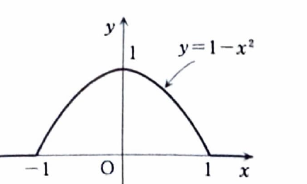

本資料では、関数 $f(t)$ のフーリエ変換を

$$
F(u)=\frac{1}{\sqrt{2\pi}}\int_{-\infty}^{\infty}f(t)e^{-iut}\,dt
$$

で定める。逆変換は

$$
f(x)=\frac{1}{\sqrt{2\pi}}\int_{-\infty}^{\infty}F(u)e^{iux}\,du
$$

である。これは $f$ が点 $x$ で連続な場合に成り立つ反転公式である。

この二つの式を一つにまとめた

$$
\frac{1}{2\pi}
\int_{-\infty}^{\infty}
\left(
\int_{-\infty}^{\infty}
f(t)e^{-iut}\,dt
\right)e^{iux}\,du
$$

を $f(x)$ のフーリエ積分という。

> 資料によっては、$f(x)$ のフーリエ変換を $\overline{f}(u)$ と表すこともある。本ファイルでは $F(u)$ に統一する。

> オイラーの公式
>
> $$
> e^{i\theta}=\cos\theta+i\sin\theta
> $$
>
> から
>
> $$
> e^{-iut}=\cos ut-i\sin ut
> $$
>
> となる。
>
> $f(t)$ が偶関数なら、$f(t)\sin ut$ は奇関数なので、その積分は $0$ になる。そのため、偶関数のフーリエ変換では余弦部分だけを計算すればよい。

---

第16章 章末問題3

右のグラフで与えられる関数のフーリエ変換を求めよ。

グラフが表す関数は、

$$
f(t)=
\begin{cases}
1-t^2 & (|t|\le1),\\
0 & (|t|>1)
\end{cases}
$$

である。

---

## 解答

> $f(t)$ は偶関数なので、フーリエ変換を余弦積分に直してから部分積分を行う方法を選ぶ。
>
> 複素指数関数のまま積分する方法もあるが、実部と虚部を分ければ虚部が奇関数として消えることが分かり、計算が見通しよくなる。
>
> 資料の解答は $u\ne0$ の式を示している。完全なフーリエ変換としては $u=0$ の値も定義から求める。

フーリエ変換の定義は、

$$
F(u)=\frac{1}{\sqrt{2\pi}}
\int_{-\infty}^{\infty}f(t)e^{-iut}\,dt
$$

である。$f(t)$ は $|t|\le1$ でだけ $0$ でないので、

$$
F(u)
=
\frac{1}{\sqrt{2\pi}}
\int_{-1}^{1}(1-t^2)e^{-iut}\,dt
$$

となる。

オイラーの公式

$$
e^{-iut}=\cos ut-i\sin ut
$$

を代入すると、

$$
F(u)
=
\frac{1}{\sqrt{2\pi}}
\int_{-1}^{1}
(1-t^2)(\cos ut-i\sin ut)\,dt
$$

である。$(1-t^2)\cos ut$ は偶関数、$(1-t^2)\sin ut$ は奇関数なので、

$$
F(u)
=
\frac{2}{\sqrt{2\pi}}
\int_0^1(1-t^2)\cos ut\,dt
$$

となる。

$u\ne0$ として、

$$
I(u)=\int_0^1(1-t^2)\cos ut\,dt
$$

を計算する。

> 1回目の部分積分では、
>
> $$
> A(t)=1-t^2,\qquad dv=\cos ut\,dt
> $$
>
> とおく。すると、
>
> $$
> dA=-2t\,dt,\qquad v=\frac{1}{u}\sin ut
> $$
>
> である。

したがって、

$$
I(u)
=
\left[
(1-t^2)\frac{\sin ut}{u}
\right]_0^1
+
\frac{2}{u}\int_0^1 t\sin ut\,dt
$$

である。境界項は、$t=1$ では $1-t^2=0$、$t=0$ では $\sin0=0$ なので、

$$
\left[
(1-t^2)\frac{\sin ut}{u}
\right]_0^1
=0
$$

である。よって、

$$
I(u)
=
\frac{2}{u}\int_0^1 t\sin ut\,dt
$$

となる。

次に、

$$
J(u)=\int_0^1 t\sin ut\,dt
$$

を部分積分する。代入前の設定は、

$$
A(t)=t,\qquad dv=\sin ut\,dt
$$

であり、

$$
dA=dt,\qquad v=-\frac{1}{u}\cos ut
$$

となる。したがって、

$$
J(u)
=
\left[
-\frac{t}{u}\cos ut
\right]_0^1
+
\frac{1}{u}\int_0^1\cos ut\,dt
$$

である。第1項は、

$$
\left[
-\frac{t}{u}\cos ut
\right]_0^1
=
-\frac{\cos u}{u}
$$

である。第2項では、まず

$$
\int\cos ut\,dt=\frac{1}{u}\sin ut
$$

であるから、

$$
\frac{1}{u}\int_0^1\cos ut\,dt
=
\frac{1}{u^2}
[\sin ut]_0^1
$$

$$
=
\frac{\sin u}{u^2}
$$

である。よって、

$$
J(u)
=
-\frac{\cos u}{u}
+
\frac{\sin u}{u^2}
$$

となる。

これを $I(u)$ に代入すると、

$$
I(u)
=
\frac{2}{u}
\left(
-\frac{\cos u}{u}
+
\frac{\sin u}{u^2}
\right)
$$

$$
=
-\frac{2\cos u}{u^2}
+
\frac{2\sin u}{u^3}
$$

$$
=
\frac{2(\sin u-u\cos u)}{u^3}
$$

である。したがって、

$$
F(u)
=
\frac{2}{\sqrt{2\pi}}I(u)
$$

に代入すると、

$$
F(u)
=
\frac{2}{\sqrt{2\pi}}
\cdot
\frac{2(\sin u-u\cos u)}{u^3}
$$

$$
\boxed{
F(u)
=
\frac{4}{\sqrt{2\pi}}
\frac{\sin u-u\cos u}{u^3}
\qquad (u\ne0)
}
$$

となる。

次に $u=0$ の値を求める。定義は、

$$
F(0)
=
\frac{1}{\sqrt{2\pi}}
\int_{-\infty}^{\infty}f(t)\,dt
$$

である。$f(t)$ の定義を代入すると、

$$
F(0)
=
\frac{1}{\sqrt{2\pi}}
\int_{-1}^{1}(1-t^2)\,dt
$$

となる。被積分関数は偶関数なので、

$$
F(0)
=
\frac{2}{\sqrt{2\pi}}
\int_0^1(1-t^2)\,dt
$$

である。積分すると、

$$
F(0)
=
\frac{2}{\sqrt{2\pi}}
\left[
t-\frac{t^3}{3}
\right]_0^1
$$

$$
=
\frac{2}{\sqrt{2\pi}}
\left(
1-\frac{1}{3}
\right)
$$

$$
F(0)
=
\frac{2}{\sqrt{2\pi}}
\cdot
\frac{2}{3}
$$

$$
\boxed{
F(0)=\frac{4}{3\sqrt{2\pi}}
}
$$

である。

> $u\ne0$ の式も $u\to0$ でこの値に近づく。
>
> $$
> \sin u=u-\frac{u^3}{6}+O(u^5)
> $$
>
> $$
> u\cos u
> =
> u\left(1-\frac{u^2}{2}+O(u^4)\right)
> =
> u-\frac{u^3}{2}+O(u^5)
> $$
>
> なので、
>
> $$
> \sin u-u\cos u
> =
> \frac{u^3}{3}+O(u^5)
> $$
>
> であり、
>
> $$
> \lim_{u\to0}
> \frac{4}{\sqrt{2\pi}}
> \frac{\sin u-u\cos u}{u^3}
> =
> \frac{4}{3\sqrt{2\pi}}
> $$
>
> となる。

以上より、フーリエ変換は

$$
\boxed{
F(u)=
\begin{cases}
\dfrac{4}{\sqrt{2\pi}}
\dfrac{\sin u-u\cos u}{u^3}
& (u\ne0),\\[10pt]
\dfrac{4}{3\sqrt{2\pi}}
& (u=0)
\end{cases}
}
$$

である。
