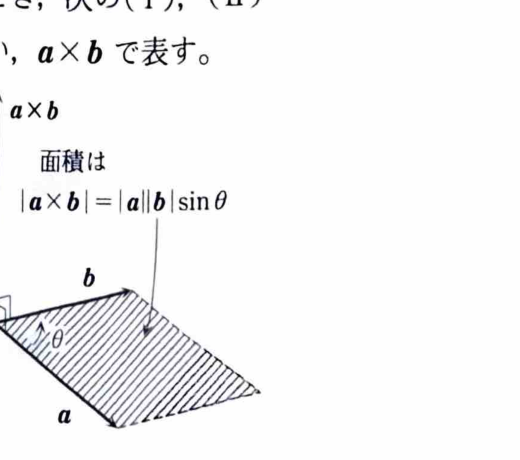

例題18-1（内積と外積）

> **前提知識：内積と外積**
>
> 3次元ベクトル
>
> $$
> a=(a_x,a_y,a_z),\qquad b=(b_x,b_y,b_z)
> $$
>
> の内積は
>
> $$
> a\cdot b=a_xb_x+a_yb_y+a_zb_z
> $$
>
> である。幾何学的には、2ベクトルのなす角を $\theta$ とすると
>
> $$
> a\cdot b=|a||b|\cos\theta
> $$
>
> である。
>
> 外積は
>
> $$
> a\times b=
> \begin{pmatrix}
> a_yb_z-a_zb_y\\
> a_zb_x-a_xb_z\\
> a_xb_y-a_yb_x
> \end{pmatrix}
> $$
>
> である。$a\times b$ は $a$ と $b$ の両方に垂直であり、その大きさは
>
> $$
> |a\times b|=|a||b|\sin\theta
> $$
>
> となる。したがって、$|a\times b|$ は $a,b$ を2辺とする平行四辺形の面積に等しい。
>
> また、3ベクトル $a,b,c$ に対して
>
> $$
> (a\times b)\cdot c
> $$
>
> をスカラー三重積といい、その絶対値は $a,b,c$ を3辺とする平行六面体の体積に等しい。

>
> $a$ または $b$ が零ベクトルのときは
>
> $$
> a\cdot b=0
> $$
>
> と定める。また、$a$ または $b$ が零ベクトルである場合、または $a,b$ が平行である場合には
>
> $$
> a\times b=0
> $$
>
> である。
>
> 外積の向きは、$a$ から $b$ へ回すときの右ねじの進む方向である。
>
> スカラー三重積は
>
> $$
> a\cdot(b\times c)=(a\times b)\cdot c
> $$
>
> と循環的に書き換えられる。

> 

---

## (1)

$a=(1,2,1)$、$b=(2,-1,1)$ のとき、内積 $a\cdot b$ および外積 $a\times b$ を求めよ。

---

## (1) 解答

> この小問は、成分がすべて与えられているため、内積と外積の成分表示へ直接代入する方法が最も確実である。
> 内積はなす角から求めることもできるが、角度が与えられていないので成分計算の方が簡単である。
> 外積は行列式を用いて計算する方法もあるが、符号の取り違えを避けるため、ここでは各成分の公式を明示して計算する。

内積の公式は

$$
a\cdot b=a_xb_x+a_yb_y+a_zb_z
$$

である。

ここで

$$
a_x=1,\quad a_y=2,\quad a_z=1,
$$

$$
b_x=2,\quad b_y=-1,\quad b_z=1
$$

を代入すると、

$$
\begin{aligned}
a\cdot b
&=1\cdot2+2\cdot(-1)+1\cdot1\\
&=2-2+1\\
&=1
\end{aligned}
$$

したがって、

$$
\boxed{a\cdot b=1}
$$

外積の公式は

$$
a\times b=
\begin{pmatrix}
a_yb_z-a_zb_y\\
a_zb_x-a_xb_z\\
a_xb_y-a_yb_x
\end{pmatrix}
$$

である。

まず第1成分は、

$$
a_yb_z-a_zb_y
$$

に値を代入して、

$$
2\cdot1-1\cdot(-1)=2+1=3
$$

となる。

第2成分は、

$$
a_zb_x-a_xb_z
$$

に値を代入して、

$$
1\cdot2-1\cdot1=2-1=1
$$

となる。

第3成分は、

$$
a_xb_y-a_yb_x
$$

に値を代入して、

$$
1\cdot(-1)-2\cdot2=-1-4=-5
$$

となる。

よって、

$$
a\times b=
\begin{pmatrix}
3\\
1\\
-5
\end{pmatrix}
$$

したがって、

$$
\boxed{a\times b=(3,1,-5)}
$$

---

## (2)

$a=(2,-3,4)$、$b=(1,2,-1)$、$c=(3,-1,2)$ を3辺とする平行六面体の体積を求めよ。

---

## (2) 解答

> 平行六面体の体積は、スカラー三重積の絶対値
>
> $$
> |(a\times b)\cdot c|
> $$
>
> で求められる。
> 行列式
>
> $$
> \left|\det(a,b,c)\right|
> $$
>
> を直接計算する方法もあるが、資料の流れに合わせ、まず $a\times b$ を求めてから $c$ との内積を計算する。

外積の公式は

$$
a\times b=
\begin{pmatrix}
a_yb_z-a_zb_y\\
a_zb_x-a_xb_z\\
a_xb_y-a_yb_x
\end{pmatrix}
$$

である。

第1成分は、

$$
a_yb_z-a_zb_y
$$

に値を代入して、

$$
(-3)\cdot(-1)-4\cdot2=3-8=-5
$$

となる。

第2成分は、

$$
a_zb_x-a_xb_z
$$

に値を代入して、

$$
4\cdot1-2\cdot(-1)=4+2=6
$$

となる。

第3成分は、

$$
a_xb_y-a_yb_x
$$

に値を代入して、

$$
2\cdot2-(-3)\cdot1=4+3=7
$$

となる。

したがって、

$$
a\times b=
\begin{pmatrix}
-5\\
6\\
7
\end{pmatrix}
$$

次に、内積の公式

$$
(a\times b)\cdot c
=(a\times b)_xc_x+(a\times b)_yc_y+(a\times b)_zc_z
$$

へ値を代入する。

$$
\begin{aligned}
(a\times b)\cdot c
&=(-5)\cdot3+6\cdot(-1)+7\cdot2\\
&=-15-6+14\\
&=-7
\end{aligned}
$$

体積はスカラー三重積の絶対値なので、

$$
V=|(a\times b)\cdot c|
$$

に値を代入して、

$$
V=|-7|=7
$$

したがって、求める体積は

$$
\boxed{7}
$$
