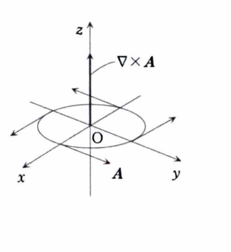

例題18-2（勾配・発散・回転）

> **前提知識：勾配・発散・回転**
>
> スカラー場 $\phi(x,y,z)$ の勾配は
>
> $$
> \operatorname{grad}\phi=\nabla\phi=
> \left(
> \frac{\partial\phi}{\partial x},
> \frac{\partial\phi}{\partial y},
> \frac{\partial\phi}{\partial z}
> \right)
> $$
>
> であり、結果はベクトルである。
>
> ベクトル場 $A=(A_1,A_2,A_3)$ の発散は
>
> $$
> \operatorname{div}A=\nabla\cdot A
> =\frac{\partial A_1}{\partial x}
> +\frac{\partial A_2}{\partial y}
> +\frac{\partial A_3}{\partial z}
> $$
>
> であり、結果はスカラーである。
>
> ベクトル場 $A=(A_1,A_2,A_3)$ の回転は
>
> $$
> \operatorname{rot}A=\nabla\times A
> =
> \left(
> \frac{\partial A_3}{\partial y}-\frac{\partial A_2}{\partial z},
> \frac{\partial A_1}{\partial z}-\frac{\partial A_3}{\partial x},
> \frac{\partial A_2}{\partial x}-\frac{\partial A_1}{\partial y}
> \right)
> $$
>
> であり、結果はベクトルである。

>
> **ラプラシアン**
>
> $$
> \Delta
> =
> \frac{\partial^2}{\partial x^2}
> +
> \frac{\partial^2}{\partial y^2}
> +
> \frac{\partial^2}{\partial z^2}
> =
> \nabla\cdot\nabla
> =
> \nabla^2
> $$
>
> と定義する。
>
> **資料に示された演算公式**
>
> 定数 $k$、スカラー場 $\phi,\psi$、ベクトル場 $A,B$ に対して、
>
> $$
> \nabla\times(A+B)
> =
> \nabla\times A+\nabla\times B
> $$
>
> $$
> \nabla\times(kA)
> =
> k(\nabla\times A)
> $$
>
> $$
> \nabla(\phi\psi)
> =
> (\nabla\phi)\psi+\phi(\nabla\psi)
> $$
>
> $$
> \nabla\left(\frac{\phi}{\psi}\right)
> =
> \frac{(\nabla\phi)\psi-\phi(\nabla\psi)}{\psi^2}
> $$
>
> $$
> \nabla\cdot(\phi A)
> =
> (\nabla\phi)\cdot A+\phi(\nabla\cdot A)
> $$
>
> $$
> \nabla\times(\phi A)
> =
> (\nabla\phi)\times A+\phi(\nabla\times A)
> $$

> 

---

## (1)

$$
\phi(x,y,z)=x^2+y^2+z^2
$$

のとき、勾配 $\nabla\phi$ を求めよ。

---

## (1) 解答

> 勾配は、スカラー場を $x,y,z$ でそれぞれ偏微分し、その3つを成分として並べればよい。
> この問題では各項が別々の変数だけを含むため、定義へ直接当てはめる方法が最も簡単である。
> 等位面の法線方向を考える幾何学的な方法もあるが、数値計算には偏微分の定義を使う方が確実である。

勾配の定義は

$$
\nabla\phi=
\left(
\frac{\partial\phi}{\partial x},
\frac{\partial\phi}{\partial y},
\frac{\partial\phi}{\partial z}
\right)
$$

である。

まず、

$$
\frac{\partial\phi}{\partial x}
$$

を求める。$y,z$ を定数として扱うと、

$$
\frac{\partial}{\partial x}(x^2+y^2+z^2)=2x
$$

である。

同様に、

$$
\frac{\partial\phi}{\partial y}
$$

は、

$$
\frac{\partial}{\partial y}(x^2+y^2+z^2)=2y
$$

である。

また、

$$
\frac{\partial\phi}{\partial z}
$$

は、

$$
\frac{\partial}{\partial z}(x^2+y^2+z^2)=2z
$$

である。

したがって、

$$
\boxed{\nabla\phi=(2x,2y,2z)}
$$

---

## (2)

$$
A=(A_1,A_2,A_3)=(x,y,z)
$$

のとき、発散 $\nabla\cdot A$ を求めよ。

---

## (2) 解答

> 発散では、ベクトル場の第1成分を $x$ で、第2成分を $y$ で、第3成分を $z$ で偏微分し、それらを加える。
> 各成分の全微分を取るのではなく、対応する変数でだけ微分する点が重要である。

発散の定義は

$$
\nabla\cdot A
=
\frac{\partial A_1}{\partial x}
+\frac{\partial A_2}{\partial y}
+\frac{\partial A_3}{\partial z}
$$

である。

ここで、

$$
A_1=x,\qquad A_2=y,\qquad A_3=z
$$

なので、

$$
\frac{\partial A_1}{\partial x}
=
\frac{\partial x}{\partial x}
=1
$$

$$
\frac{\partial A_2}{\partial y}
=
\frac{\partial y}{\partial y}
=1
$$

$$
\frac{\partial A_3}{\partial z}
=
\frac{\partial z}{\partial z}
=1
$$

となる。

したがって、

$$
\nabla\cdot A=1+1+1=3
$$

よって、

$$
\boxed{\nabla\cdot A=3}
$$

---

## (3)

$$
A=(A_1,A_2,A_3)=(-y,x,0)
$$

のとき、回転 $\nabla\times A$ を求めよ。

---

## (3) 解答

> 回転は成分公式へ直接代入して求める。
> 形式的な行列式
>
> $$
> \begin{vmatrix}
> i&j&k\\
> \partial_x&\partial_y&\partial_z\\
> A_1&A_2&A_3
> \end{vmatrix}
> $$
>
> を使う方法もあるが、第2成分の符号を誤りやすいため、ここでは定義された成分順をそのまま使う。

回転の定義は

$$
\nabla\times A
=
\left(
\frac{\partial A_3}{\partial y}-\frac{\partial A_2}{\partial z},
\frac{\partial A_1}{\partial z}-\frac{\partial A_3}{\partial x},
\frac{\partial A_2}{\partial x}-\frac{\partial A_1}{\partial y}
\right)
$$

である。

ここで、

$$
A_1=-y,\qquad A_2=x,\qquad A_3=0
$$

である。

第1成分は、

$$
\frac{\partial A_3}{\partial y}-\frac{\partial A_2}{\partial z}
$$

に各成分を代入して、

$$
\frac{\partial 0}{\partial y}-\frac{\partial x}{\partial z}
=0-0=0
$$

となる。

第2成分は、

$$
\frac{\partial A_1}{\partial z}-\frac{\partial A_3}{\partial x}
$$

に各成分を代入して、

$$
\frac{\partial(-y)}{\partial z}-\frac{\partial 0}{\partial x}
=0-0=0
$$

となる。

第3成分は、

$$
\frac{\partial A_2}{\partial x}-\frac{\partial A_1}{\partial y}
$$

に各成分を代入して、

$$
\frac{\partial x}{\partial x}-\frac{\partial(-y)}{\partial y}
=1-(-1)=2
$$

となる。

したがって、

$$
\boxed{\nabla\times A=(0,0,2)}
$$
