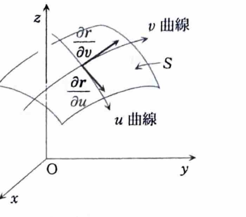

例題18-5（曲面の面積）

> **前提知識：曲面の面積**
>
> 曲面が
>
> $$
> r(u,v)=(x(u,v),y(u,v),z(u,v))
> $$
>
> と表されるとき、面積素は
>
> $$
> dS=
> \left|
> \frac{\partial r}{\partial u}
> \times
> \frac{\partial r}{\partial v}
> \right|
> dudv
> $$
>
> である。
>
> 特に、曲面がグラフ
>
> $$
> z=f(x,y)
> $$
>
> で表されるとき、
>
> $$
> dS=
> \sqrt{1+f_x^2+f_y^2}\,dxdy
> $$
>
> となる。

>
> より一般に、スカラー場 $\phi$ の曲面積分は
>
> $$
> \iint_S\phi\,dS
> =
> \iint_D
> \phi(r(u,v))
> \left|
> \frac{\partial r}{\partial u}
> \times
> \frac{\partial r}{\partial v}
> \right|
> dudv
> $$
>
> である。特に $\phi=1$ とすれば曲面の面積が得られる。

> 

曲面

$$
z=1-x^2-y^2,\qquad z\ge0
$$

の面積 $S$ を求めよ。

---

## 解答

> 曲面が $z=f(x,y)$ の形で与えられているため、グラフ曲面の面積公式
>
> $$
> S=\iint_D\sqrt{1+f_x^2+f_y^2}\,dxdy
> $$
>
> を使うのが最も直接的である。
> 曲面を極座標で最初からパラメータ表示して接ベクトルの外積を計算する方法もあるが、同じ積分に帰着し、計算量が増えるためここでは用いない。

曲面を表す関数を

$$
f(x,y)=1-x^2-y^2
$$

とおく。

条件

$$
z\ge0
$$

へ曲面の式を代入すると、

$$
1-x^2-y^2\ge0
$$

である。

したがって、$xy$ 平面への射影領域は

$$
D:x^2+y^2\le1
$$

となる。

まず、偏導関数の文字式は

$$
f_x=\frac{\partial f}{\partial x},\qquad
f_y=\frac{\partial f}{\partial y}
$$

である。

$f(x,y)=1-x^2-y^2$ を代入して計算すると、

$$
f_x=-2x,\qquad f_y=-2y
$$

となる。

面積公式へ代入すると、

$$
S
=
\iint_D
\sqrt{1+(-2x)^2+(-2y)^2}\,dxdy
$$

である。

整理すると、

$$
S
=
\iint_D
\sqrt{1+4x^2+4y^2}\,dxdy
$$

となる。

領域 $D$ は単位円板なので、極座標

$$
x=r\cos\theta,\qquad y=r\sin\theta
$$

を用いる。

このとき、

$$
x^2+y^2=r^2,\qquad dxdy=r\,drd\theta
$$

であり、積分範囲は

$$
0\le r\le1,\qquad0\le\theta\le2\pi
$$

である。

したがって、

$$
\begin{aligned}
S
&=
\int_0^{2\pi}
\int_0^1
\sqrt{1+4r^2}\,r\,drd\theta\\
&=
2\pi
\int_0^1
r\sqrt{1+4r^2}\,dr
\end{aligned}
$$

となる。

> 置換積分として
>
> $$
> u=1+4r^2
> $$
>
> とおくと、
>
> $$
> du=8r\,dr
> $$
>
> である。

したがって、

$$
r\,dr=\frac18\,du
$$

であり、

$$
\int r\sqrt{1+4r^2}\,dr
=
\frac18\int u^{1/2}\,du
$$

となる。

指数関数の積分公式

$$
\int u^{1/2}\,du
=
\frac{2}{3}u^{3/2}
$$

を用いると、

$$
\int r\sqrt{1+4r^2}\,dr
=
\frac1{12}(1+4r^2)^{3/2}
$$

である。

よって、

$$
\begin{aligned}
S
&=
2\pi
\left[
\frac1{12}(1+4r^2)^{3/2}
\right]_0^1\\
&=
\frac{\pi}{6}
\left\{
(1+4)^{3/2}-1^{3/2}
\right\}\\
&=
\frac{\pi}{6}
\left(5\sqrt5-1\right)
\end{aligned}
$$

したがって、

$$
\boxed{S=\frac{5\sqrt5-1}{6}\pi}
$$
