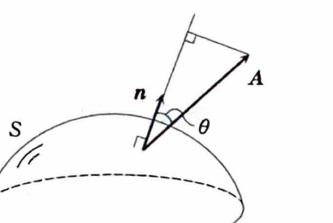

例題18-6（ベクトル場の面積分）

> **前提知識：ベクトル場の面積分と流束**
>
> 向きづけられた曲面 $S$ の単位法線ベクトルを $n$ とすると、ベクトル場 $A$ の面積分は
>
> $$
> \iint_S A\cdot n\,dS
> $$
>
> であり、曲面を通過する流束ともいう。
>
> 曲面が
>
> $$
> r(u,v)
> $$
>
> とパラメータ表示され、向きに合う法線面積ベクトルとして
>
> $$
> \frac{\partial r}{\partial u}
> \times
> \frac{\partial r}{\partial v}
> $$
>
> を選べるとき、
>
> $$
> \iint_S A\cdot n\,dS
> =
> \iint_D
> A(r(u,v))
> \cdot
> \left(
> \frac{\partial r}{\partial u}
> \times
> \frac{\partial r}{\partial v}
> \right)
> dudv
> $$
>
> である。

>
> $A$ と $n$ のなす角を $\theta$ とすると、
>
> $$
> A\cdot n=|A|\cos\theta
> $$
>
> なので、面積分はベクトル場の法線方向成分を曲面全体で合計している。
>
> 記号
>
> $$
> \iint_S A\cdot d\boldsymbol{S}
> $$
>
> で表すこともある。

> 

ベクトル場を

$$
A=(2x,2y,z)
$$

とし、$S$ を半球面

$$
x^2+y^2+z^2=9,\qquad z\ge0
$$

とする。法線を外向きにとるとき、

$$
\iint_S A\cdot n\,dS
$$

を求めよ。

---

## 解答

> 半球面を $z=\sqrt{9-x^2-y^2}$ というグラフとして表し、上向きの法線面積ベクトルを用いる。
> 上半球の外向き法線は上向き成分をもつので、この選び方が向きと一致する。
> 発散定理を使って半球と底面で囲まれる半球体へ変換する方法もあるが、資料では曲面の面積分の基本公式を練習する目的で直接積分しているため、その方法に従う。

上半球は

$$
z=\sqrt{9-x^2-y^2}
$$

と表される。

$xy$ 平面への射影領域は

$$
D:x^2+y^2\le9
$$

である。

グラフ曲面

$$
r(x,y)=(x,y,z(x,y))
$$

に対して、

$$
\frac{\partial r}{\partial x}=(1,0,z_x)
$$

および

$$
\frac{\partial r}{\partial y}=(0,1,z_y)
$$

である。

したがって、

$$
\frac{\partial r}{\partial x}
\times
\frac{\partial r}{\partial y}
=
(-z_x,-z_y,1)
$$

である。

球面の式

$$
x^2+y^2+z^2=9
$$

を $x$ で偏微分すると、

$$
2x+2zz_x=0
$$

なので、

$$
z_x=-\frac{x}{z}
$$

である。

同様に $y$ で偏微分すると、

$$
2y+2zz_y=0
$$

なので、

$$
z_y=-\frac{y}{z}
$$

である。

したがって、

$$
\frac{\partial r}{\partial x}
\times
\frac{\partial r}{\partial y}
=
\left(
\frac{x}{z},
\frac{y}{z},
1
\right)
$$

となる。

次に、ベクトル場

$$
A=(2x,2y,z)
$$

と法線面積ベクトルとの内積を求める。

内積の文字式は

$$
A\cdot
\left(
\frac{\partial r}{\partial x}
\times
\frac{\partial r}{\partial y}
\right)
$$

である。

値を代入すると、

$$
\begin{aligned}
A\cdot
\left(
\frac{\partial r}{\partial x}
\times
\frac{\partial r}{\partial y}
\right)
&=
(2x,2y,z)\cdot
\left(
\frac{x}{z},
\frac{y}{z},
1
\right)\\
&=
\frac{2x^2}{z}
+\frac{2y^2}{z}
+z
\end{aligned}
$$

となる。

通分すると、

$$
\frac{2x^2+2y^2+z^2}{z}
$$

である。

球面上では

$$
z^2=9-x^2-y^2
$$

なので、

$$
2x^2+2y^2+z^2
=
2x^2+2y^2+9-x^2-y^2
=
x^2+y^2+9
$$

となる。

また、

$$
z=\sqrt{9-x^2-y^2}
$$

であるから、

$$
A\cdot
\left(
\frac{\partial r}{\partial x}
\times
\frac{\partial r}{\partial y}
\right)
=
\frac{x^2+y^2+9}{\sqrt{9-x^2-y^2}}
$$

である。

したがって、

$$
\iint_S A\cdot n\,dS
=
\iint_D
\frac{x^2+y^2+9}
{\sqrt{9-x^2-y^2}}
\,dxdy
$$

となる。

極座標

$$
x=r\cos\theta,\qquad y=r\sin\theta
$$

を用いると、

$$
x^2+y^2=r^2,\qquad dxdy=r\,drd\theta
$$

であり、領域は

$$
0\le r\le3,\qquad0\le\theta\le2\pi
$$

に移る。

よって、

$$
\begin{aligned}
\iint_S A\cdot n\,dS
&=
\int_0^{2\pi}
\int_0^3
\frac{r^2+9}{\sqrt{9-r^2}}
r\,drd\theta\\
&=
2\pi
\int_0^3
\frac{r^2+9}{\sqrt{9-r^2}}
r\,dr
\end{aligned}
$$

となる。

ここで、

$$
r^2+9=18-(9-r^2)
$$

なので、

$$
\frac{r^2+9}{\sqrt{9-r^2}}
=
\frac{18}{\sqrt{9-r^2}}
-
\sqrt{9-r^2}
$$

である。

したがって、

$$
\iint_S A\cdot n\,dS
=
2\pi
\int_0^3
\left(
\frac{18}{\sqrt{9-r^2}}
-
\sqrt{9-r^2}
\right)
r\,dr
$$

となる。

> 置換
>
> $$
> u=9-r^2
> $$
>
> とすると、
>
> $$
> du=-2r\,dr
> $$
>
> である。

この積分の原始関数は、

$$
-18\sqrt{9-r^2}
+\frac13(9-r^2)^{3/2}
$$

である。

実際に微分すると、

$$
\frac{d}{dr}
\left\{
-18\sqrt{9-r^2}
+\frac13(9-r^2)^{3/2}
\right\}
=
\left(
\frac{18}{\sqrt{9-r^2}}
-
\sqrt{9-r^2}
\right)r
$$

となる。

よって、

$$
\begin{aligned}
\iint_S A\cdot n\,dS
&=
2\pi
\left[
-18\sqrt{9-r^2}
+\frac13(9-r^2)^{3/2}
\right]_0^3\\
&=
2\pi
\left\{
0-
\left(-18\cdot3+\frac13\cdot27\right)
\right\}\\
&=
2\pi\{54-9\}\\
&=
90\pi
\end{aligned}
$$

したがって、

$$
\boxed{\iint_S A\cdot n\,dS=90\pi}
$$
