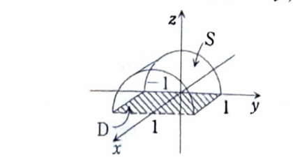

第18章 章末問題4

> 出典：名古屋工業大学

> **前提知識：ベクトル場の面積分と流束**
>
> 向きづけられた曲面 $S$ の単位法線ベクトルを $n$ とすると、ベクトル場 $A$ の面積分は
>
> $$
> \iint_S A\cdot n\,dS
> $$
>
> であり、曲面を通過する流束ともいう。
>
> 曲面が
>
> $$
> r(u,v)
> $$
>
> とパラメータ表示され、向きに合う法線面積ベクトルとして
>
> $$
> \frac{\partial r}{\partial u}
> \times
> \frac{\partial r}{\partial v}
> $$
>
> を選べるとき、
>
> $$
> \iint_S A\cdot n\,dS
> =
> \iint_D
> A(r(u,v))
> \cdot
> \left(
> \frac{\partial r}{\partial u}
> \times
> \frac{\partial r}{\partial v}
> \right)
> dudv
> $$
>
> である。

>
> $A$ と $n$ のなす角を $\theta$ とすると、
>
> $$
> A\cdot n=|A|\cos\theta
> $$
>
> なので、面積分はベクトル場の法線方向成分を曲面全体で合計している。
>
> 記号
>
> $$
> \iint_S A\cdot d\boldsymbol{S}
> $$
>
> で表すこともある。

$xyz$ 空間内の半円柱面

$$
y^2+z^2=1,\qquad z\ge0
$$

を2つの平面

$$
x=0,\qquad x=1
$$

で切ったときに得られる曲面

$$
S=\{(x,y,z)\mid y^2+z^2=1,\ z\ge0,\ 0\le x\le1\}
$$

を考える。

ベクトル場

$$
F=yz\,j+z^2k
$$

が外向き、すなわち $S$ 上の $z>0$ の点では法線の $z$ 成分が正になる向きに貫く流束を求めよ。

---

## 解答

> 半円柱面を上半円のグラフ
>
> $$
> z=\sqrt{1-y^2}
> $$
>
> として、$(x,y)$ をパラメータに選ぶ。
> このとき上向きの法線面積ベクトルは、指定された外向きと一致する。
> 円柱座標に似たパラメータ
>
> $$
> r(x,\theta)=(x,\cos\theta,\sin\theta)
> $$
>
> を使う方法もあるが、資料はグラフ表示を用いており、内積が定数 $1$ に簡約されるため、その方法に従う。

曲面は

$$
z=\sqrt{1-y^2}
$$

と表される。

したがって、パラメータ表示を

$$
r(x,y)=(x,y,z(y))
$$

とする。

射影領域は

$$
D:
0\le x\le1,\qquad -1\le y\le1
$$

である。

> 

接ベクトルは、

$$
\frac{\partial r}{\partial x}
=
(1,0,0)
$$

および

$$
\frac{\partial r}{\partial y}
=
(0,1,z_y)
$$

である。

したがって、

$$
\frac{\partial r}{\partial x}
\times
\frac{\partial r}{\partial y}
=
(0,-z_y,1)
$$

である。

まず、$z_y$ を求める。文字式は

$$
z_y=
\frac{d}{dy}
\sqrt{1-y^2}
$$

である。

合成関数の微分より、

$$
z_y
=
\frac12(1-y^2)^{-1/2}(-2y)
=
-\frac{y}{\sqrt{1-y^2}}
$$

である。

曲面上では

$$
z=\sqrt{1-y^2}
$$

なので、

$$
z_y=-\frac yz
$$

である。

したがって、

$$
\frac{\partial r}{\partial x}
\times
\frac{\partial r}{\partial y}
=
\left(
0,\frac yz,1
\right)
$$

となる。

> 第3成分が $1>0$ なので、この法線面積ベクトルは問題で指定された外向きと一致する。

ベクトル場は

$$
F=yz\,j+z^2k
$$

なので、成分表示では

$$
F=(0,yz,z^2)
$$

である。

内積の文字式は

$$
F\cdot
\left(
\frac{\partial r}{\partial x}
\times
\frac{\partial r}{\partial y}
\right)
$$

である。

値を代入すると、

$$
\begin{aligned}
F\cdot
\left(
\frac{\partial r}{\partial x}
\times
\frac{\partial r}{\partial y}
\right)
&=
(0,yz,z^2)
\cdot
\left(
0,\frac yz,1
\right)\\
&=
0\cdot0
+
yz\cdot\frac yz
+
z^2\cdot1\\
&=
y^2+z^2
\end{aligned}
$$

となる。

曲面上では

$$
y^2+z^2=1
$$

なので、

$$
F\cdot
\left(
\frac{\partial r}{\partial x}
\times
\frac{\partial r}{\partial y}
\right)
=
1
$$

である。

したがって、流束は

$$
\iint_S F\cdot n\,dS
=
\iint_D1\,dxdy
$$

となる。

領域 $D$ は長方形

$$
0\le x\le1,\qquad -1\le y\le1
$$

なので、

$$
\begin{aligned}
\iint_D1\,dxdy
&=
\int_0^1
\int_{-1}^1
1\,dydx\\
&=
\int_0^1
[y]_{-1}^1
dx\\
&=
\int_0^1
2\,dx\\
&=
[2x]_0^1\\
&=2
\end{aligned}
$$

よって、求める流束は

$$
\boxed{
\iint_S F\cdot n\,dS=2
}
$$
