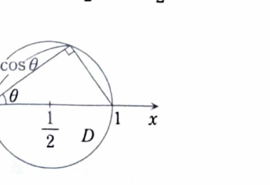

類題18-5

> **前提知識：曲面の面積**
>
> 曲面が
>
> $$
> r(u,v)=(x(u,v),y(u,v),z(u,v))
> $$
>
> と表されるとき、面積素は
>
> $$
> dS=
> \left|
> \frac{\partial r}{\partial u}
> \times
> \frac{\partial r}{\partial v}
> \right|
> dudv
> $$
>
> である。
>
> 特に、曲面がグラフ
>
> $$
> z=f(x,y)
> $$
>
> で表されるとき、
>
> $$
> dS=
> \sqrt{1+f_x^2+f_y^2}\,dxdy
> $$
>
> となる。

>
> より一般に、スカラー場 $\phi$ の曲面積分は
>
> $$
> \iint_S\phi\,dS
> =
> \iint_D
> \phi(r(u,v))
> \left|
> \frac{\partial r}{\partial u}
> \times
> \frac{\partial r}{\partial v}
> \right|
> dudv
> $$
>
> である。特に $\phi=1$ とすれば曲面の面積が得られる。

半球面

$$
x^2+y^2+z^2=1,\qquad z\ge0
$$

が、円柱

$$
x^2+y^2\le x
$$

によって切り取られる部分の曲面積 $S$ を求めよ。

---

## 解答

> 半球面を
>
> $$
> z=\sqrt{1-x^2-y^2}
> $$
>
> というグラフとして表し、曲面積公式を使う。
> 難しい点は、円柱条件が $xy$ 平面上でどの領域を表すかを正しく極座標へ変換することである。
> 球面を球面座標でパラメータ表示する方法もあるが、円柱との交わりを表す条件が複雑になるため、資料どおり $xy$ 平面への射影を使う。

半球面は

$$
z=\sqrt{1-x^2-y^2}
$$

と表される。

> 射影領域 $D$ は円柱条件
>
> $$
> x^2+y^2\le x
> $$
>
> で与えられる。これは
>
> $$
> \left(x-\frac12\right)^2+y^2\le\left(\frac12\right)^2
> $$
>
> と変形でき、中心 $(1/2,0)$、半径 $1/2$ の円板である。

> 

曲面を表す関数を

$$
z=f(x,y)=\sqrt{1-x^2-y^2}
$$

とおく。

曲面積公式は

$$
S=
\iint_D
\sqrt{1+f_x^2+f_y^2}\,dxdy
$$

である。

まず、$f_x$ を求める。文字式は

$$
f_x=
\frac{\partial}{\partial x}
(1-x^2-y^2)^{1/2}
$$

である。

合成関数の微分より、

$$
f_x
=
\frac12(1-x^2-y^2)^{-1/2}(-2x)
=
-\frac{x}{\sqrt{1-x^2-y^2}}
$$

である。

半球面上では

$$
z=\sqrt{1-x^2-y^2}
$$

なので、

$$
f_x=-\frac{x}{z}
$$

とも書ける。

同様に、

$$
f_y
=
-\frac{y}{\sqrt{1-x^2-y^2}}
=
-\frac{y}{z}
$$

である。

したがって、

$$
\begin{aligned}
1+f_x^2+f_y^2
&=
1+\frac{x^2}{z^2}+\frac{y^2}{z^2}\\
&=
\frac{z^2+x^2+y^2}{z^2}
\end{aligned}
$$

となる。

球面上では

$$
x^2+y^2+z^2=1
$$

なので、

$$
1+f_x^2+f_y^2
=
\frac1{z^2}
$$

である。

上半球では $z\ge0$ なので、

$$
\sqrt{1+f_x^2+f_y^2}
=
\frac1z
=
\frac1{\sqrt{1-x^2-y^2}}
$$

となる。

よって、

$$
S=
\iint_D
\frac1{\sqrt{1-x^2-y^2}}
\,dxdy
$$

である。

極座標

$$
x=r\cos\theta,\qquad y=r\sin\theta
$$

を用いる。

円柱条件は、代入前には

$$
x^2+y^2\le x
$$

である。

値を代入すると、

$$
r^2\le r\cos\theta
$$

となる。

$r\ge0$ なので、

$$
0\le r\le\cos\theta
$$

である。

右辺が非負でなければならないため、

$$
-\frac{\pi}{2}\le\theta\le\frac{\pi}{2}
$$

である。

また、

$$
dxdy=r\,drd\theta
$$

なので、

$$
S
=
\int_{-\pi/2}^{\pi/2}
\int_0^{\cos\theta}
\frac{r}{\sqrt{1-r^2}}
\,drd\theta
$$

となる。

内側の積分を計算する。

$$
\int
\frac{r}{\sqrt{1-r^2}}
\,dr
$$

に対して、

$$
u=1-r^2
$$

とおくと、

$$
du=-2r\,dr
$$

である。

したがって、

$$
\int
\frac{r}{\sqrt{1-r^2}}
\,dr
=
-\sqrt{1-r^2}
$$

である。

よって、

$$
\begin{aligned}
\int_0^{\cos\theta}
\frac{r}{\sqrt{1-r^2}}
\,dr
&=
\left[
-\sqrt{1-r^2}
\right]_0^{\cos\theta}\\
&=
1-\sqrt{1-\cos^2\theta}\\
&=
1-|\sin\theta|
\end{aligned}
$$

となる。

> $\sqrt{\sin^2\theta}=|\sin\theta|$ であり、負の $\theta$ も積分範囲に含むため、絶対値を外してはいけない。
> 被積分関数は $\theta$ に関して偶関数なので、対称性を使う。

したがって、

$$
\begin{aligned}
S
&=
\int_{-\pi/2}^{\pi/2}
(1-|\sin\theta|)\,d\theta\\
&=
2\int_0^{\pi/2}
(1-\sin\theta)\,d\theta\\
&=
2\left[
\theta+\cos\theta
\right]_0^{\pi/2}\\
&=
2\left(
\frac{\pi}{2}-1
\right)\\
&=
\pi-2
\end{aligned}
$$

よって、

$$
\boxed{S=\pi-2}
$$
