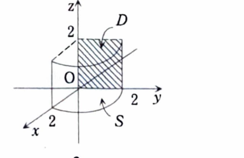

類題18-6

> **前提知識：ベクトル場の面積分と流束**
>
> 向きづけられた曲面 $S$ の単位法線ベクトルを $n$ とすると、ベクトル場 $A$ の面積分は
>
> $$
> \iint_S A\cdot n\,dS
> $$
>
> であり、曲面を通過する流束ともいう。
>
> 曲面が
>
> $$
> r(u,v)
> $$
>
> とパラメータ表示され、向きに合う法線面積ベクトルとして
>
> $$
> \frac{\partial r}{\partial u}
> \times
> \frac{\partial r}{\partial v}
> $$
>
> を選べるとき、
>
> $$
> \iint_S A\cdot n\,dS
> =
> \iint_D
> A(r(u,v))
> \cdot
> \left(
> \frac{\partial r}{\partial u}
> \times
> \frac{\partial r}{\partial v}
> \right)
> dudv
> $$
>
> である。

>
> $A$ と $n$ のなす角を $\theta$ とすると、
>
> $$
> A\cdot n=|A|\cos\theta
> $$
>
> なので、面積分はベクトル場の法線方向成分を曲面全体で合計している。
>
> 記号
>
> $$
> \iint_S A\cdot d\boldsymbol{S}
> $$
>
> で表すこともある。

ベクトル場を

$$
A=(2y,6zx,3x)
$$

とし、$S$ を円柱面

$$
x^2+y^2=4,\qquad x\ge0,\qquad y\ge0,\qquad0\le z\le2
$$

を満たす部分とする。法線を円柱の外向きにとるとき、

$$
\iint_S A\cdot n\,dS
$$

を求めよ。

---

## 解答

> 曲面は半径2の円柱の第1象限部分である。
> 資料では $x=\sqrt{4-y^2}$ として $(y,z)$ をパラメータに選び、法線面積ベクトルを直接計算している。
> 円柱座標による
>
> $$
> r(\theta,z)=(2\cos\theta,2\sin\theta,z)
> $$
>
> でも解けるが、資料の方法はグラフ曲面の面積分の練習になるため、それに従う。

曲面は

$$
x=\sqrt{4-y^2}
$$

と表せる。

第1象限部分なので、

$$
0\le y\le2
$$

であり、高さの条件は

$$
0\le z\le2
$$

である。

曲面を

$$
r(y,z)=(x(y),y,z)
$$

と表す。

> 

接ベクトルは、

$$
\frac{\partial r}{\partial y}
=
(x_y,1,0)
$$

および

$$
\frac{\partial r}{\partial z}
=
(0,0,1)
$$

である。

したがって、

$$
\frac{\partial r}{\partial y}
\times
\frac{\partial r}{\partial z}
=
(1,-x_y,0)
$$

である。

まず、$x_y$ を求める。文字式は

$$
x_y=
\frac{d}{dy}
\sqrt{4-y^2}
$$

である。

合成関数の微分より、

$$
x_y
=
\frac12(4-y^2)^{-1/2}(-2y)
=
-\frac{y}{\sqrt{4-y^2}}
$$

である。

曲面上では

$$
x=\sqrt{4-y^2}
$$

なので、

$$
x_y=-\frac yx
$$

である。

したがって、

$$
\frac{\partial r}{\partial y}
\times
\frac{\partial r}{\partial z}
=
\left(
1,\frac yx,0
\right)
$$

となる。

> このベクトルは $x$ 成分と $y$ 成分がともに非負であり、第1象限の円柱面で外向きの方向を向いている。

ベクトル場は

$$
A=(2y,6zx,3x)
$$

である。

内積の文字式は

$$
A\cdot
\left(
\frac{\partial r}{\partial y}
\times
\frac{\partial r}{\partial z}
\right)
$$

である。

値を代入すると、

$$
\begin{aligned}
A\cdot
\left(
\frac{\partial r}{\partial y}
\times
\frac{\partial r}{\partial z}
\right)
&=
(2y,6zx,3x)
\cdot
\left(
1,\frac yx,0
\right)\\
&=
2y\cdot1
+
6zx\cdot\frac yx
+
3x\cdot0\\
&=
2y+6yz
\end{aligned}
$$

となる。

したがって、

$$
\iint_S A\cdot n\,dS
=
\int_0^2
\int_0^2
(2y+6yz)\,dzdy
$$

である。

まず $z$ で積分する。

$$
\int(2y+6yz)\,dz
=
2yz+3yz^2
$$

である。

よって、

$$
\begin{aligned}
\int_0^2(2y+6yz)\,dz
&=
\left[
2yz+3yz^2
\right]_0^2\\
&=
4y+12y\\
&=
16y
\end{aligned}
$$

となる。

次に $y$ で積分する。

$$
\begin{aligned}
\iint_S A\cdot n\,dS
&=
\int_0^2 16y\,dy\\
&=
\left[
8y^2
\right]_0^2\\
&=
8\cdot4\\
&=
32
\end{aligned}
$$

したがって、

$$
\boxed{\iint_S A\cdot n\,dS=32}
$$
