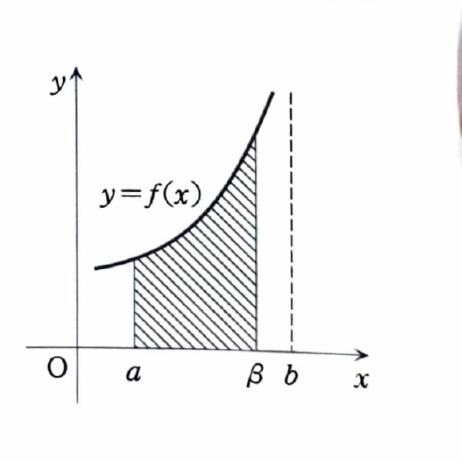

> **前提知識：広義積分の定義**
>
> 積分区間が無限に延びる場合や、有限区間内で被積分関数が発散する場合は、まず特異点を避けた通常の定積分を計算し、最後に極限を取る。例えば、
>
> $$
> \int_a^\infty f(x)\,dx
> =
> \lim_{\beta\to\infty}\int_a^\beta f(x)\,dx
> $$
>
> であり、この極限が有限値に収束するとき広義積分は収束する。有限端点 $b$ が特異点なら
>
> $$
> \int_a^b f(x)\,dx
> =
> \lim_{\beta\to b-0}\int_a^\beta f(x)\,dx
> $$
>
> と定義する。
>
> 

> **前提知識：比較による収束・発散判定**
>
> 非負関数について、十分大きな $x$ で $0\le f(x)\le g(x)$ が成り立ち、$\int g(x)\,dx$ が収束するなら $\int f(x)\,dx$ も収束する。逆に、$0\le g(x)\le f(x)$ が成り立ち、$\int g(x)\,dx$ が発散するなら $\int f(x)\,dx$ も発散する。
>
> 資料で紹介されているべき型の判定も有用である。$\lim_{x\to\infty}x^\alpha f(x)=l$ とすると、$\alpha>1$ かつ $|l|<\infty$ なら収束し、$0<\alpha\le1$ かつ $|l|>0$ なら発散する。有限端点 $b$ についても、$\lim_{x\to b-0}(b-x)^\alpha f(x)=l$ を用いる同様の判定がある。

---

**第3章 章末問題 3**

次の問いに答えよ。

---

## (1)

$n=0,1,2$ に対して、次の不定積分を求めよ。

$$
\int\frac{x^n}{x^2+1}\,dx
$$

---

## (1) 解答

> **解法の選択**
>
> $n$ の値ごとに分子を確認する。$n=0$ は逆正接関数、$n=1$ は分母 $x^2+1$ の微分が分子に現れる対数型、$n=2$ は
>
> $$
> x^2=(x^2+1)-1
> $$
>
> と分解して基本積分へ直す。
>
> 一般の部分分数分解を使う必要はなく、各 $n$ に応じた最短の変形を選ぶ。

### $n=0$ のとき

$n=0$ を代入する前の式は

$$
\int\frac{x^n}{x^2+1}\,dx
$$

である。$n=0$ を代入すると、

$$
\int\frac1{x^2+1}\,dx
$$

となる。逆正接関数の微分公式

$$
\frac{d}{dx}\tan^{-1}x=\frac1{1+x^2}
$$

より、

$$
\boxed{
\int\frac1{x^2+1}\,dx
=
\tan^{-1}x+C
}
$$

である。

### $n=1$ のとき

$n=1$ を代入すると、

$$
\int\frac{x}{x^2+1}\,dx
$$

となる。置換式を文字だけで示す。

$$
u=x^2+1,
\qquad
du=2x\,dx
$$

したがって、

$$
\begin{aligned}
\int\frac{x}{x^2+1}\,dx
&=
\frac12\int\frac1u\,du\\
&=
\frac12\log|u|+C\\
&=
\frac12\log(x^2+1)+C.
\end{aligned}
$$

$x^2+1>0$ なので絶対値は省ける。よって、

$$
\boxed{
\int\frac{x}{x^2+1}\,dx
=
\frac12\log(x^2+1)+C
}
$$

である。

### $n=2$ のとき

$n=2$ を代入すると、

$$
\int\frac{x^2}{x^2+1}\,dx
$$

となる。分子を文字式で

$$
x^2=(x^2+1)-1
$$

と変形する。これを代入すると、

$$
\frac{x^2}{x^2+1}
=
1-\frac1{x^2+1}
$$

である。したがって、

$$
\begin{aligned}
\int\frac{x^2}{x^2+1}\,dx
&=
\int
\left(
1-\frac1{x^2+1}
\right)dx\\
&=
x-\tan^{-1}x+C.
\end{aligned}
$$

よって、

$$
\boxed{
\int\frac{x^2}{x^2+1}\,dx
=
x-\tan^{-1}x+C
}
$$

である。

以上をまとめると、

$$
\boxed{
\begin{array}{ll}
n=0:&\displaystyle \tan^{-1}x+C,\\[2mm]
n=1:&\displaystyle \frac12\log(x^2+1)+C,\\[2mm]
n=2:&\displaystyle x-\tan^{-1}x+C.
\end{array}
}
$$

---

## (2)

$n$ を負でない整数とするとき、次の広義積分は収束するか発散するかを判定せよ。収束する場合には広義積分の値を求め、発散する場合にはその理由を示せ。

$$
\int_1^\infty\frac{x^n}{x^2+1}\,dx
$$

---

## (2) 解答

> **解法の選択**
>
> $n=0$ と $n\ge1$ では無限遠での大きさが本質的に異なる。$n=0$ は $1/x^2$ 程度なので収束し、(1) の原始関数で値を求められる。$n\ge1$ では $x^n\ge x$ が成り立ち、被積分関数は発散する $x/(x^2+1)$ 以上になるため比較判定で発散する。
>
> 漸近式
>
> $$
> \frac{x^n}{x^2+1}\sim x^{n-2}
> $$
>
> と $p$ 型積分を比較する方法もあるが、資料の比較はより初等的である。

### $n=0$ のとき

$n=0$ を代入する前の式は

$$
\int_1^\infty\frac{x^n}{x^2+1}\,dx
$$

である。代入すると、

$$
\int_1^\infty\frac1{x^2+1}\,dx
$$

となる。広義積分の定義より、

$$
\begin{aligned}
\int_1^\infty\frac1{x^2+1}\,dx
&=
\lim_{\beta\to\infty}
\int_1^\beta\frac1{x^2+1}\,dx\\
&=
\lim_{\beta\to\infty}
\left[
\tan^{-1}x
\right]_1^\beta\\
&=
\lim_{\beta\to\infty}
\left(
\tan^{-1}\beta-\frac\pi4
\right)\\
&=
\frac\pi2-\frac\pi4\\
&=
\frac\pi4.
\end{aligned}
$$

したがって、$n=0$ では収束し、その値は

$$
\boxed{\frac\pi4}
$$

である。

### $n\ge1$ のとき

$x\ge1$ かつ $n\ge1$ なら、

$$
x^n\ge x
$$

である。分母 $x^2+1$ は正なので、

$$
\frac{x^n}{x^2+1}
\ge
\frac{x}{x^2+1}
$$

となる。

比較対象を定義から計算する。

$$
\begin{aligned}
\int_1^\infty\frac{x}{x^2+1}\,dx
&=
\lim_{\beta\to\infty}
\int_1^\beta\frac{x}{x^2+1}\,dx\\
&=
\lim_{\beta\to\infty}
\left[
\frac12\log(x^2+1)
\right]_1^\beta\\
&=
\lim_{\beta\to\infty}
\frac12
\left\{
\log(\beta^2+1)-\log2
\right\}\\
&=
+\infty.
\end{aligned}
$$

元の被積分関数はこの発散積分の被積分関数以上なので、比較判定法より、

$$
\int_1^\infty\frac{x^n}{x^2+1}\,dx
$$

は $n\ge1$ で発散する。

以上より、

$$
\boxed{
\begin{array}{ll}
n=0:&\text{収束し、値は }\displaystyle\frac\pi4,\\[2mm]
n\ge1:&\text{発散}.
\end{array}
}
$$
