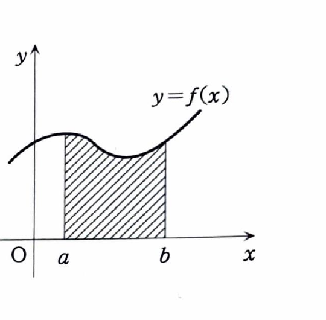

> **前提知識：定積分の基本**
>
> 関数 $F(x)$ が $f(x)$ の原始関数、すなわち $F'(x)=f(x)$ を満たすとき、微積分学の基本定理より
>
> $$
> \int_a^b f(x)\,dx=\left[F(x)\right]_a^b=F(b)-F(a)
> $$
>
> である。$f(x)$ が区間 $[a,b]$ で非負かつ連続なら、この定積分は曲線 $y=f(x)$ と $x$ 軸、直線 $x=a,\ x=b$ に囲まれた面積を表す。
>
> 

---

**類題 3-7**

$$
I_n=\int_0^1\frac1{(x^2+1)^n}\,dx
$$

とおく。

---

## (1)

$I_{n+1}$ を $I_n$ で表せ。

---

## (1) 解答

> **解法の選択**
>
> $I_{n+1}$ の被積分関数を直接部分積分するより、まず $I_n$ を
>
> $$
> I_n=\int_0^1 1\cdot(x^2+1)^{-n}\,dx
> $$
>
> と見て部分積分する。微分で $x(x^2+1)^{-n-1}$ が現れ、さらに $x^2=(1+x^2)-1$ と変形すると $I_n$ と $I_{n+1}$ の関係が得られる。資料と同じ方法である。
>
> 三角置換 $x=\tan\theta$ でも漸化式を導けるが、部分積分が直接的である。

部分積分で

$$
f(x)=\frac1{(x^2+1)^n},
\qquad
g'(x)=1
$$

とおく。すると、

$$
f'(x)
=
-n(x^2+1)^{-n-1}\cdot2x
=
-\frac{2nx}{(x^2+1)^{n+1}},
\qquad
g(x)=x
$$

である。したがって、

$$
\begin{aligned}
I_n
&=
\left[
\frac{x}{(x^2+1)^n}
\right]_0^1
-
\int_0^1
x\left(
-\frac{2nx}{(x^2+1)^{n+1}}
\right)dx\\
&=
\frac1{2^n}
+
2n\int_0^1
\frac{x^2}{(x^2+1)^{n+1}}\,dx.
\end{aligned}
$$

ここで、代入前の文字式は

$$
x^2=(x^2+1)-1
$$

である。これを代入すると、

$$
\frac{x^2}{(x^2+1)^{n+1}}
=
\frac1{(x^2+1)^n}
-
\frac1{(x^2+1)^{n+1}}
$$

となる。よって、

$$
\begin{aligned}
I_n
&=
\frac1{2^n}
+
2n
\int_0^1
\left\{
\frac1{(x^2+1)^n}
-
\frac1{(x^2+1)^{n+1}}
\right\}dx\\
&=
\frac1{2^n}
+
2n(I_n-I_{n+1}).
\end{aligned}
$$

整理すると、

$$
I_n
=
\frac1{2^n}
+
2nI_n-2nI_{n+1}
$$

なので、

$$
2nI_{n+1}
=
(2n-1)I_n+\frac1{2^n}.
$$

両辺を $2n$ で割ると、

$$
I_{n+1}
=
\frac{2n-1}{2n}I_n
+
\frac1{n2^{n+1}}.
$$

したがって、

$$
\boxed{\displaystyle
I_{n+1}
=
\frac{2n-1}{2n}I_n
+
\frac1{n2^{n+1}}
}
$$

---

## (2)

$$
\int_0^1\frac1{(x^2+1)^3}\,dx
$$

の値を求めよ。

---

## (2) 解答

> **解法の選択**
>
> 求める積分は $I_3$ である。(1) の漸化式を $I_1\to I_2\to I_3$ の順に使う。最初の $I_1$ は逆正接関数で直接計算できる。
>
> 三角置換で直接積分する方法もあるが、(1) の結果を使うことが本問の狙いである。

まず、

$$
I_1
=
\int_0^1\frac1{x^2+1}\,dx
$$

である。原始関数は $\tan^{-1}x$ なので、

$$
\begin{aligned}
I_1
&=
\left[\tan^{-1}x\right]_0^1\\
&=
\frac\pi4.
\end{aligned}
$$

次に、漸化式

$$
I_{n+1}
=
\frac{2n-1}{2n}I_n
+
\frac1{n2^{n+1}}
$$

へ $n=1$ を代入する前の式を示した。代入すると、

$$
\begin{aligned}
I_2
&=
\frac{2\cdot1-1}{2\cdot1}I_1
+
\frac1{1\cdot2^2}\\
&=
\frac12I_1+\frac14\\
&=
\frac12\cdot\frac\pi4+\frac14\\
&=
\frac\pi8+\frac14.
\end{aligned}
$$

さらに同じ漸化式へ $n=2$ を代入すると、

$$
\begin{aligned}
I_3
&=
\frac{2\cdot2-1}{2\cdot2}I_2
+
\frac1{2\cdot2^3}\\
&=
\frac34I_2+\frac1{16}\\
&=
\frac34
\left(
\frac\pi8+\frac14
\right)
+
\frac1{16}\\
&=
\frac{3\pi}{32}
+
\frac3{16}
+
\frac1{16}\\
&=
\frac{3\pi}{32}+\frac14.
\end{aligned}
$$

したがって、

$$
\boxed{\displaystyle
\int_0^1\frac1{(x^2+1)^3}\,dx
=
\frac{3\pi}{32}+\frac14
}
$$
