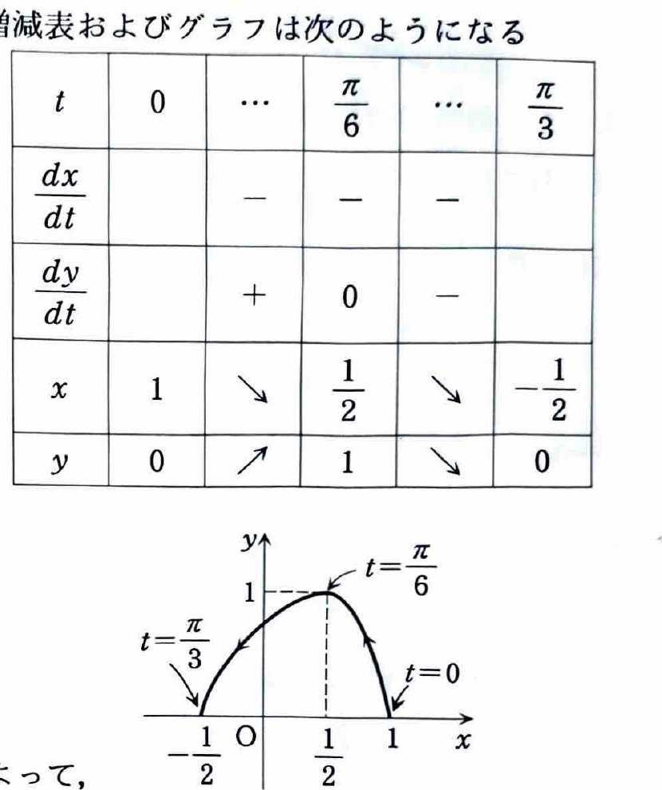

**類題 4-1（資料末尾に収録された解答断片）**

> 資料にはこの類題の問題文が収録されておらず、解答だけが掲載されている。以下の問題文は、解答中に明示された媒介変数表示、変数範囲、増減表および面積計算から復元したものである。

媒介変数表示

$$
x=\cos2t,
\qquad
y=\sin3t
\qquad
\left(0\le t\le\frac\pi3\right)
$$

で表される曲線と $x$ 軸で囲まれる部分の面積を求めよ。

---

## 解答

> **解法の選択**
>
> 媒介変数表示された曲線の面積は、
>
> $$
> S=\int y\,dx
> =
> \int y(t)\frac{dx}{dt}\,dt
> $$
>
> を使って求める。曲線の進む向きによって積分区間の向きが逆になるため、増減表で $x$ の変化を確認する必要がある。
>
> 曲線を $y$ の関数として陽に表す方法は複雑になるので、媒介変数のまま計算するのが適切である。

まず微分前の式は

$$
x=\cos2t,
\qquad
y=\sin3t
$$

である。微分すると、

$$
\frac{dx}{dt}=-2\sin2t,
\qquad
\frac{dy}{dt}=3\cos3t
$$

となる。

区間 $0\le t\le\pi/3$ では、

$$
\frac{dx}{dt}=-2\sin2t\le0
$$

なので $x$ は単調減少する。また、

$$
\frac{dy}{dt}=3\cos3t
$$

は $t=\pi/6$ で符号を正から負へ変えるので、$y$ は $t=\pi/6$ まで増加し、その後減少する。

代表値は、

$$
\begin{array}{c|ccc}
t&0&\pi/6&\pi/3\\ \hline
x&1&1/2&-1/2\\
y&0&1&0
\end{array}
$$

である。

したがって曲線は、$t=0$ の点 $(1,0)$ から始まり、$t=\pi/6$ で $(1/2,1)$ を通り、$t=\pi/3$ の点 $(-1/2,0)$ に至る。求める面積は、

$$
S=\int_{-1/2}^{1}y\,dx
$$

である。$t$ が $0$ から $\pi/3$ へ増えると $x$ は $1$ から $-1/2$ へ減るので、

$$
S
=
\int_{\pi/3}^{0}
y(t)\frac{dx}{dt}\,dt
$$

とする。ここへ

$$
y(t)=\sin3t,
\qquad
\frac{dx}{dt}=-2\sin2t
$$

を代入すると、

$$
\begin{aligned}
S
&=
\int_{\pi/3}^{0}
\sin3t\cdot(-2\sin2t)\,dt\\
&=
2\int_0^{\pi/3}\sin3t\sin2t\,dt.
\end{aligned}
$$

積和公式を、まず文字だけで示す。

$$
2\sin A\sin B
=
\cos(A-B)-\cos(A+B)
$$

ここに $A=3t$、$B=2t$ を代入すると、

$$
2\sin3t\sin2t
=
\cos t-\cos5t
$$

である。したがって、

$$
\begin{aligned}
S
&=
\int_0^{\pi/3}
(\cos t-\cos5t)\,dt\\
&=
\left[
\sin t-\frac15\sin5t
\right]_0^{\pi/3}\\
&=
\sin\frac\pi3
-
\frac15\sin\frac{5\pi}3\\
&=
\frac{\sqrt3}{2}
-
\frac15\left(-\frac{\sqrt3}{2}\right)\\
&=
\frac{3\sqrt3}{5}.
\end{aligned}
$$

したがって、

$$
\boxed{S=\frac{3\sqrt3}{5}}
$$
